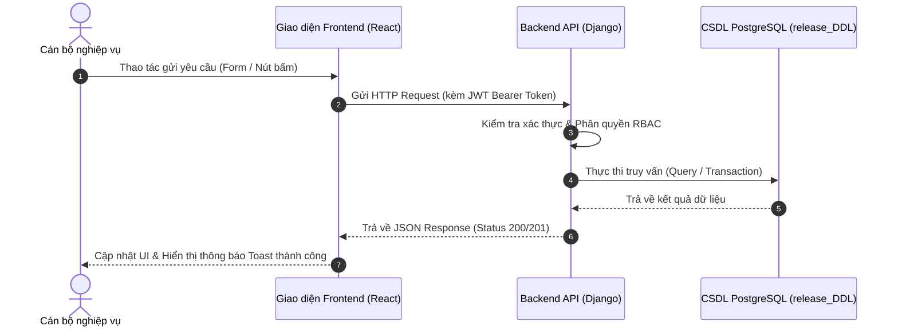

# [BIỂU MẪU CHUẨN] BÁO CÁO NGHIỆM THU CHI TIẾT PHÂN HỆ
## HỆ THỐNG QUẢN LÝ VĂN BẢN VÀ HỒ SƠ ĐIỆN TỬ BẢO LONG (QLVB&TL)
*(Dành cho Trưởng nhóm 1 đến Nhóm 8 điền và nộp về cho Ban Quản trị Dự án - PM Châu Tuấn Kiệt)*

---

> **HƯỚNG DẪN DÀNH CHO CÁC NHÓM:**
> 1. Mỗi nhóm điền đầy đủ và trung thực tất cả các mục từ **Phần 1 đến Phần 8**.
> 2. Giữ nguyên toàn bộ cấu trúc tiêu đề, không tự ý xóa bỏ các bảng biểu hay đổi tên mục.
> 3. Mọi số liệu báo cáo (commits, PRs, số unit tests) đều phải có dẫn chứng mã nguồn thực tế trên repository và đã được merge vào nhánh `staging`.
> 4. Sau khi hoàn tất, gửi file `.md` (kèm ảnh minh chứng) về cho PM Châu Tuấn Kiệt trước hạn chốt để PM tổng hợp thành Báo cáo Tổng thể toàn đồ án nộp cho Giảng viên hướng dẫn.

---

### PHẦN 1: THÔNG TIN CHUNG VÀ BẢNG PHÂN CÔNG ĐÓNG GÓP

- **Tên nhóm phát triển:** **NHÓM [Số nhóm: 1, 2, ..., 8]**
- **Phân hệ phụ trách:** [Tên phân hệ chính theo đề cương, ví dụ: Quản lý Văn bản đến/đi/mật, Ký số, Công việc...]
- **Tổng định mức độ khó:** **[Điểm độ khó theo đề cương, ví dụ: 0.8, 1.0...]**
- **Trưởng nhóm:** **[Họ và tên Trưởng nhóm]** — MSSV: [Mã số SV] — Email: [Email]

#### Bảng Phân công Nhiệm vụ & Khối lượng Đóng góp Thành viên:

| STT | Mã SV | Họ và tên | Vai trò trong nhóm | Nhiệm vụ kỹ thuật cụ thể đảm nhận | Tỷ lệ đóng góp (%) | Điểm đề xuất (Thang 10) |
| :-: | :---: | :--- | :--- | :--- | :---: | :---: |
| 1 | [Mã SV 1] | **[Họ tên Trưởng nhóm]** | Trưởng nhóm / Fullstack | • [Nhiệm vụ 1: Thiết kế API, Model...]<br>• [Nhiệm vụ 2: Dựng giao diện...] | **...%** | **... / 10** |
| 2 | [Mã SV 2] | **[Họ tên Thành viên 2]** | Thành viên / Backend | • [Nhiệm vụ cụ thể...]<br>• [Nhiệm vụ cụ thể...] | **...%** | **... / 10** |
| 3 | [Mã SV 3] | **[Họ tên Thành viên 3]** | Thành viên / Frontend | • [Nhiệm vụ cụ thể...]<br>• [Nhiệm vụ cụ thể...] | **...%** | **... / 10** |
| 4 | [Mã SV 4] | **[Họ tên Thành viên 4]** | Thành viên / QA & Test | • [Nhiệm vụ cụ thể...]<br>• [Nhiệm vụ cụ thể...] | **...%** | **... / 10** |

> *(Lưu ý: Tổng tỷ lệ đóng góp của các thành viên trong nhóm bắt buộc phải bằng **100%**)*.

---

### PHẦN 2: ĐẶC TẢ YÊU CẦU NGHIỆP VỤ & PHẠM VI CHỨC NĂNG

#### 2.1. Mục tiêu phân hệ
- [Mô tả ngắn gọn 2 - 3 câu về mục tiêu giải quyết bài toán nghiệp vụ của phân hệ trong thực tế tại Tổng Công ty Bảo hiểm Bảo Long].

#### 2.2. Danh mục chức năng chi tiết theo đề cương môn học

| STT | Mã chức năng | Tên chức năng | Mô tả nghiệp vụ chi tiết | Mức độ hoàn thành | Ghi chú / Tính năng mở rộng |
| :-: | :---: | :--- | :--- | :---: | :--- |
| 1 | `UC_[MÃ]_01` | [Tên chức năng 1] | [Mô tả luồng xử lý, dữ liệu đầu vào / đầu ra...] | 100% | [Đạt chuẩn / Mở rộng...] |
| 2 | `UC_[MÃ]_02` | [Tên chức năng 2] | [Mô tả luồng xử lý...] | 100% | |
| 3 | `UC_[MÃ]_03` | [Tên chức năng 3] | [Mô tả luồng xử lý...] | 100% | |
| 4 | `UC_[MÃ]_04` | [Tên chức năng 4] | [Mô tả luồng xử lý...] | 100% | |

---

### PHẦN 3: KIẾN TRÚC KỸ THUẬT, CƠ SỞ DỮ LIỆU & API CONTRACT

#### 3.1. Cấu trúc Cơ sở Dữ liệu (PostgreSQL Schema)
- **Tên các bảng quản lý:** `[tên_bảng_1]`, `[tên_bảng_2]`...
- **Ràng buộc toàn vẹn & Khóa ngoại:**

| Tên bảng | Tên cột chính | Kiểu dữ liệu | Ràng buộc (PK/FK/Unique/Check) | Mô tả ý nghĩa dữ liệu |
| :--- | :--- | :--- | :--- | :--- |
| `[tên_bảng]` | `id` | `UUID / BIGINT` | `PRIMARY KEY` | Khóa chính định danh duy nhất |
| | `[tên_cột]` | `VARCHAR(...)` | `NOT NULL, UNIQUE` | [Mô tả ý nghĩa...] |
| | `[tên_cột_fk]` | `BIGINT` | `REFERENCES [bảng_khác](id)` | Khóa ngoại liên kết phân hệ [...] |
| | `created_at` | `TIMESTAMPTZ` | `DEFAULT CURRENT_TIMESTAMP` | Thời gian tạo (YYYY-MM-DD HH:mm:ss) |

#### 3.2. Danh mục API Endpoints (Backend Django REST Framework)

| Method | Endpoint URL | Phân quyền truy cập (RBAC) | Mô tả chức năng API | Mã phản hồi HTTP |
| :---: | :--- | :--- | :--- | :---: |
| `GET` | `/api/v1/[module]/...` | `IsAuthenticated`, `[quyền]` | Lấy danh sách có phân trang và bộ lọc | `200 OK` |
| `POST` | `/api/v1/[module]/...` | `can_create_[module]` | Tạo mới bản ghi nghiệp vụ | `201 Created` |
| `GET` | `/api/v1/[module]/{id}/` | `can_view_[module]` | Xem thông tin chi tiết | `200 OK` |
| `PUT / PATCH` | `/api/v1/[module]/{id}/` | `can_edit_[module]` | Cập nhật thông tin bản ghi | `200 OK` |
| `DELETE` | `/api/v1/[module]/{id}/` | `can_delete_[module]` | Xóa hoặc chuyển trạng thái hủy | `204 No Content` |

#### 3.3. Sơ đồ Luồng Nghiệp vụ (Sequence Diagram / Flowchart)


---

### PHẦN 4: KẾT QUẢ GIAO DIỆN & TRẢI NGHIỆM NGƯỜI DÙNG (UI/UX)

#### 4.1. Màn hình Danh sách / Bảng điều khiển chính
*(Dán ảnh chụp màn hình thực tế và mô tả các thành phần: Bộ lọc, Tìm kiếm, Bảng dữ liệu, Nút thao tác)*
```
+------------------------------------------------------------------------+
|                                                                        |
|                 [DÁN ẢNH CHỤP MÀN HÌNH DANH SÁCH TẠI ĐÂY]              |
|                                                                        |
+------------------------------------------------------------------------+
```
- **Mô tả thao tác:** [Mô tả chi tiết các cột hiển thị, bộ lọc theo năm/thời gian, phân trang].

#### 4.2. Màn hình Chi tiết / Popup thao tác nghiệp vụ
```
+------------------------------------------------------------------------+
|                                                                        |
|                 [DÁN ẢNH CHỤP MÀN HÌNH CHI TIẾT / POPUP TẠI ĐÂY]       |
|                                                                        |
+------------------------------------------------------------------------+
```
- **Mô tả thao tác:** [Mô tả chức năng chi tiết, duyệt, tải file đính kèm, ký duyệt...].

#### 4.3. Đáp ứng Giao diện Đa nền tảng (Responsive Mobile / Tablet / Dark Mode)
- **Tương thích Mobile:** [Có/Không, mô tả bố cục trên màn hình nhỏ].
- **Hỗ trợ Dark/Light Theme:** [Kế thừa biến CSS `var(--bg-surface)`, `var(--text-main)` từ Nhóm 1].
- **Hỗ trợ Đa ngôn ngữ (i18n):** [Đã dịch đầy đủ từ khóa trong `vi.json` và `en.json`].

---

### PHẦN 5: BẰNG CHỨNG MÃ NGUỒN TRÊN GIT (COMMITS & PULL REQUESTS)

#### 5.1. Bảng Dẫn chứng Commit tiêu biểu trên Git

| Mã Hash | Ngày tạo | Tác giả | Nội dung Commit (Theo chuẩn Conventional Commits) | Pull Request liên quan |
| :---: | :---: | :--- | :--- | :---: |
| `[hash_1]` | DD/MM/2026 | [Họ tên tác giả] | `feat([module]): [Mô tả tính năng mới]` | PR #[số] |
| `[hash_2]` | DD/MM/2026 | [Họ tên tác giả] | `fix([module]): [Mô tả lỗi đã sửa]` | PR #[số] |
| `[hash_3]` | DD/MM/2026 | [Họ tên tác giả] | `test([module]): [Bổ sung unit test]` | PR #[số] |
| `[hash_4]` | DD/MM/2026 | [Họ tên tác giả] | `refactor([module]): [Tối ưu hóa mã nguồn]` | PR #[số] |

#### 5.2. Danh sách Pull Requests đã merge vào Staging

| STT | Số hiệu PR | Tiêu đề Pull Request | Trạng thái CI / Quality Gate | Issue liên kết đóng tự động |
| :-: | :---: | :--- | :---: | :---: |
| 1 | **PR #[số]** | `[Loại]([module]): [Tiêu đề PR]` | `Passed (4/4 checks)` | `Closes #[issue_id]` |
| 2 | **PR #[số]** | `[Loại]([module]): [Tiêu đề PR]` | `Passed (4/4 checks)` | `Closes #[issue_id]` |

---

### PHẦN 6: KẾT QUẢ KIỂM THỬ (TESTING & QUALITY ASSURANCE)

#### 6.1. Bảng Tổng hợp Kết quả Kiểm thử Đơn vị (Unit Testing)
- **Tổng số Test Cases:** **... tests** | **Số test Passed:** **... / ...** (Tỷ lệ: **100%**)
- **Thư mục kiểm thử:** `[đường_dẫn_thư_mục_test]`

| Tên Test Suite / Test File | Số lượng test | Kết quả | Chức năng kiểm thử trọng tâm |
| :--- | :---: | :---: | :--- |
| `[ten_file_test].test.tsx` (Frontend) | ... | `PASS` | Kiểm thử render giao diện, validate form, click sự kiện |
| `test_[ten_module].py` (Backend) | ... | `PASS` | Kiểm thử logic Model, Serializer, quyền truy cập API |

#### 6.2. Kịch bản Kiểm thử Nghiệp vụ (Scenario / E2E Testing)

| Mã ca test | Kịch bản kiểm thử | Dữ liệu đầu vào (Input) | Kết quả kỳ vọng | Kết quả thực tế | Trạng thái |
| :---: | :--- | :--- | :--- | :--- | :---: |
| `TC_01` | Tạo mới bản ghi hợp lệ | Điền đủ các trường bắt buộc | Lưu thành công, trả HTTP 201 | Trả đúng HTTP 201, hiện toast | `PASSED` |
| `TC_02` | Validate trường bắt buộc | Để trống trường bắt buộc | Báo lỗi 400 kèm chi tiết | Báo lỗi đỏ dưới ô nhập | `PASSED` |
| `TC_03` | Phân quyền truy cập trái phép | Đăng nhập tài khoản không có quyền | Báo lỗi 403 Forbidden | Chặn truy cập, hiện thông báo | `PASSED` |

---

### PHẦN 7: BÀI HỌC KINH NGHIỆM & GIÁ TRỊ TÍCH LŨY ĐƯỢC

1. **Kiến thức Công nghệ & Kỹ thuật mới tiếp thu được:**
   - [Trình bày về React 19, TypeScript, Django REST Framework, PostgreSQL...].
2. **Kỹ năng Phối hợp & Quản trị Dự án:**
   - [Làm việc nhóm trên Git Flow, tuân thủ Quality Gate Staging của PM, giải quyết xung đột Merge Conflict].
3. **Các khó khăn kỹ thuật lớn nhất đã gặp phải và cách giải quyết:**
   - *Khó khăn 1:* [Mô tả khó khăn]. $\rightarrow$ *Cách giải quyết:* [Mô tả giải pháp].
   - *Khó khăn 2:* [Mô tả khó khăn]. $\rightarrow$ *Cách giải quyết:* [Mô tả giải pháp].

---

### PHẦN 8: TỰ ĐÁNH GIÁ VÀ XÁC NHẬN CỦA CÁC THÀNH VIÊN

- **Mức độ hoàn thành phân hệ so với đề cương:** **[Đạt 100% / Hoàn thành xuất sắc...]**
- **Đề xuất xếp loại nhóm:** **[XUẤT SẮC / GIỎI]**
- **Điểm số đề xuất cho tập thể nhóm:** **[... / 10.0]**

*Ngày ...... tháng ...... năm 2026*

| Chữ ký Trưởng nhóm | Chữ ký Thành viên 2 | Chữ ký Thành viên 3 | Chữ ký Thành viên 4 |
| :---: | :---: | :---: | :---: |
| *(Ký và ghi rõ họ tên)* | *(Ký và ghi rõ họ tên)* | *(Ký và ghi rõ họ tên)* | *(Ký và ghi rõ họ tên)* |
| **[Họ tên Trưởng nhóm]** | **[Họ tên Thành viên 2]** | **[Họ tên Thành viên 3]** | **[Họ tên Thành viên 4]** |

---
*Tài liệu thuộc hồ sơ quản trị chất lượng đồ án ITC - Lập trình Django. Ban Quản trị Dự án (PM Châu Tuấn Kiệt) giữ quyền kiểm định đối chiếu mã nguồn.*

