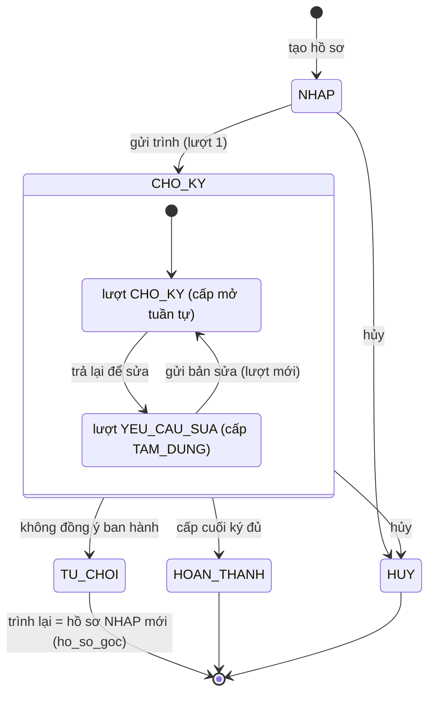

# Module 05: Trình ký số (Nhóm 5)

> **Phạm vi:** mọi người ký trong một cấp có cùng một vai trò (ký chính). Ký nháy, ủy quyền ký và ký thay chưa có trong
> module.

Phân hệ trình ký văn bản đi qua nhiều cấp, ký điện tử nội bộ Ed25519, kết thúc ở **hoàn tất duyệt nội bộ, chưa phát
hành**. Giao diện ở `/approvals`, API dưới `/api/v1/signing/`.

Tài liệu liên quan (không chép lại ở đây):

- [`signing-backend-plan.md`](signing-backend-plan.md): quy tắc nghiệp vụ, bất biến, thiết kế dữ liệu, máy trạng thái, API.
- [`danh-gia-plan-va-tich-hop.md`](danh-gia-plan-va-tich-hop.md): đánh giá plan và tích hợp với các nhóm.
- [`du-lieu-mau-va-tinh-trang-nghiep-vu.md`](du-lieu-mau-va-tinh-trang-nghiep-vu.md): bảng tình trạng flow, file khóa,
  dữ liệu mẫu chi tiết, hợp đồng API Dashboard đầy đủ.
- [`spec.md`](spec.md), [`qa-test-cases-80.md`](qa-test-cases-80.md).

## 1. Flow nghiệp vụ

| Flow | Tình trạng |
|---|---|
| Quy trình mẫu: tạo nháp, sửa, kích hoạt, ngừng, nhân bản phiên bản, xóa phiên bản chưa có hồ sơ; phạm vi công ty/phòng ban; người ký theo tài khoản (danh bạ CBNV) hoặc chức vụ (Danh mục chức vụ) | Xong |
| Tạo hồ sơ nháp (chọn PDF đính kèm trên văn bản đi hoặc tải PDF dự thảo chưa vào sổ; quy trình, hạn chót), sửa nháp | Xong |
| Trình ký: khóa tệp và mã băm, chọn người ký theo chức vụ, đặt vị trí ký | Xong |
| Ký tuần tự theo cấp, song song trong cấp | Xong |
| Khóa ký Ed25519 + PIN 8 số (Argon2id + salt, `k_srv`); xuất file khóa; ký bằng file khóa + PIN | Xong |
| Không đồng ý ban hành (kết thúc); trình lại thành hồ sơ mới | Xong |
| Trả lại để sửa → trao đổi → gửi bản sửa → lượt trình mới | Xong |
| Hủy (người tạo; quản trị hủy thay có lý do); thu hồi chữ ký khi cấp còn mở | Xong |
| Hoàn tất: bằng chứng tổng hợp, PDF hoàn tất, xác minh lại | Xong |
| Thông báo qua email và outbox `signing_notification` (gửi lại khi lỗi), nhắc hạn/quá hạn; không còn trang xem trong ứng dụng | Xong |
| Ký nháy, ủy quyền ký, thể thức KT./TL./TUQ., leo thang quá hạn | Chưa làm (mục 8) |

Trạng thái hồ sơ (`signing_request.trang_thai`) và lượt trình (`signing_attempt.trang_thai`):



Khi hồ sơ từ chối hoặc hủy, cấp đang ký chuyển `TAM_DUNG`; người chưa ký hiển thị "Không còn cần ký".

## 2. Vai trò và quyền

Quyền kiểm ở API/service (`backend/apps/signing/permissions.py`), giao diện chỉ ẩn/hiện. Nhóm quyền chuẩn lấy từ
DDL/RBAC (Nhóm 7):

| Nhóm | Trình ký |
|---|---|
| Văn thư (VT) | xem, tạo, gửi trình ký |
| Chuyên viên (CV) | xem, tạo nháp, gửi trình ký (đã cấp `send_trinhky` theo PR #254) |
| Trưởng phòng (TP) | xem, tạo, gửi, ký, hủy thay, quản lý quy trình phòng ban |
| Ban Giám đốc (BGD) | xem, tạo, gửi, ký, hủy thay, xem nhật ký mọi hồ sơ |
| Quản trị (ADMIN) | toàn quyền, quản lý quy trình công ty |

Codename: `view_trinhky`, `add_trinhky`, `send_trinhky`, `sign_trinhky`, `delegate_trinhky`, `cancel_trinhky`,
`manage_signing_process`, `view_signing_audit`. Quyền `delegate_trinhky` còn trong dữ liệu phân quyền nhưng Trình ký không còn dùng.

## 3. Cấu trúc thư mục chính

```text
backend/apps/signing/
  models.py, enums.py, permissions.py, errors.py   # model theo DDL, mã trạng thái, kiểm quyền, định dạng lỗi
  services/                                        # nghiệp vụ: trinh_ky, hanh_dong_ky, yeu_cau_sua,
                                                   #   keys, pin, thong_bao, bang_chung, tep_hoan_tat, process
  selectors.py                                     # selector chỉ đọc cho module khác (Dashboard)
  tich_hop/                                        # đọc văn bản đi (Nhóm 2), tổ chức/nhân sự (Nhóm 7)
  views.py, urls.py, serializers.py                # API /api/v1/signing/
  management/commands/                             # seed_signing_demo, nhac_han_trinh_ky, gui_thong_bao_trinh_ky
  tests/
frontend/src/
  pages/signing/          # SigningModule (route /approvals/*), DanhSach, TaoHoSo, ChiTiet, QuyTrinh, Khoa, ThongBao, TaiLieu
  components/signing/     # HanhDong, TienTrinh, XemPdf, TraoDoiPanel, KetQuaPanel, ...
  lib/signing/            # api, types, khoaKy (Ed25519, Argon2id, AES-GCM), fileKhoa, luongKhoa, pdf, i18n vi/en
```

## 4. API chính (`/api/v1/signing/`)

| Đường dẫn | Mục đích |
|---|---|
| `quy-trinh/`, `quy-trinh/{id}/`, `quy-trinh/{id}/{kich-hoat,ngung,nhan-ban}/` | Quy trình mẫu |
| `trinh-ky/` (GET `?hop=can_toi_ky\|toi_gui\|tat_ca&page=&page_size=`, POST multipart) | Danh sách (phân trang), tạo nháp |
| `trinh-ky/{id}/` (GET, PATCH) | Chi tiết; sửa nháp; chuyển sang phiên bản mới hơn cùng mã nếu phiên bản gắn hiện tại đã ngừng |
| `trinh-ky/{id}/lien-ket-van-ban-di/` (POST) | Người tạo liên kết hồ sơ đã hoàn tất duyệt với văn bản đi đã đăng ký |
| `trinh-ky/{id}/{gui,huy,trinh-lai}/` | Gửi, hủy, trình lại |
| `trinh-ky/{id}/{ky,tu-choi,thu-hoi,yeu-cau-sua}/` | Hành động người ký |
| `trinh-ky/{id}/{trao-doi,giai-quyet}/` | Trao đổi khi trả sửa, gửi bản sửa |
| `trinh-ky/{id}/{tep,tep-hoan-tat,bang-chung,tao-lai-tep-hoan-tat}/` | Tệp, tệp hoàn tất, bằng chứng |
| `khoa/`, `khoa/{id}/{thach-thuc,xac-minh,kich-hoat,thu-hoi,xoay-vong,dat-pin,mo-khoa-ky,doi-pin}/` | Khóa ký, PIN |
| `thong-bao/`, `tai-lieu/`, `toi/`, `nguoi-dung/`, `don-vi/`, `van-ban-di/` | Hỗ trợ giao diện (`thong-bao/` giữ ở backend, giao diện Trình ký không còn gọi) |
| `dashboard/` | Dữ liệu Dashboard/Header cho Nhóm 1 |

Thao tác đổi trạng thái bắt buộc header `Idempotency-Key`. Lỗi trả dạng `{"code", "detail", "fields"}` (tiếng Việt).

- Danh sách hồ sơ phân trang như các module khác (`PageNumberPagination`): `page` (mặc định 1), `page_size` (mặc định
  10, tối đa 100); trả `{"count", "next", "previous", "results"}`. Trang vượt quá số trang trả 404.
- Tìm kiếm (`q` của danh sách hồ sơ, `tai-lieu/`, `van-ban-di/`) không phân biệt hoa thường và dấu tiếng Việt: "mua sam"
  khớp "Mua sắm", "10/qd" khớp "10/QĐ".
- Mỗi văn bản đi chỉ có một hồ sơ đang mở (nháp hoặc đang chờ ký). Tạo nháp, gửi trình hoặc trình lại khi văn bản đang có
  hồ sơ mở khác trả 409 `van_ban_da_co_ho_so_dang_mo`. Hồ sơ đã hoàn thành, từ chối hoặc hủy không chặn việc trình mới.
  PDF dự thảo chưa vào sổ không áp quy tắc này.
- Văn bản trình ký khi tạo hồ sơ (`POST trinh-ky/`, multipart) dùng đúng một nguồn: (1) văn bản đi đã đăng ký với
  `van_ban_id` (`document_type=vanbandi`) và `tep_dinh_kem_id` là tệp PDF còn hiệu lực trên chính bản ghi đó; không
  nhận thêm `tep`; hoặc (2) `tep` tải lên từ máy, `trich_yeu_van_ban` bắt buộc và `so_hieu_van_ban` tùy chọn làm số
  tham chiếu. Nguồn (2) là PDF dự thảo chưa vào sổ, mã hồ sơ trình ký do hệ thống tự cấp; số tham chiếu không phải số
  văn bản chính thức. Server kiểm nội dung PDF, dung lượng tối đa 20 MB, rồi sao chép vào kho Trình ký riêng và tính
  SHA-256. Hồ sơ trả `van_ban` (`so_hieu`, `trich_yeu`) theo đúng nguồn; sửa nháp nhập tay được đổi số hiệu/trích yếu
  (hồ sơ gắn văn bản đi: 400 `van_ban_da_gan`).
- Sau khi hồ sơ nguồn dự thảo hoàn tất duyệt nội bộ và tệp hoàn tất tạo thành công, người tạo đăng ký tệp hoàn tất qua
  phân hệ Văn bản đi rồi gọi `POST trinh-ky/{id}/lien-ket-van-ban-di/` với `van_ban_id`. API chỉ cho liên kết một lần,
  kiểm người tạo, quyền xem văn bản đi, phạm vi không hạn chế, trạng thái hồ sơ và tệp hoàn tất; ghi nhật ký. Trình ký
  không tự tạo bản ghi, cấp số văn bản hoặc chuyển tệp sang kho Văn bản đi. Sau liên kết, số hiệu và trích yếu lấy từ
  bản ghi Văn bản đi.
- Bộ lọc ngày `tu_ngay`/`den_ngay` (YYYY-MM-DD) của danh sách hồ sơ, `tai-lieu/` và `thong-ke/`: ngày không có trong
  lịch (tháng 13, 30/02) hoặc `tu_ngay` > `den_ngay` trả 400 `tham_so_khong_hop_le`. Từ khóa `q` bỏ ký tự NUL, cắt
  khoảng trắng, tối đa 100 ký tự.
- Giới hạn nhập tay (serializer; giao diện đặt `maxLength` bằng đúng các số này): trích yếu văn bản 1000 ký tự; số hiệu
  100; ghi chú (hồ sơ, ký, cấp ký), mô tả quy trình, lý do (hủy, từ chối, trả sửa, thu hồi khóa), tin nhắn
  trao đổi 2000; tên quy trình 255; mã quy trình 50 ký tự gồm chữ không dấu, số, `-`, `_`, `.` (không trùng khi khác
  hoa thường); `so_gio_xu_ly` của cấp 0–8760 giờ. Một người (hoặc một chức vụ cùng phạm vi) chỉ xuất hiện một lần trong
  một cấp ký (400 `nguoi_ky_trung_trong_cap`).
- Lỗi validation (`fields`) bằng tiếng Việt (bảng ánh xạ ở `errors.py`); `trao-doi/` trả `ten_nguoi_viet` cho từng tin nhắn.
- Bộ lọc trạng thái (`trinh-ky/?nhanh=`, `trinh-ky/thong-ke/`): `cho_ky` (lượt hiện hành chờ ký, chưa quá hạn),
  `qua_han` (lượt hiện hành chờ ký, qua hạn chót hoặc có cấp đang ký qua hạn xử lý), `hoan_thanh` (đã ký xong),
  `tra_lai` (đang trả lại để sửa). Giá trị khác trả 400. Hồ sơ nháp, không đồng ý, đã hủy chỉ hiện ở "Tất cả".
  `thong-ke/` nhận thêm `q`, `quy_trinh`, `tu_ngay`, `den_ngay` (không nhận `nhanh`) để số trên các thẻ khớp với danh
  sách đang xem.
- `tai-lieu/` phân trang như danh sách hồ sơ (`page`, `page_size`; `{"count", "next", "previous", "results"}`).
- Xóa quy trình (`DELETE quy-trinh/{id}/`): xóa được một phiên bản ở mọi trạng thái khi không có hồ sơ trình ký nào
  (kể cả đã hủy, hoàn thành) dùng phiên bản đó; còn hồ sơ trả 409 `quy_trinh_da_duoc_dung` kèm số hồ sơ
  (`fields.so_ho_so`). API quy trình trả `so_ho_so` để giao diện khóa nút Xóa. Sửa vẫn chỉ áp dụng cho bản nháp.

### `GET /api/v1/signing/dashboard/` (Nhóm 1)

Yêu cầu đăng nhập (JWT); chưa đăng nhập trả 401. Chỉ dữ liệu của người đang đăng nhập. Backend có thể gọi
`signing.selectors.tong_quan_dashboard(user)`. Mẫu (rút gọn từ dữ liệu `seed_signing_demo`, tài khoản `truongphong`;
bản đầy đủ ở `du-lieu-mau-va-tinh-trang-nghiep-vu.md` mục 5.2):

```json
{
  "so_cho_ky": 2,
  "gan_day": [
    {
      "id": 2,
      "tieu_de": "102/TTr-CNTT — Tờ trình mua sắm thiết bị mạng cho văn phòng khu vực",
      "nguoi_trinh": "Văn thư Ban CNTT",
      "ngay_trinh": "2026-10-21T15:29:41.935258+07:00",
      "trang_thai": "CHO_KY",
      "nhan_trang_thai": "Chờ ký",
      "can_toi_ky": true
    }
  ]
}
```

`gan_day` tối đa 5 phiếu, mới nhất trước. `trang_thai`: `NHAP`, `CHO_KY`, `HOAN_THANH`, `TU_CHOI`, `HUY`
(nhãn: Nháp, Chờ ký, Đã ký, Từ chối, Đã hủy).

## 5. Cấu hình môi trường (`backend/.env`, không commit giá trị bí mật)

| Biến | Ghi chú |
|---|---|
| `SIGNING_DOCUMENT_ROOT` | Thư mục lưu tệp PDF, ảnh chữ ký snapshot, tệp hoàn tất |
| `SIGNING_PIN_SECRET` | Bí mật máy chủ cho PIN và `k_srv`; bắt buộc trên staging/production (`check --deploy` báo `signing.E001/E002`) |
| `SIGNING_PDF_FONT`, `SIGNING_PDF_FONT_BOLD` | Phông có dấu cho PDF hoàn tất; trống thì tự dò phông hệ thống |
| `SIGNING_EMAIL_BACKEND` | Để trống trên staging/production. Chỉ dùng để chọn backend không cần máy chủ thư khi dev/test: `django.core.mail.backends.console.EmailBackend` hoặc `django.core.mail.backends.locmem.EmailBackend`. Đặt giá trị SMTP thì được coi như để trống (gửi qua cấu hình `EMAIL_*`); giá trị không nạp được báo `signing.E004` |
| `SIGNING_FRONTEND_URL` | Địa chỉ giao diện dùng trong liên kết email |
| `EMAIL_HOST`, `EMAIL_PORT`, `EMAIL_USE_TLS`, `EMAIL_HOST_USER`, `EMAIL_HOST_PASSWORD` | SMTP chung của dự án (Django 6.1 `MAILERS`); `EMAIL_HOST` trống thì email in ra console |
| `DEFAULT_FROM_EMAIL` | Địa chỉ người gửi, bắt buộc khi gửi SMTP, ví dụ `Hệ thống QLVB <qlvb@baohiembaolong.vn>`. Để trống thì mọi thư lỗi `Invalid address ''`; `manage.py check` báo `signing.W003` |
| `ADMIN_PASSWORD` | Mật khẩu `admin` khi khởi tạo bằng `seed_db` / `scripts/build_db.py --seed` |
| `DEMO_PASSWORD` | Mật khẩu tài khoản mẫu của `seed_signing_demo` |

System check của phân hệ (`python manage.py check`): `signing.W002` khi `SIGNING_EMAIL_BACKEND` đặt SMTP mà dự án chưa
có `EMAIL_HOST`; `signing.W003` khi gửi SMTP mà `DEFAULT_FROM_EMAIL` trống; `signing.E004` khi `SIGNING_EMAIL_BACKEND`
không nạp được.

### 5.1. Tài khoản demo và mật khẩu

- Năm tài khoản demo `admin`, `vanthu`, `chuyenvien`, `truongphong`, `giamdoc` dùng chung **mật khẩu demo của lớp**:
  đặt `ADMIN_PASSWORD` và `DEMO_PASSWORD` cùng một giá trị (mật khẩu demo của lớp) trong `.env`. Không ghi giá trị này
  vào repo, tài liệu hay issue.
- `admin` do `seed_db` tạo theo `ADMIN_PASSWORD`; `seed_signing_demo` không đổi mật khẩu `admin` đã có. Nếu `admin` đã
  tồn tại với mật khẩu khác, đổi bằng:

  ```bash
  cd backend
  python manage.py changepassword admin     # hoặc: pnpm manage changepassword admin
  ```

- Bốn tài khoản còn lại đã có mà mật khẩu khác: `python manage.py seed_signing_demo --dat-lai-mat-khau`.
- Windows (PowerShell, CMD) không dùng được cú pháp `BIEN=... lệnh`: ghi biến vào tệp `backend/.env` (settings tự nạp
  `backend/.env`, sau đó `.env` ở thư mục gốc):

  ```dotenv
  ADMIN_PASSWORD=<mật khẩu demo của lớp>
  DEMO_PASSWORD=<mật khẩu demo của lớp>
  ```

  rồi chạy `pnpm manage seed_signing_demo --email-domain <miền email>`.

### 5.2. Thử gửi email thật

1. Ghi vào `backend/.env`:

   ```dotenv
   EMAIL_HOST=<máy chủ SMTP>
   EMAIL_PORT=587
   EMAIL_USE_TLS=true
   EMAIL_HOST_USER=<tài khoản SMTP>
   EMAIL_HOST_PASSWORD=<mật khẩu SMTP>
   DEFAULT_FROM_EMAIL="Hệ thống QLVB <qlvb@baohiembaolong.vn>"
   ```

   `SIGNING_EMAIL_BACKEND` để trống.
2. Kiểm tra cấu hình: `pnpm manage check` (không có `signing.W002`, `signing.W003`), rồi gửi thư thử:
   `pnpm manage sendtestemail <email nhận>`.
3. Tài khoản mẫu cần có email thì thông báo mới có kênh email: chạy `seed_signing_demo --email-domain <miền>` (gán
   `<username>@<miền>` cho tài khoản mẫu chưa có email). Không có email thì thông báo chỉ ghi vào outbox, không gửi email.
4. Email lỗi được ghi `THAT_BAI` kèm lý do trong `signing_notification`; sửa cấu hình xong chạy
   `python manage.py gui_thong_bao_trinh_ky` để gửi lại.

## 6. Cách chạy

```bash
pnpm db:setup                                           # dựng DB local (scripts/build_db.py --seed)
cd backend
DEMO_PASSWORD='<mật khẩu demo>' python manage.py seed_signing_demo   # dữ liệu mẫu, chạy lại không nhân bản
python manage.py seed_signing_demo --reset              # hủy bộ hồ sơ mẫu cũ (giữ bằng chứng, lùi 30 ngày) rồi tạo lại
python manage.py nhac_han_trinh_ky                      # nhắc hạn/quá hạn, chạy định kỳ
python manage.py gui_thong_bao_trinh_ky                 # gửi lại email lỗi, chạy định kỳ
python manage.py runserver                              # cùng `pnpm dev` ở frontend
```

Trên staging, deploy chỉ chạy migration; lệnh dữ liệu mẫu chạy tay một lần trên máy chủ (xem
`du-lieu-mau-va-tinh-trang-nghiep-vu.md` mục 4.6).

Tài khoản mẫu: `truongphong` (ký cấp 1, có hồ sơ chờ ký), `giamdoc` (ký cấp 2), `vanthu`
(người trình, đủ trạng thái), `chuyenvien` (soạn nháp), `admin` (quản trị). Sau khi chạy lệnh mẫu, mỗi người
ký tự tạo khóa ký ở trang **Cấu hình khóa ký** (tải file khóa) trước khi ký.

## 7. Kiểm thử

```bash
python backend/manage.py test signing                   # PostgreSQL 16
python backend/manage.py test                           # toàn bộ
pnpm --dir frontend lint && pnpm --dir frontend exec tsc -b
pnpm --dir frontend check:i18n && pnpm --dir frontend check:tokens
pnpm --dir frontend test && pnpm --dir frontend build
```

Kết quả tại PR #251 (local, PostgreSQL 16): backend toàn bộ 1069 test, 0 skip, đạt; `test signing` 265 test đạt;
frontend lint, typecheck, i18n, tokens sạch, 525 test đạt, build đạt. E2E Playwright Chromium trên dữ liệu mẫu: tạo
khóa và tải file khóa, ký bằng file khóa + PIN, trả sửa, gửi bản sửa, không đồng ý ban hành, hủy, xem PDF
desktop và mobile 390px, thông báo có người thực hiện và lý do.

Báo cáo chi tiết các luồng nghiệp vụ (Happy path, Trả sửa lượt 2, Từ chối), ca biên (Edge cases) và nhật ký bằng chứng kiểm thử: xem tại [`FLOW_TEST_EVIDENCE.md`](./FLOW_TEST_EVIDENCE.md). Danh mục 116 test case đối chiếu theo Issue #80 và #248: xem tại [`qa-test-cases-80.md`](./qa-test-cases-80.md).

## 8. Chưa làm và lý do

- Ký nháy, ủy quyền ký (theo thời gian và khẩn cấp) và thể thức KT./TL./TUQ.: chưa có. Trước khi bổ sung cần chốt
  chính sách nghiệp vụ (ai được ký thay, giới hạn theo loại văn bản hoặc giá trị, cách thể hiện trên khối chữ ký) và
  thực hiện bằng PR đổi schema riêng (DDL + migration + `DDL_CHANGELOG.md`).
- Nhóm Chuyên viên (CV) đã được cấp quyền `send_trinhky` qua PR #254 (migration `authorization/0007_grant_cv_send_trinhky`, issue #226), cho phép chuyên viên tự gửi hồ sơ do mình tạo.
- Tab "Thông báo" và trang `/approvals/thong-bao` đã bỏ khỏi giao diện (issue #355). Thông báo vẫn gửi qua email và
  outbox `signing_notification` (`gui_thong_bao_trinh_ky`, `nhac_han_trinh_ky`); API `thong-bao/` giữ nguyên. Đường dẫn
  `/approvals/thong-bao` chuyển về trang chính. Phân trang, tìm kiếm, lọc loại và đánh dấu đã xem của PR #344 chỉ còn
  ở backend.
- Tìm không dấu dùng `LOWER(TRANSLATE(...))` sẵn có của PostgreSQL, quét tuần tự (đủ cho quy mô hiện tại). Muốn dùng
  extension `unaccent` và index theo biểu thức thì phải đổi `release_DDL.sql` (`CREATE EXTENSION`, function
  `IMMUTABLE`, index), cần PR đổi schema riêng theo AGENTS.md mục 5–6. Dữ liệu lưu dạng tổ hợp (NFD) chưa được chuẩn
  hóa khi tìm.

## 9. Sửa lỗi kiểm thử staging (sau PR #251)

- `DEFAULT_FROM_EMAIL` trống làm mọi email SMTP lỗi `Invalid address ''`: thêm system check `signing.W003`, giá trị mẫu
  trong `.env.example`, hướng dẫn mục 5.2.
- Một văn bản có nhiều hồ sơ trình ký chạy song song: chặn ở service (tạo nháp, gửi trình, trình lại), trả 409
  `van_ban_da_co_ho_so_dang_mo`; khóa advisory theo văn bản tránh hai yêu cầu đồng thời cùng qua.
- `SIGNING_EMAIL_BACKEND` đặt SMTP lỗi trên Django 6.1 (`The EMAIL_HOST setting is not available when MAILERS is
  defined`): giá trị SMTP dùng mailer mặc định của dự án; chạy được trên Django 5.2 và 6.1; check `signing.W002`,
  `signing.E004`.
- Danh sách hồ sơ phân trang (backend `page`/`page_size`, giao diện thanh phân trang, đổi bộ lọc về trang 1).
- Tìm không dấu ở danh sách hồ sơ, trang tệp, chọn văn bản đi và lọc quy trình.
- Form "Tạo quy trình": ô tên cấp ký có nhãn "Tên cấp ký" (trước đó dùng nhầm "Tên quy trình").
- Email và thông báo "Cần ký", "Sắp đến hạn", "Quá hạn" ghi hạn xử lý của cấp (dd/mm/yyyy HH:MM); API `thong-bao/`
  trả `han_xu_ly`.
- `seed_signing_demo --reset`: bộ hồ sơ mẫu cũ lùi ngày tạo/ngày trình 30 ngày nên không chen vào 5 phiếu gần nhất
  của Dashboard.
- Tab "Tệp trình ký" đổi lại thành "Văn bản công khai" (en "Public documents") theo quyết định của nhóm, đảo ngược
  thay đổi ở PR #251. Khối "Tài liệu" trong trang chi tiết hồ sơ giữ nguyên.

## 10. Nhật ký thay đổi PR #251

- File khóa `.tlbmkey` (bản bọc private key): xuất khi tạo khóa và đổi PIN, nhập vào thiết bị, ký bằng file + PIN.
- Thông báo: hủy báo người tạo (khi hủy thay) và người đã ký; tin nhắn trao đổi; nhắc hạn/quá hạn (`nhac_han_trinh_ky`);
  số thông báo mới ở tab; email và thông báo ghi người thực hiện và lý do.
- Lịch sử hiển thị người thực hiện; ghi "Gửi trình ký" trước "Mở cấp ký".
- API Dashboard cho Nhóm 1 và selector `tong_quan_dashboard`.
- Lệnh dữ liệu mẫu duy nhất `seed_signing_demo` (`--reset`, mật khẩu từ `DEMO_PASSWORD`); gỡ lệnh cũ
  `seed_demo_signing` (ghi cứng mật khẩu, khóa bí mật suy ra từ chuỗi cố định).
- Lỗi từ rà soát E2E staging:
  - vùng xem PDF trắng do pdfjs-dist 5.x gọi `Map.prototype.getOrInsertComputed`: dùng bản legacy có polyfill, hiện lỗi
    thay vì nuốt, hủy lần vẽ cũ trước khi vẽ lại;
  - danh sách trên màn hình 390px mất cột trạng thái: dạng thẻ cho màn hình hẹp;
  - hồ sơ từ chối/hủy vẫn "đang ký": cấp chuyển `TAM_DUNG`, người chưa ký "Không còn cần ký";
  - email từ chối, trả sửa, hủy thiếu lý do và người thao tác: đã bổ sung;
  - lỗi 404/401 của API trả tiếng Anh: trả tiếng Việt;
  - hồ sơ trả lại hiện "Đang chờ ký", quá hạn không có dấu: badge "Đang trả lại để sửa", "Quá hạn";
  - tab tài liệu "Văn bản công khai": đổi thành "Tệp trình ký";
  - nút trợ lý AI nổi che nút hành động: chừa khoảng dưới trong trang Trình ký;
  - bổ sung test frontend cho TaoHoSoPage, KhoaPage, TraoDoiPanel, KetQuaPanel, XemPdf.

## 11. Chỉnh nghiệp vụ trình ký (issue #275, schema #274)

- Xóa quy trình theo số hồ sơ phụ thuộc thay cho quy tắc "chỉ xóa nháp" (mục 4).
- Chọn người ký khi cấu hình quy trình: theo tài khoản lấy từ danh bạ cán bộ của phân hệ CBNV
  (`GET /api/accounts/staffs/`), theo chức vụ lấy từ Danh mục chức vụ (`GET /api/positions/?all=true`, cần quyền
  `view_chucvu`; nhóm ADMIN, TP có sẵn). Phạm vi chức vụ chọn trên form: trong đơn vị người trình hoặc toàn cơ quan.
  Người cụ thể giữ chức vụ được xác định lúc gửi (như trước).
- Văn bản trình ký: chọn văn bản đi đã đăng ký và một PDF đính kèm của chính bản ghi; hoặc tải PDF dự thảo chưa vào sổ
  với mã hồ sơ tự cấp (số hiệu tham chiếu, trích yếu). Sau khi hoàn tất duyệt, người tạo đăng ký tệp hoàn tất trong Văn
  bản đi rồi liên kết hồ sơ; Trình ký không cấp số hoặc tự tạo bản ghi. Schema đổi ở PR
  riêng (#274): `signing_request.document_type`, `document_id` cho phép NULL; thêm `so_hieu_van_ban`,
  `trich_yeu_van_ban`; CHECK `chk_signing_request_van_ban`; migration `signing/0015_van_ban_trinh_ky_khac`.
- Nhãn "Văn bản" đổi thành "Văn bản trình ký": cột danh sách, form tạo, khối thông tin trang chi tiết, email thông báo,
  trang phê duyệt của tệp PDF hoàn tất.
- Bộ lọc trạng thái còn 4 lựa chọn (mục 4); badge tab "Cần tôi ký duyệt" đếm cả hồ sơ quá hạn.
- Tab "Văn bản công khai" phân trang (10 tệp mỗi trang, dùng chung thanh `PhanTrang`).
- Chọn chức vụ (và đơn vị) là hiện ngay tên cán bộ đang giữ chức vụ (họ tên, đơn vị), ở ô thêm theo chức vụ, ở từng
  người ký theo chức vụ trong form và ở trang chi tiết quy trình; không có ai thì cảnh báo "Chưa có cán bộ nào ở chức
  vụ/đơn vị này". API chỉ đọc `GET can-bo-theo-chuc-vu/?chuc_vu=&don_vi=` (quyền xem hoặc quản lý quy trình; chỉ cán bộ
  `is_active`, trạng thái đang làm việc; tối đa 50 dòng kèm `count`). Đơn vị tìm: đơn vị cố định của cấp; "đơn vị người
  trình" của quy trình phòng ban là đơn vị áp dụng; quy trình công ty theo đơn vị người trình hiện mọi đơn vị kèm ghi
  chú người ký thực tế xác định lúc gửi.
- Dữ liệu cán bộ: Trình ký đọc qua lớp `tich_hop/to_chuc.py` (model của Nhóm 7) và API công khai của CBNV ở giao diện;
  bản chụp tên người ký/chức vụ trên lượt trình là bằng chứng bất biến, không phải danh bạ riêng. Đề xuất Nhóm 7 bổ
  sung selector Python công khai (tìm cán bộ, cán bộ theo chức vụ/đơn vị, lãnh đạo đơn vị) để thay các truy vấn trực
  tiếp trong `tich_hop/to_chuc.py`. API `nguoi-dung/` chỉ phục vụ chọn người ký khi cấu hình quy trình.

## 12. Rà soát trước kiểm thử chéo (issue #286, PR #287)

Rà từng màn hình và API theo cách người kiểm thử nhóm khác thao tác (nhập liệu sai, bàn phím, màn hình hẹp, đường dẫn
sai, thiếu quyền, tham số lạ). Chỉ hai mức độ: High (chức năng chính hỏng, 500, mất/sai dữ liệu) và Medium (giao diện,
chữ, i18n, kiểm tra nhập liệu, truy cập). Danh sách lỗi và bằng chứng nằm ở issue và mô tả PR; tóm tắt thay đổi:

- **API không còn 500 với tham số lạ**: `tu_ngay`/`den_ngay` đúng dạng nhưng không có trong lịch; từ khóa chứa ký tự NUL;
  `PUT quy-trinh/{id}/` với JSON không phải đối tượng; `so_gio_xu_ly` vượt cột integer.
- **Email không bị từ chối vì xuống dòng**: trích yếu nhiều dòng làm tiêu đề email lỗi `BadHeaderError`, email kẹt
  `THAT_BAI`; tên văn bản trong tiêu đề và nội dung được gộp thành một dòng.
- **Giới hạn độ dài và định dạng** (mục 4): trích yếu, ghi chú, lý do, tin nhắn, mô tả quy trình, mã quy trình,
  số giờ xử lý; người ký trùng trong cấp bị chặn ngay khi lưu quy trình thay vì đến lúc gửi hồ sơ.
- **Thông báo lỗi tiếng Việt** trong `fields`; giao diện nêu trường và lý do đầu tiên thay cho "Dữ liệu không hợp lệ."
  (bảng nhãn trường `truong.*`, bản dịch vi/en cho các mã lỗi nghiệp vụ còn thiếu).
- **Hộp thoại**: tiêu điểm vào ô nhập đầu tiên, Tab quay vòng trong hộp, trả tiêu điểm khi đóng, Esc và bấm nền đóng
  (hộp trên cùng), chặn đóng khi đang gửi; hộp xem tệp của "Văn bản công khai" dùng chung khung này.
- **Đường dẫn**: `/approvals/<không phải số nguyên dương>` báo không tìm thấy mà không gọi API; đường dẫn con không có
  trang hiện "Trang không tồn tại"; lỗi 404 có đường về danh sách (không có "Thử lại"); vào thẳng "Cấu hình khóa ký",
  "Tạo hồ sơ" khi thiếu quyền thì báo ngay.
- **Nhập liệu**: chặn ở trình duyệt tệp rỗng, không phải PDF, quá 20 MB và hạn chót ở quá khứ (không gửi request);
  `maxLength` khớp máy chủ; xóa thông báo lỗi cũ khi đổi dữ liệu; tìm văn bản đi chờ ngừng gõ; "Văn bản công khai" tự áp
  dụng từ khóa như danh sách hồ sơ; Enter gửi tin nhắn trao đổi và Enter ở ô PIN ký.
- **Quy trình**: xóa được cấp ký khi cấu hình; nhấn đúp "Tạo phiên bản mới" không sinh hai phiên bản; "Ngừng" cần xác
  nhận; kiểm tra mã và số giờ ngay trên form. **Khóa ký**: thu hồi khóa cần xác nhận; ô nhập file khóa theo ngôn ngữ
  giao diện.
- **Hiển thị**: danh sách hồ sơ chuyển sang dạng thẻ dưới 1024px, "Văn bản công khai" dưới 1280px (bảng không còn cắt cột
  Hạn chót ở 768px); chuỗi dài không có dấu cách xuống dòng, tiêu đề tối đa 3 dòng trong thẻ; trang Cấu hình khóa ký không tràn
  ngang ở 390px; số trên thẻ lọc khớp danh sách; số "Cần tôi ký duyệt" và thông báo mới tải lại ngay sau thao tác;
  hạn xử lý của cấp hiện khi hồ sơ không đặt hạn chót; chi tiết hiện ghi chú; tin nhắn trao đổi hiện tên người viết;
  thông báo ghi rõ chỉ hiển thị 50 mục gần nhất; nút "Xem trước và đặt vị trí ký" không còn là nút lồng trong liên kết.
- **Kiểm thử không ổn định**: một số test đọc nhật ký bằng `values_list` không `order_by("id")`, thứ tự dòng phụ thuộc
  cách PostgreSQL lưu (không đảm bảo); đã sắp xếp theo `id`. Test mới: `tests/test_ra_soat_kiem_thu_cheo.py` (backend),
  `raSoatKiemThuCheo.test.tsx` (frontend).

Ngoài phạm vi Nhóm 5 (không sửa, đã ghi ở mô tả PR): cảnh báo chunk lớn khi build (`index` thuộc bundle chung,
`vite.config.js`); `/api/...` với tham số đường dẫn sai kiểu (ví dụ `trinh-ky/abc/`) trả trang 404 HTML của Django thay
vì JSON (cấu hình URL chung `backend/config/urls.py`).


Kết quả kiểm tra local (PostgreSQL 16): `manage.py check` và `makemigrations --check --dry-run` sạch; `manage.py test`
toàn bộ 1160 test đạt (1 skip có sẵn); frontend lint, `tsc -b`, `check:i18n`, `check:tokens` sạch, 628 test đạt, build
đạt (cảnh báo chunk lớn do bundle chung, không thuộc Nhóm 5). E2E Playwright Chromium: hộp thoại, đường dẫn sai, tệp và
hạn chót sai, form quy trình, trao đổi, ký bằng file khóa + PIN (kể cả Enter), số đếm sau khi ký, 768px và 390px.

Ghi chú #355: các mục "số thông báo mới ở tab" và "thông báo chỉ hiển thị 50 mục gần nhất" ở trên không còn áp dụng
vì tab Thông báo đã bỏ khỏi giao diện.
