# QA staging các hạng mục epic #447 (Trình ký)

> Phạm vi: các hạng mục đã hợp nhất vào `staging` thuộc epic #447. Kết quả kiểm thử thủ công có giao diện trên môi trường staging.
> Ngày kiểm thử: 2026-11-04. Issue theo dõi: #518. Quy ước mã và cột theo [`qa-test-cases-80.md`](qa-test-cases-80.md) và [`FLOW_TEST_EVIDENCE.md`](FLOW_TEST_EVIDENCE.md); mã test case dùng tiền tố `EP-` (không trùng QT, KP, HS, KY, TS, KQ, DT, UI, DB, BM, STG, QA).

---

## 0. Môi trường và phương pháp

| Mục | Nội dung |
|---|---|
| Môi trường | Staging của hệ thống (cổng 8088), trình duyệt Chrome điều khiển bằng Playwright (`playwright-core`, kênh `chrome`) |
| Tài khoản | Một tài khoản QA vai trò chuyên viên: không phải quản trị, chưa có quyền ký, là người trình của 6 hồ sơ có sẵn. Đăng nhập thủ công; phiên lưu ngoài repo |
| Khung hiển thị | 1366×850 (máy tính) và 390×844 (điện thoại); ngôn ngữ `vi`/`en`; giao diện sáng/tối |
| Che thông tin | Tên hiển thị tài khoản, email, token được thay bằng `[tài khoản QA]`, `[email]`, `[token]` trước khi chụp; vùng xem trước PDF làm mờ |
| Dữ liệu | Chỉ đọc dữ liệu có sẵn. Lệnh ghi duy nhất là `POST` với id không tồn tại hoặc thân rỗng (EP-03, EP-05); cả hai trả 403 nên không ghi dữ liệu |
| Giả lập | EP-09 chặn request API và EP-10 trả 429 do trình duyệt tạo, không phải sự cố hoặc giới hạn thật của máy chủ |
| Phiên bản | `origin/staging` tại thời điểm lập tài liệu: `61ab83ef`. Chưa đối chiếu được phiên bản đã triển khai |
| Chưa kiểm | MFA email: cờ tính năng tắt, staging chưa có `EMAIL_HOST` (EP-26) |

**Giới hạn của đợt này:** tài khoản duy nhất không có vai trò quản trị, người ký hoặc văn thư. Các ca cần vai trò đó (EP-11 đến EP-26) ghi **Blocked** kèm điều kiện cần. Chưa tạo khóa ký thử nghiệm vì tài khoản hiện chưa có quyền ký.

---

## 1. Tổng hợp

| Chỉ số | Giá trị |
|---|---|
| Test case Pass | 10 |
| Test case Blocked | 16 |
| Test case Fail | 0 |
| Bước Pass / Blocked / Fail | 39 / 18 / 0 |
| Lỗi phát hiện | 0 (không tạo issue bug) |

Quan sát không tính là lỗi (ghi ở cột Ghi chú): chip "Quá hạn" gộp hồ sơ chỉ trễ hạn cấp ký trong khi nhãn dòng vẫn "Đang chờ ký" (đúng thiết kế #265); định dạng thời điểm trong thông báo 429 khác nhau giữa `vi` và `en`; cột "Hạn chót" bị cắt mép ở 1366px; thanh tab chỉ hiển thị khoảng 1,5 tab ở 390px.

---

## 2. Test case

| ID | Hạng mục / Nguồn (PR, issue) | Tiền điều kiện (vai trò) | Bước | Expectation | Actual | Kết quả (Pass/Fail/Blocked) | Mức nghiêm trọng | Ghi chú | Ảnh |
|---|---|---|---|---|---|---|---|---|---|
| EP-01 | #456, PR #457 (tab quản lý khóa ký) | Chuyên viên, không phải quản trị, chưa có quyền ký | 1. Mở `/approvals` (vi, sáng, 1366px). | Thanh tab Trình ký không có mục "Quản lý khóa ký" với tài khoản không phải quản trị. | Thanh tab có 4 mục: Cần tôi ký duyệt, Hồ sơ tôi trình, Hồ sơ được xem, Quy trình ký. Liên kết `/approvals*` trong DOM: `/approvals`, `/approvals/toi-gui`, `/approvals/tat-ca`, `/approvals/quy-trinh`; không có liên kết `quan-ly-khoa`. | Pass | — | Tên hiển thị tài khoản đã được che trong ảnh. | 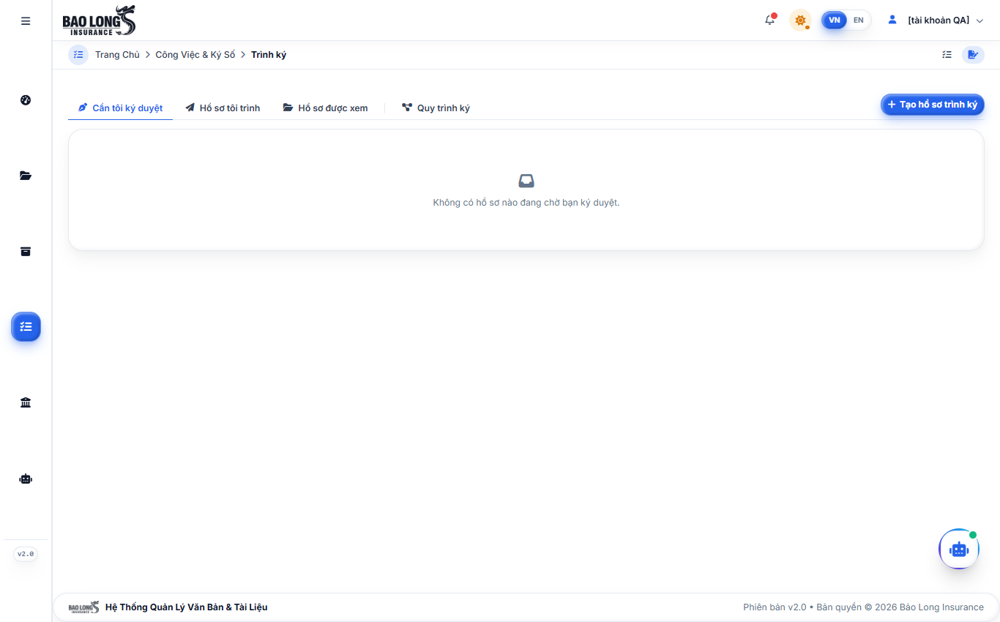 |
| EP-01 | #456, PR #457 (tab quản lý khóa ký) | Chuyên viên, không phải quản trị, chưa có quyền ký | 2. Như bước 1, ngôn ngữ en. | Như bước 1. | 4 mục tab: Awaiting my signature, Submitted by me, Requests available to me, Signing workflows. Danh sách liên kết DOM giống bước 1. | Pass | — | — |  |
| EP-02 | #456, PR #457; #451, PR #452 (API quản trị) | Chuyên viên, không phải quản trị, chưa có quyền ký | 1. Vào thẳng `/approvals/quan-ly-khoa` (vi, sáng, 1366px). | Hiển thị thông báo không có quyền, không tải danh sách tài khoản; API quản trị trả 403. | Tiêu đề "Quản lý khóa ký"; nội dung chỉ có cảnh báo "Chỉ quản trị viên được dùng chức năng này."; không có bảng tài khoản. `GET /api/v1/signing/quan-tri/nguoi-dung/` trả 403. | Pass | — | — |  |
| EP-02 | #456, PR #457; #451, PR #452 (API quản trị) | Chuyên viên, không phải quản trị, chưa có quyền ký | 2. Như bước 1, ngôn ngữ en. | Hiển thị thông báo không có quyền, không tải danh sách tài khoản; API quản trị trả 403. | Tiêu đề "Key management"; cảnh báo "Only administrators can use this function."; `GET .../quan-tri/nguoi-dung/` trả 403. | Pass | — | — | 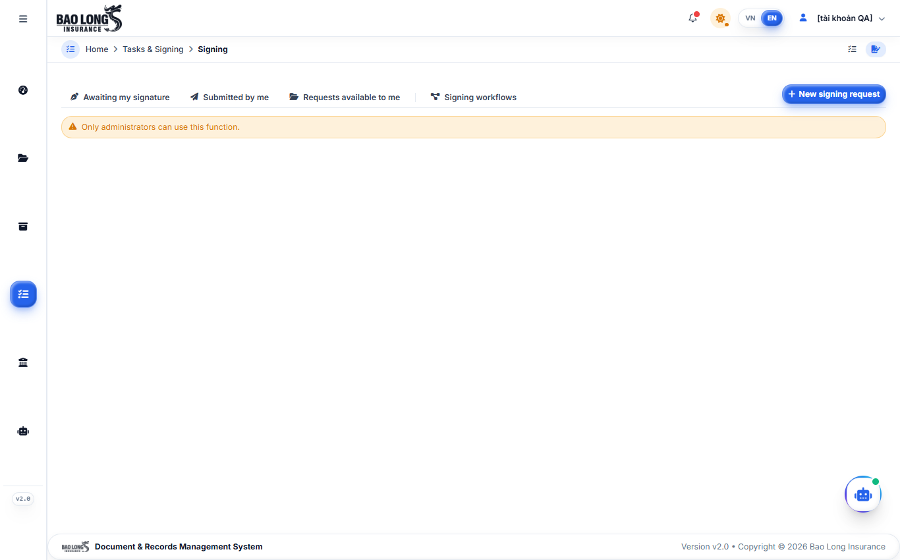 |
| EP-02 | #456, PR #457; #451, PR #452 (API quản trị) | Chuyên viên, không phải quản trị, chưa có quyền ký | 3. Như bước 1, giao diện tối. | Hiển thị thông báo không có quyền, không tải danh sách tài khoản; API quản trị trả 403. | Cảnh báo "Chỉ quản trị viên được dùng chức năng này." hiển thị; `GET .../quan-tri/nguoi-dung/` trả 403. | Pass | — | — | 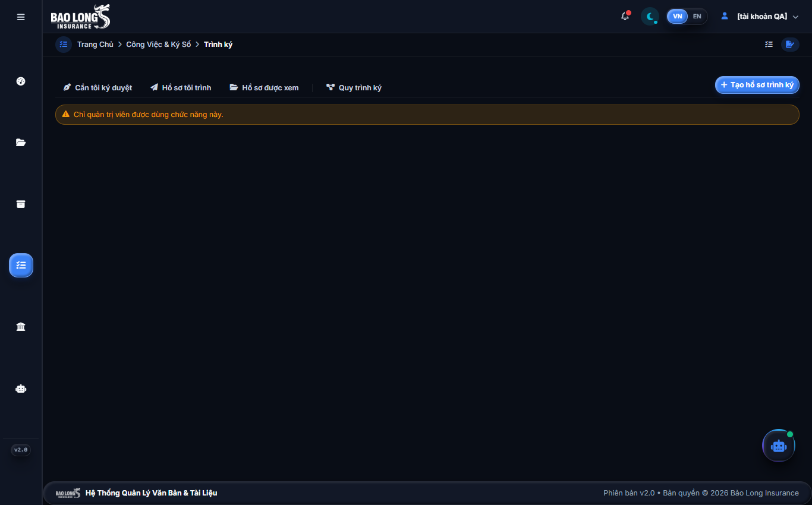 |
| EP-02 | #456, PR #457; #451, PR #452 (API quản trị) | Chuyên viên, không phải quản trị, chưa có quyền ký | 4. Như bước 1, khung 390px. | Hiển thị thông báo không có quyền, không tải danh sách tài khoản; API quản trị trả 403. | Cảnh báo hiển thị đủ chữ trong khung 390px; thanh tab cuộn ngang được (khoảng 1,5 tab hiển thị cùng lúc, nút "Tạo hồ sơ trình ký" nằm cạnh thanh tab). `GET .../quan-tri/nguoi-dung/` trả 403. | Pass | — | Kiểm bằng DOM: tab "Quy trình ký" truy cập được sau khi cuộn thanh tab; không có cuộn ngang ở cấp trang. | 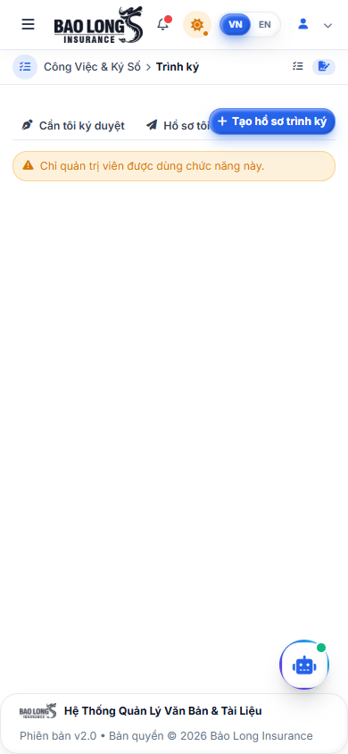 |
| EP-03 | #451, PR #452 (API quản trị khóa và quyền ký) | Chuyên viên, không phải quản trị, chưa có quyền ký; gọi API bằng token của chính phiên đó | 1. `GET /api/v1/signing/quan-tri/nguoi-dung/?q=`. | 403, thông điệp không có quyền. | HTTP 403, `{"code":"khong_co_quyen","detail":"Chỉ quản trị viên được dùng chức năng này.","fields":{}}`. | Pass | — | Ảnh là thẻ trích phản hồi thật; token không hiển thị. | 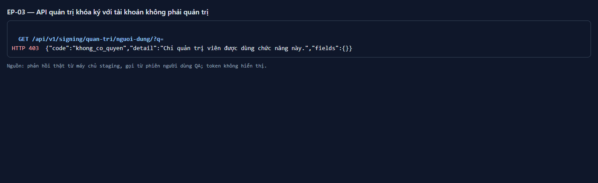 |
| EP-03 | #451, PR #452 (API quản trị khóa và quyền ký) | Chuyên viên, không phải quản trị, chưa có quyền ký; gọi API bằng token của chính phiên đó | 2. `POST .../quan-tri/nguoi-dung/0/khoa-quyen-ky/` với thân `{}` (id không tồn tại). | 403 trước khi kiểm tra id (không phải 404), không có bản ghi nào thay đổi. | HTTP 403, cùng mã `khong_co_quyen`. | Pass | — | Dùng id không tồn tại để loại trừ tác dụng phụ; kết quả 403 cho thấy kiểm quyền chạy trước tra cứu đối tượng. | 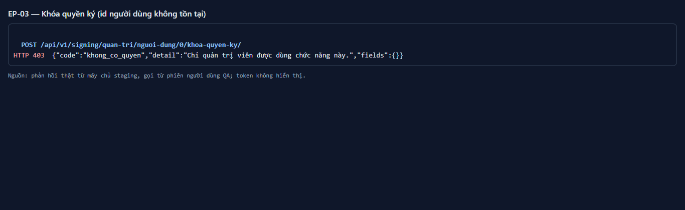 |
| EP-03 | #451, PR #452 (API quản trị khóa và quyền ký) | Chuyên viên, không phải quản trị, chưa có quyền ký; gọi API bằng token của chính phiên đó | 3. `POST .../quan-tri/nguoi-dung/0/bat-lai-quyen-ky/` với thân `{}`. | Như bước 2. | HTTP 403, cùng mã `khong_co_quyen`. | Pass | — | Như bước 2. | 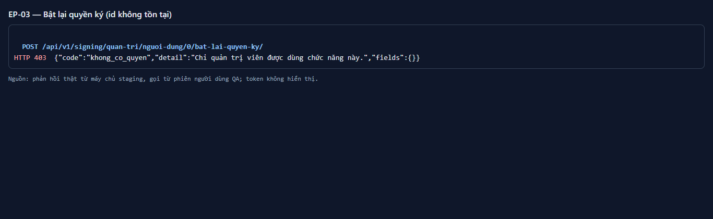 |
| EP-03 | #451, PR #452 (API quản trị khóa và quyền ký) | Chuyên viên, không phải quản trị, chưa có quyền ký; gọi API bằng token của chính phiên đó | 4. `POST .../quan-tri/nguoi-dung/0/thu-hoi-khoa/` với thân `{}`. | Như bước 2. | HTTP 403, cùng mã `khong_co_quyen`. | Pass | — | Như bước 2. | 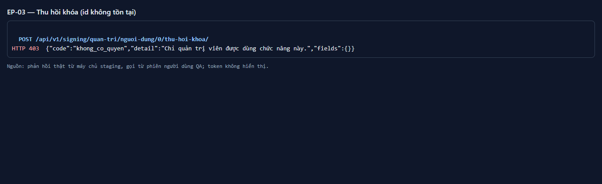 |
| EP-04 | #454, PR #455; #466 (khóa ký và trạng thái tài khoản) | Chuyên viên, không phải quản trị, chưa có quyền ký | 1. Mở `/approvals/khoa` (vi, sáng, 1366px). | Hiển thị thông báo chưa có quyền ký, không có form tạo khóa. | Tiêu đề "Cấu hình khóa ký"; chỉ có thông báo "Tài khoản của bạn chưa được cấp quyền ký nên không cần khóa ký. Liên hệ quản trị nếu cần ký duyệt."; không có form tạo khóa. `GET /api/v1/signing/khoa/` trả 200. | Pass | — | — |  |
| EP-04 | #454, PR #455; #466 (khóa ký và trạng thái tài khoản) | Chuyên viên, không phải quản trị, chưa có quyền ký | 2. Như bước 1, ngôn ngữ en. | Hiển thị thông báo chưa có quyền ký, không có form tạo khóa. | "Signing key settings"; "Your account has no signing permission, so it does not need a signing key. Contact the administrator if you must sign." | Pass | — | — | 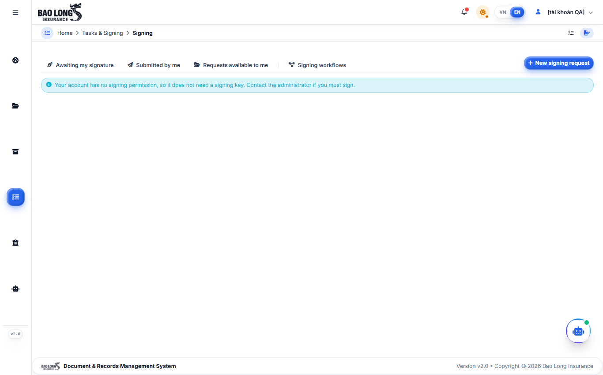 |
| EP-04 | #454, PR #455; #466 (khóa ký và trạng thái tài khoản) | Chuyên viên, không phải quản trị, chưa có quyền ký | 3. Như bước 1, giao diện tối. | Hiển thị thông báo chưa có quyền ký, không có form tạo khóa. | Thông báo thông tin hiển thị trên nền tối, chữ đọc được; không có form tạo khóa. | Pass | — | — | 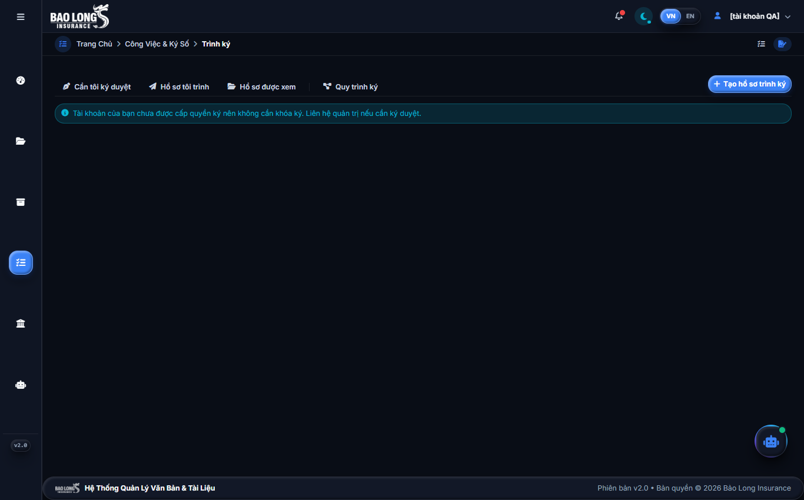 |
| EP-04 | #454, PR #455; #466 (khóa ký và trạng thái tài khoản) | Chuyên viên, không phải quản trị, chưa có quyền ký | 4. Như bước 1, khung 390px. | Hiển thị thông báo chưa có quyền ký, không có form tạo khóa. | Thông báo hiển thị đủ chữ trong khung 390px. | Pass | — | — | 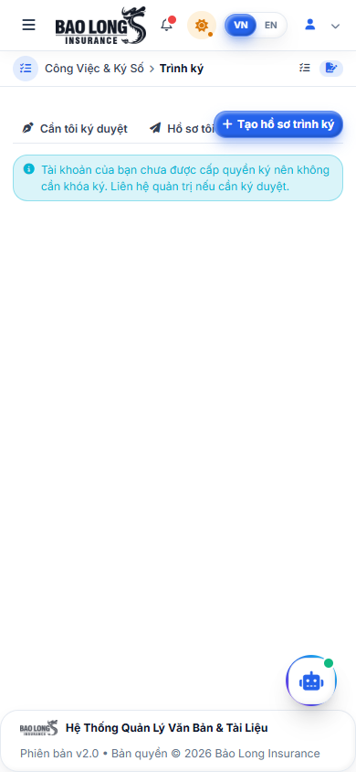 |
| EP-05 | #468, PR #477 (PIN và khóa); #507, PR #508 (challenge); #424 (ảnh chữ ký) | Chuyên viên, không phải quản trị, chưa có quyền ký; gọi API bằng token của chính phiên đó | 1. `GET /api/v1/signing/khoa/`. | Trả danh sách rỗng, không lộ khóa của tài khoản khác. | HTTP 200, thân `[]`. | Pass | — | — | 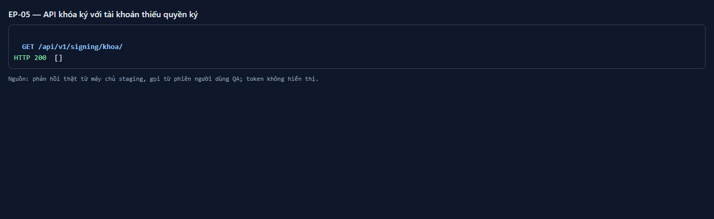 |
| EP-05 | #468, PR #477 (PIN và khóa); #507, PR #508 (challenge); #424 (ảnh chữ ký) | Chuyên viên, không phải quản trị, chưa có quyền ký; gọi API bằng token của chính phiên đó | 2. `GET /api/v1/signing/khoa/0/thach-thuc/` (khóa không thuộc tài khoản). | Không cấp challenge; trả 403 hoặc 404. | HTTP 404, `{"code":"khong_tim_thay","detail":"Không tìm thấy hoặc tài khoản không được xem dữ liệu này.","fields":{}}`. | Pass | — | Challenge của khóa thật chưa kiểm được, xem EP-23. | 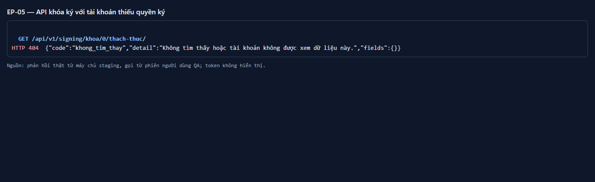 |
| EP-05 | #468, PR #477 (PIN và khóa); #507, PR #508 (challenge); #424 (ảnh chữ ký) | Chuyên viên, không phải quản trị, chưa có quyền ký; gọi API bằng token của chính phiên đó | 3. `POST /api/v1/signing/khoa/` với thân `{}` (tạo khóa khi thiếu quyền ký). | 403, nêu quyền còn thiếu. | HTTP 403, `{"code":"khong_co_quyen","detail":"Tài khoản không có quyền thực hiện thao tác này.","fields":{"quyen":["sign_trinhky"]}}`. | Pass | — | Thân rỗng nên dù được chấp nhận cũng không tạo khóa hợp lệ. | 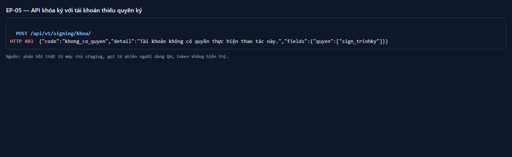 |
| EP-05 | #468, PR #477 (PIN và khóa); #507, PR #508 (challenge); #424 (ảnh chữ ký) | Chuyên viên, không phải quản trị, chưa có quyền ký; gọi API bằng token của chính phiên đó | 4. `GET /api/v1/signing/anh-chu-ky-ca-nhan/`. | Cho biết chưa có ảnh chữ ký. | HTTP 200, `{"co_anh":false}`. | Pass | — | — | 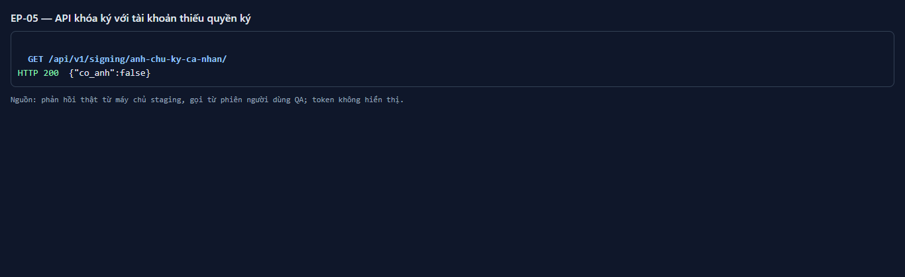 |
| EP-06 | #424, PR #462 (ảnh chữ ký); #459 (nguồn đọc ảnh chữ ký) | Chuyên viên, không phải quản trị, chưa có quyền ký | 1. Mở `/approvals` (vi, sáng, 1366px). | Hộp "Cần tôi ký duyệt" hiển thị trạng thái rỗng, không có hồ sơ. | Hiển thị "Không có hồ sơ nào đang chờ bạn ký duyệt."; các API danh sách trả 200. | Pass | — | — |  |
| EP-06 | #424, PR #462 (ảnh chữ ký); #459 (nguồn đọc ảnh chữ ký) | Chuyên viên, không phải quản trị, chưa có quyền ký | 2. Như bước 1, ngôn ngữ en. | Hộp "Cần tôi ký duyệt" hiển thị trạng thái rỗng, không có hồ sơ. | Hiển thị "Nothing is waiting for your signature." | Pass | — | — | 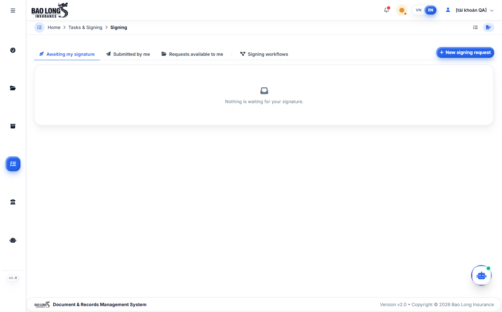 |
| EP-06 | #424, PR #462 (ảnh chữ ký); #459 (nguồn đọc ảnh chữ ký) | Chuyên viên, không phải quản trị, chưa có quyền ký | 3. Như bước 1, giao diện tối. | Hộp "Cần tôi ký duyệt" hiển thị trạng thái rỗng, không có hồ sơ. | Hiển thị "Không có hồ sơ nào đang chờ bạn ký duyệt." | Pass | — | — | 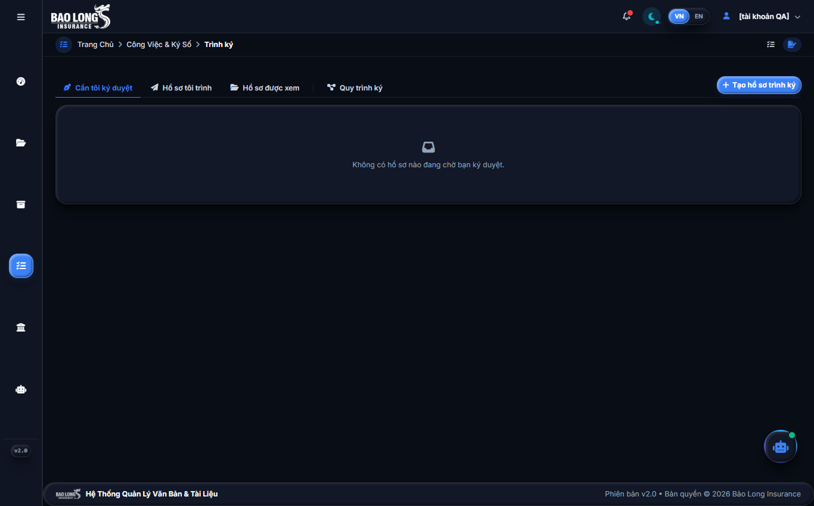 |
| EP-06 | #424, PR #462 (ảnh chữ ký); #459 (nguồn đọc ảnh chữ ký) | Chuyên viên, không phải quản trị, chưa có quyền ký | 4. Như bước 1, khung 390px. | Hộp "Cần tôi ký duyệt" hiển thị trạng thái rỗng, không có hồ sơ. | Hiển thị đủ chữ trong thẻ; thanh tab hiển thị khoảng 1,5 tab, nút "Tạo hồ sơ trình ký" nằm cạnh thanh tab. | Pass | — | Tất cả tab truy cập được bằng cuộn ngang thanh tab (kiểm bằng DOM). Chưa có chỉ dẫn cuộn trực quan: khuyến nghị cải tiến, không tính lỗi. | 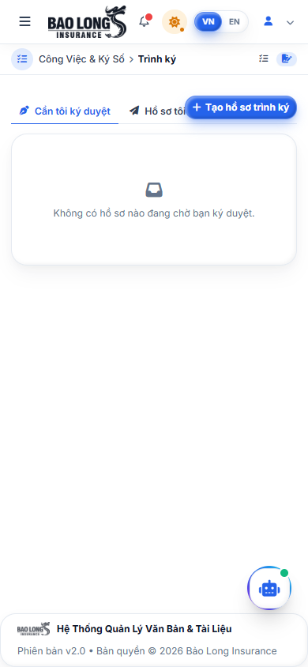 |
| EP-07 | #265 (phân định trễ hạn cấp ký), #447 | Chuyên viên là người trình của 6 hồ sơ chờ ký (3 quá hạn toàn trình, 3 chỉ trễ hạn cấp ký) | 1. Mở `/approvals/toi-gui` (vi, sáng, 1366px). | Danh sách hồ sơ do tài khoản trình, bộ đếm khớp số dòng. | Chip: Tất cả 6, Đang chờ ký 0, Quá hạn 6, Đã ký xong 0, Trả lại để sửa 0; bảng 6 dòng: 3 dòng nhãn "Quá hạn", 3 dòng nhãn "Đang chờ ký" kèm "Hạn bước ký" đã qua. API: `qua_han=true` cho cả 6, `qua_han_cap=true` cho 3 dòng sau. | Pass | — | Nhãn dòng "Đang chờ ký" khi chỉ trễ hạn cấp ký và chip "Quá hạn" gộp cả hai loại phù hợp thiết kế trong `ChungUI.tsx` (`qua_han && !qua_han_cap`). Ở 1366px chữ "Hạn bước ký" trong cột Hạn chót bị cắt mép, bảng cuộn ngang (rộng 1279px so với vùng 1250px); ở 1920px không bị cắt. | 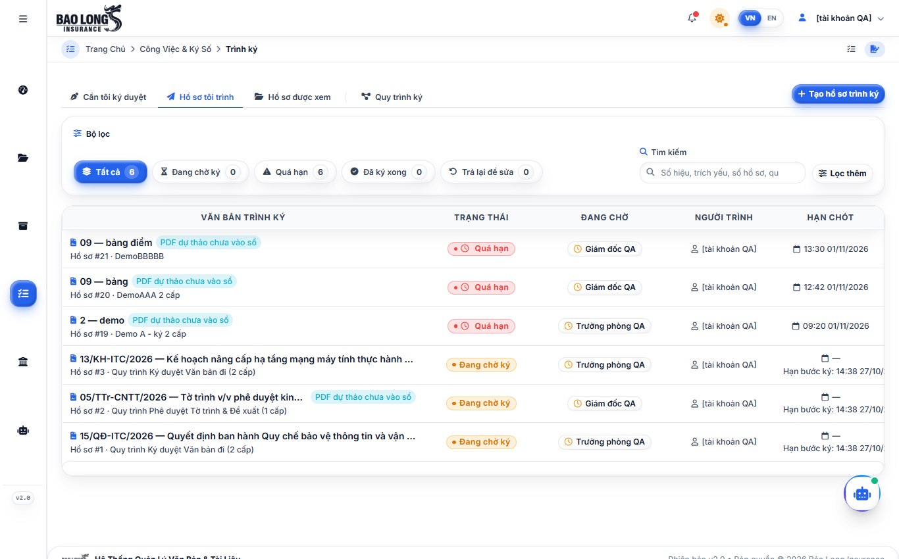 |
| EP-07 | #265 (phân định trễ hạn cấp ký), #447 | Chuyên viên là người trình của 6 hồ sơ chờ ký (3 quá hạn toàn trình, 3 chỉ trễ hạn cấp ký) | 2. Mở `/approvals/tat-ca` (tab Hồ sơ được xem). | Hiển thị hồ sơ mà tài khoản được xem. | Hiển thị cùng 6 hồ sơ, cùng bộ đếm; có thêm tab con "Hồ sơ trình ký" và "Tệp tài liệu". | Pass | — | Tài khoản không phải văn thư nên không đối chiếu được phạm vi "văn thư xem tất cả", xem EP-22. | 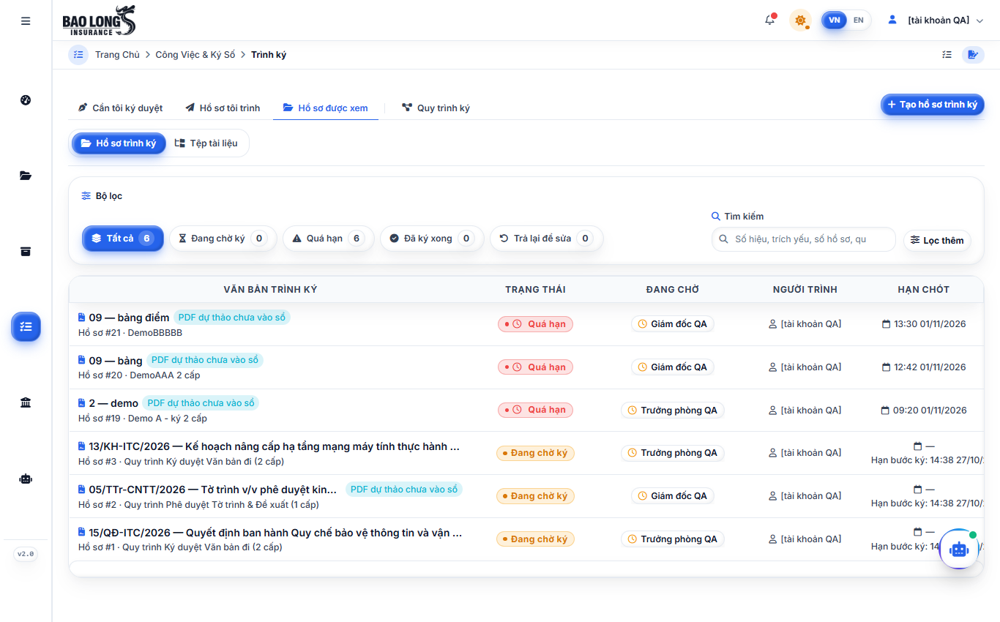 |
| EP-07 | #265 (phân định trễ hạn cấp ký), #447 | Chuyên viên là người trình của 6 hồ sơ chờ ký (3 quá hạn toàn trình, 3 chỉ trễ hạn cấp ký) | 3. Như bước 2, ngôn ngữ en. | Nhãn dịch đủ, định dạng ngày theo en. | Tiêu đề cột "DOCUMENT FOR SIGNING / STATUS / WAITING FOR / SUBMITTED BY / DEADLINE", nhãn "Overdue", "Unregistered draft PDF"; ngày dạng `01/11/2026, 13:30`. | Pass | — | Tên quy trình, chức danh và tên văn bản là dữ liệu danh mục nên giữ tiếng Việt. | 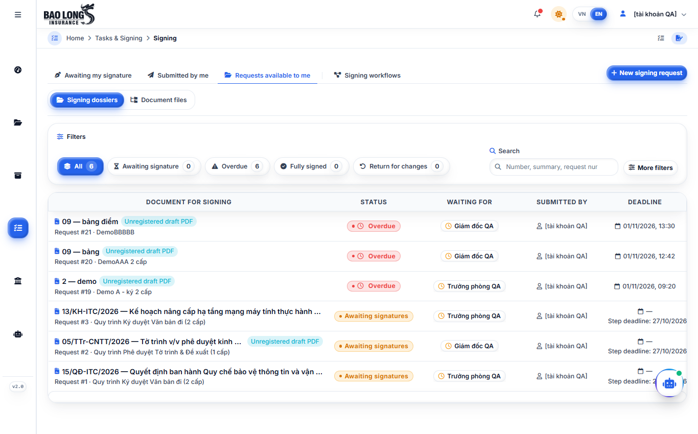 |
| EP-07 | #265 (phân định trễ hạn cấp ký), #447 | Chuyên viên là người trình của 6 hồ sơ chờ ký (3 quá hạn toàn trình, 3 chỉ trễ hạn cấp ký) | 4. Như bước 2, giao diện tối. | Bố cục và màu nhãn đọc được. | Bảng, chip lọc và nhãn trạng thái hiển thị đủ trên nền tối. | Pass | — | Nút trợ lý AI nổi che một phần ô "Hạn bước ký" ở dòng cuối khi chưa cuộn (thành phần dùng chung, ngoài module Trình ký). | 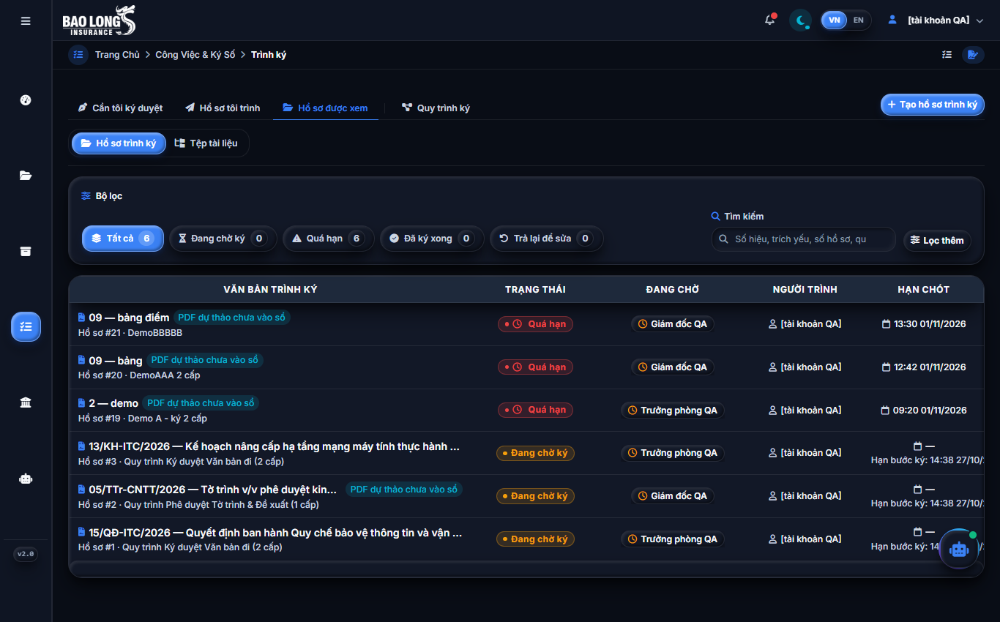 |
| EP-07 | #265 (phân định trễ hạn cấp ký), #447 | Chuyên viên là người trình của 6 hồ sơ chờ ký (3 quá hạn toàn trình, 3 chỉ trễ hạn cấp ký) | 5. Như bước 2, khung 390px. | Danh sách chuyển dạng thẻ, không vỡ bố cục. | Danh sách hiển thị dạng thẻ có đủ: tên văn bản, nhãn, người trình, hạn chót; chip lọc xếp nhiều dòng. | Pass | — | — | 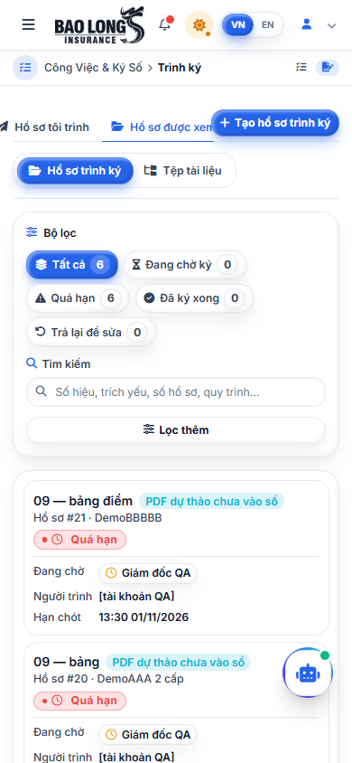 |
| EP-08 | #424, PR #462; #459; #265 | Chuyên viên là người trình | 1. Mở chi tiết hồ sơ quá hạn toàn trình, đã ký cấp 1, đang chờ cấp 2 (vi, sáng). | Chi tiết hiển thị nhãn quá hạn, tiến trình theo cấp, lịch sử, xem trước PDF. | Nhãn "Quá hạn"; "Thông tin hồ sơ"; "Tiến trình ký duyệt": cấp 1 "Đã xong" / "Đã ký", cấp 2 "Đang ký"; "Lịch sử": Tạo hồ sơ, Gửi trình ký, Mở cấp ký; PDF xem trước "Trang 1/3". Có nút "Hủy hồ sơ", không có nút thay người ký. | Pass | — | Nội dung PDF được làm mờ trong ảnh. Nút thay người ký chỉ áp dụng khi người ký bị khóa quyền, xem EP-20. | 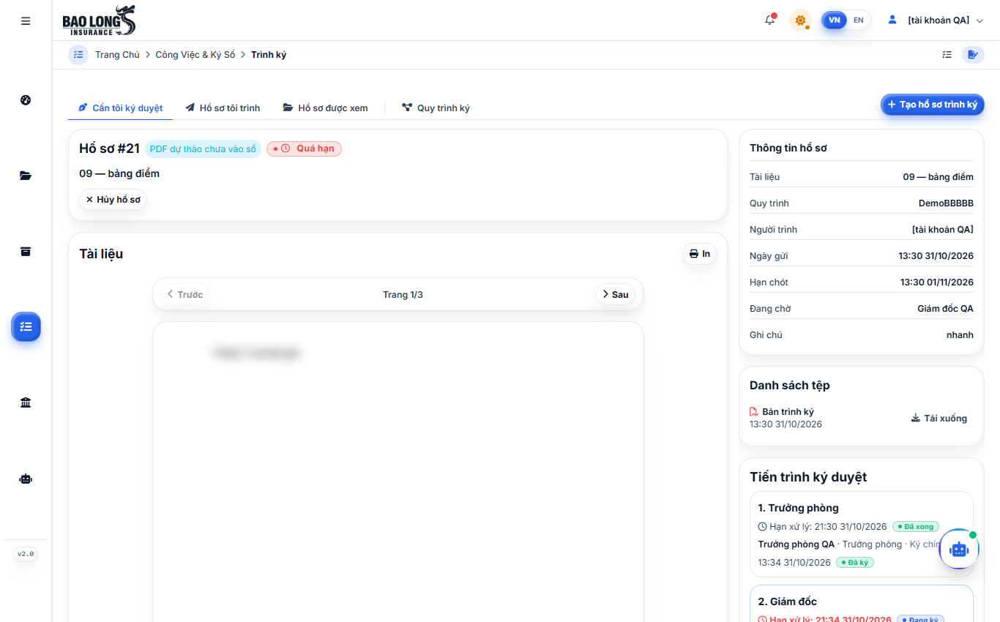 |
| EP-08 | #424, PR #462; #459; #265 | Chuyên viên là người trình | 2. Mở chi tiết hồ sơ cũ (gửi từ 26/10/2026, không hạn chót, hạn cấp 1 đã qua) (vi, sáng). | Hồ sơ cũ mở được, hiển thị cấp ký trễ hạn riêng. | Nhãn "Đang chờ ký"; "Hạn chót —"; cấp 1 "Hạn xử lý: 14:38 27/10/2026" chữ đỏ, "Đang ký"; PDF 5 trang xem trước được. | Pass | — | Nội dung PDF được làm mờ. | 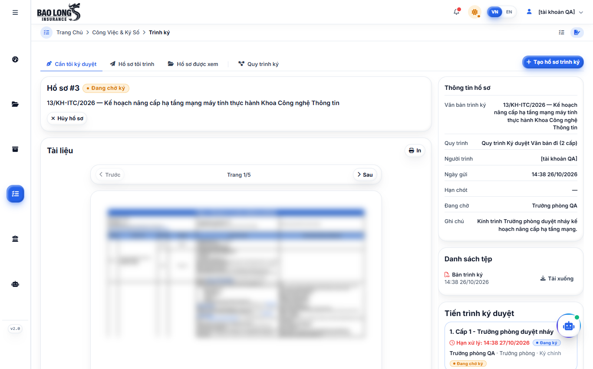 |
| EP-08 | #424, PR #462; #459; #265 | Chuyên viên là người trình | 3. Như bước 2, ngôn ngữ en. | Nhãn dịch đủ. | "Request #3", "Awaiting signatures", "Cancel request", "Document", "Dossier details", "Signing progress", "Due: 27/10/2026, 14:38". | Pass | — | Tên quy trình, chức danh và ghi chú giữ tiếng Việt (dữ liệu). | 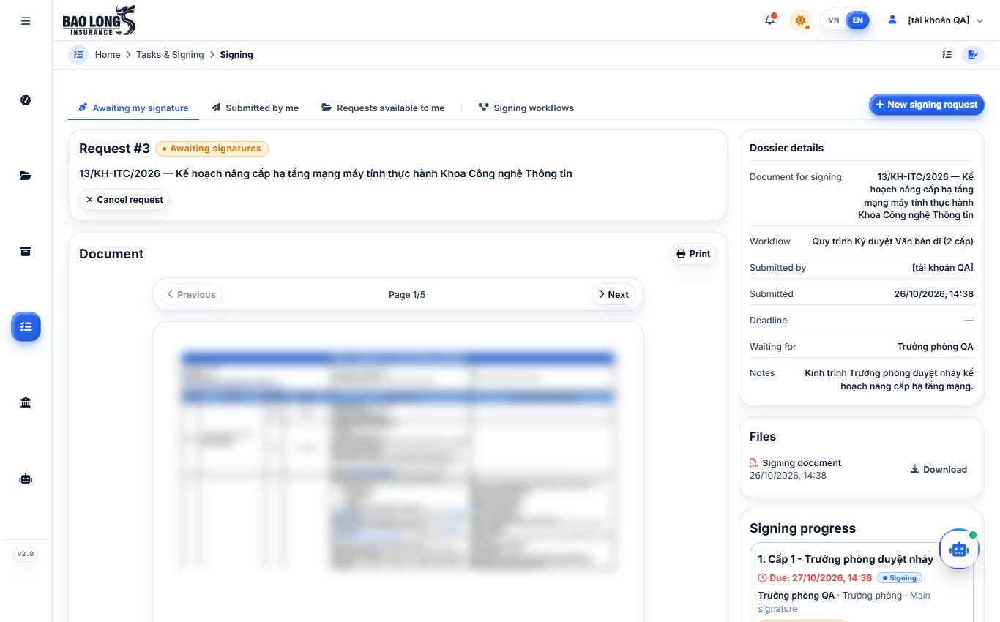 |
| EP-08 | #424, PR #462; #459; #265 | Chuyên viên là người trình | 4. Như bước 2, giao diện tối. | Bố cục và màu đọc được. | Các khối thông tin, tiến trình, nút hiển thị đủ trên nền tối; vùng xem trước PDF giữ nền sáng. | Pass | — | — | 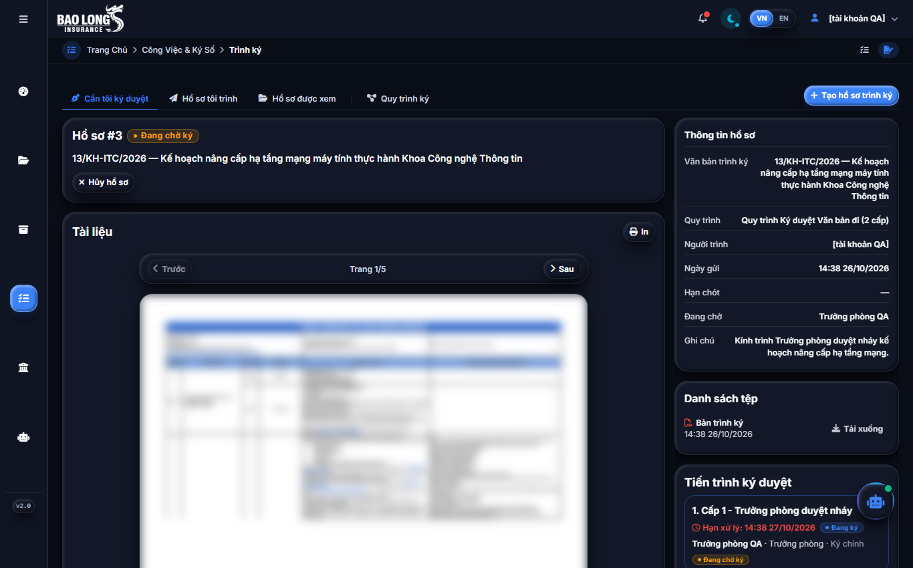 |
| EP-08 | #424, PR #462; #459; #265 | Chuyên viên là người trình | 5. Như bước 2, khung 390px. | Bố cục một cột, không vỡ. | Khối tiêu đề, "Tài liệu", "Thông tin hồ sơ" xếp một cột; PDF xem trước vừa khung. | Pass | — | Chỉ chụp phần đầu trang. | 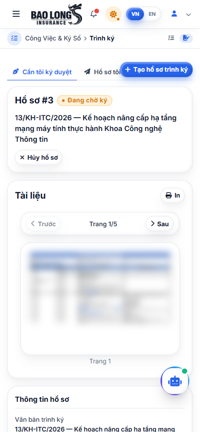 |
| EP-09 | Biên chung của lớp gọi API Trình ký; #492 | Chuyên viên; mạng lỗi giả lập bằng chặn request `/api/v1/signing/trinh-ky/**` trên trình duyệt (không phải sự cố máy chủ thật) | 1. Mở `/approvals/toi-gui` (vi, sáng) khi API bị chặn. | Hiển thị lỗi kết nối kèm nút "Thử lại", không treo ở trạng thái đang tải. | Chip lọc không có số; thông báo đỏ "Không thể kết nối đến máy chủ Backend. Vui lòng kiểm tra lại đường truyền!" và nút "Thử lại". | Pass | — | — | 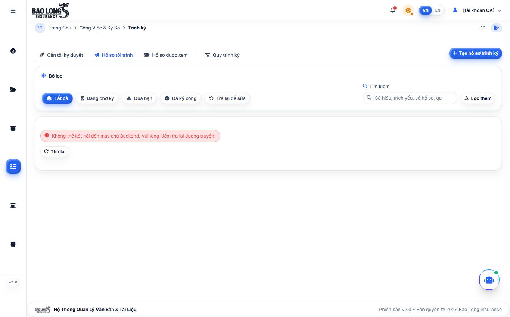 |
| EP-09 | Biên chung của lớp gọi API Trình ký; #492 | Chuyên viên; mạng lỗi giả lập bằng chặn request `/api/v1/signing/trinh-ky/**` trên trình duyệt (không phải sự cố máy chủ thật) | 2. Như bước 1, ngôn ngữ en. | Hiển thị lỗi kết nối kèm nút "Thử lại", không treo ở trạng thái đang tải. | "Cannot connect to the Backend server. Please check your network connection!" (3/3 lần chạy lại). | Pass | — | Lần chạy đầu tiên của bước này dừng ở "Loading…" và quá 45 giây chờ mạng nhàn rỗi; chạy lại 3 lần đều hiện lỗi đúng nên không tái hiện được. Ảnh là lần chạy lại. | 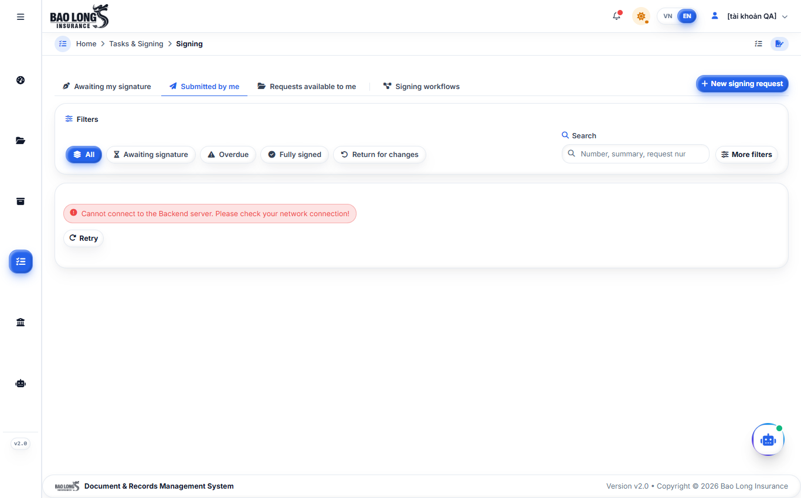 |
| EP-09 | Biên chung của lớp gọi API Trình ký; #492 | Chuyên viên; mạng lỗi giả lập bằng chặn request `/api/v1/signing/trinh-ky/**` trên trình duyệt (không phải sự cố máy chủ thật) | 3. Như bước 1, giao diện tối, khung 390px. | Hiển thị lỗi kết nối kèm nút "Thử lại", không treo ở trạng thái đang tải. | Thông báo lỗi và nút "Thử lại" hiển thị đủ trong khung 390px. | Pass | — | — | 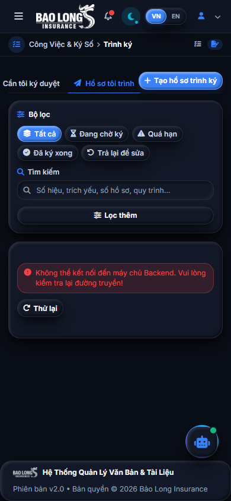 |
| EP-09 | Biên chung của lớp gọi API Trình ký; #492 | Chuyên viên; mạng lỗi giả lập bằng chặn request `/api/v1/signing/trinh-ky/**` trên trình duyệt (không phải sự cố máy chủ thật) | 4. Gỡ chặn, bấm "Thử lại". | Danh sách tải lại và hiển thị hồ sơ. | Nút "Thử lại" có mặt; sau khi bấm danh sách hiển thị lại 6 hồ sơ. | Pass | — | — | 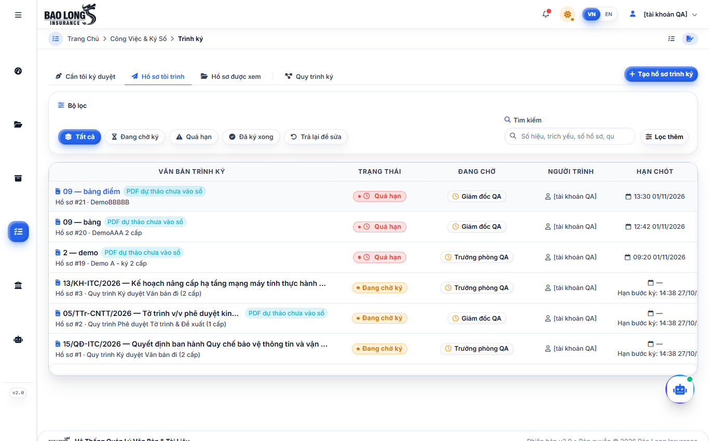 |
| EP-10 | #490, PR #492 (xử lý HTTP 429) | Chuyên viên; phản hồi 429 giả lập cho `GET /api/v1/signing/trinh-ky/` kèm `fields.thu_lai_sau` sau 60 giây (không phải giới hạn thật của máy chủ) | 1. Mở `/approvals/toi-gui` (vi, sáng). | Không dùng thông báo lỗi chung; nêu thời điểm được thử lại. | "Đã chạm giới hạn thao tác. Thử lại sau 09:52:16 4/11/26." kèm nút "Thử lại". | Pass | — | Định dạng thời điểm bản vi (`giờ:phút:giây d/M/yy`) khác bản en và khác định dạng `dd/MM/yyyy` ở các màn hình khác (lệch trình bày, không ảnh hưởng chức năng). Nút "Thử lại" không bị khóa đếm ngược; phạm vi #490 là hộp thoại PIN và đặt lại PIN, xem EP-25. | 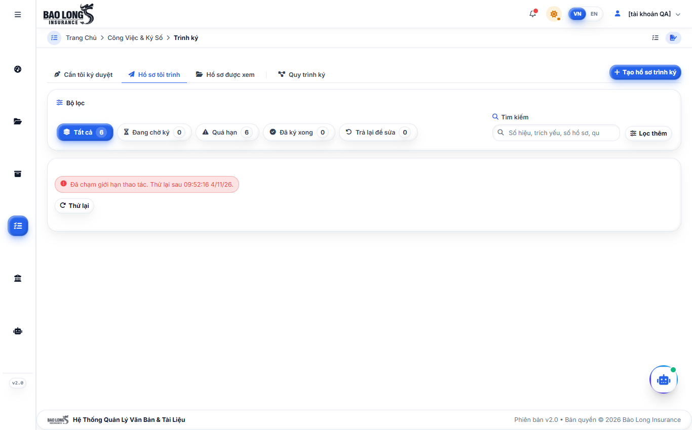 |
| EP-10 | #490, PR #492 (xử lý HTTP 429) | Chuyên viên; phản hồi 429 giả lập cho `GET /api/v1/signing/trinh-ky/` kèm `fields.thu_lai_sau` sau 60 giây (không phải giới hạn thật của máy chủ) | 2. Như bước 1, ngôn ngữ en. | Không dùng thông báo lỗi chung; nêu thời điểm được thử lại. | "Action limit reached. Try again after 04/11/2026, 09:52:22." kèm nút "Retry". | Pass | — | — | 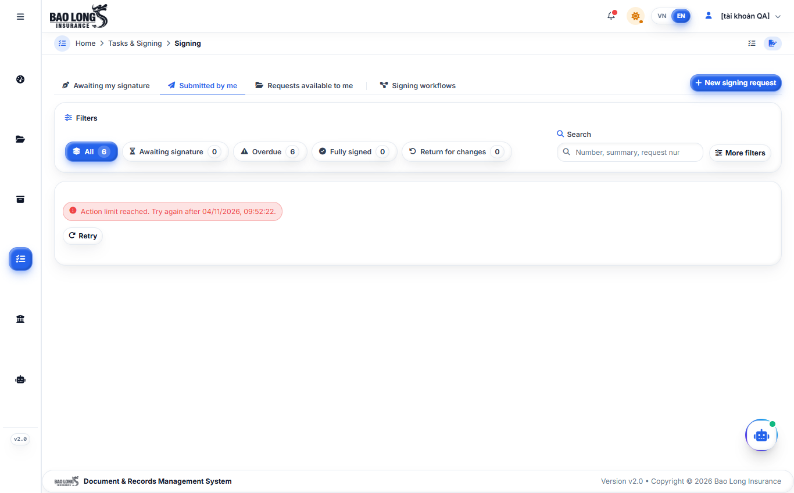 |
| EP-10 | #490, PR #492 (xử lý HTTP 429) | Chuyên viên; phản hồi 429 giả lập cho `GET /api/v1/signing/trinh-ky/` kèm `fields.thu_lai_sau` sau 60 giây (không phải giới hạn thật của máy chủ) | 3. Như bước 1, giao diện tối, 390px. | Không dùng thông báo lỗi chung; nêu thời điểm được thử lại. | Thông báo xuống dòng trong khung 390px, nút "Thử lại" hiển thị đủ. | Pass | — | — | 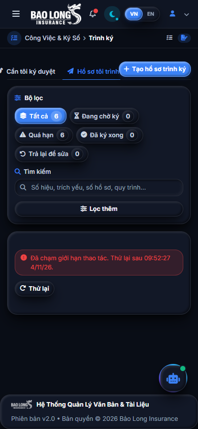 |
| EP-11 | #454, PR #455 (chặn chọn người ký bị khóa), #447 | Chuyên viên tạo hồ sơ; cần quy trình có ứng viên thiếu quyền ký | 1. Mở `/approvals/tao-moi` (vi, sáng): chọn văn bản, quy trình, lưu nháp, sang bước chọn người ký và gửi. | Người ký thiếu quyền hoặc bị khóa không gửi được, hiển thị "Người này tạm thời không có quyền ký". | Chỉ kiểm được bước 1: form có "Văn bản trình ký" (chọn văn bản đi hoặc tải PDF dự thảo), "Quy trình ký", "Hạn chót", "Ghi chú", nút "Lưu nháp và xem trước". Bước chọn người ký chưa mở vì cần lưu nháp (ghi dữ liệu lên staging) và cần ứng viên bị khóa quyền. | Blocked | Chưa đánh giá | Cần tài khoản quản trị để khóa quyền ký một tài khoản thử, rồi tạo hồ sơ với quy trình chọn theo chức vụ. | 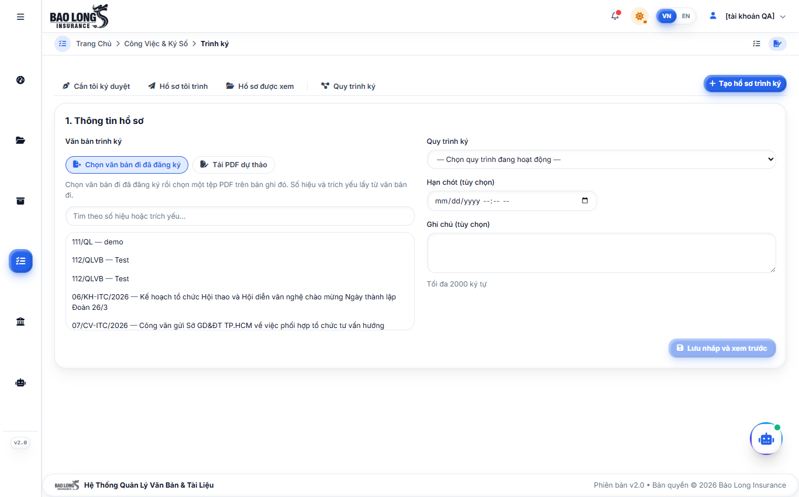 |
| EP-11 | #454, PR #455 (chặn chọn người ký bị khóa), #447 | như bước 1 | 2. Như bước 1, ngôn ngữ en. | Như bước 1. | Form hiển thị đủ nhãn en: "1. Request details", "Document for signing", "Select a registered outgoing document", "Upload a draft PDF". | Blocked | Chưa đánh giá | Phần giao diện đọc được; phần chặn gửi chưa kiểm. | 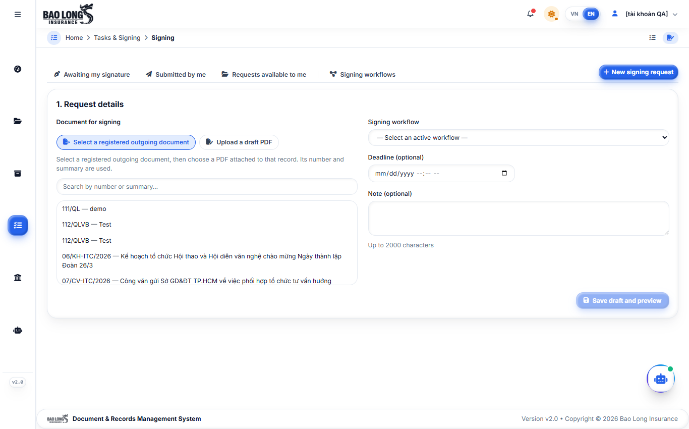 |
| EP-11 | #454, PR #455 (chặn chọn người ký bị khóa), #447 | như bước 1 | 3. Như bước 1, khung 390px. | Như bước 1. | Form hiển thị một cột, danh sách văn bản cuộn trong khung, ô "Hạn chót" hiển thị theo định dạng của trình duyệt kiểm thử (`mm/dd/yyyy`). | Blocked | Chưa đánh giá | Định dạng ô ngày giờ phụ thuộc ngôn ngữ trình duyệt, không phải chuỗi của ứng dụng. | 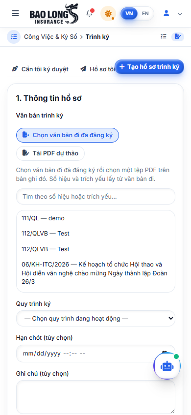 |
| EP-12 | #449, PR #450; #456, PR #457 | Quản trị | Tab `/approvals/quan-ly-khoa`: khóa tạm thời quyền ký của một tài khoản, chọn thời hạn 1 giờ, 8 giờ, 24 giờ hoặc đến khi bật lại, nhập lý do. | Khóa có hiệu lực theo thời hạn; thao tác ghi nhật ký kèm lý do. | Không thực hiện được: tài khoản QA hiện có chỉ giữ vai trò chuyên viên, không phải quản trị và chưa có quyền ký. Ảnh là màn hình hiện hành thể hiện rào chắn. | Blocked | Chưa đánh giá | Cần tài khoản quản trị và một tài khoản thử làm đối tượng bị khóa. | 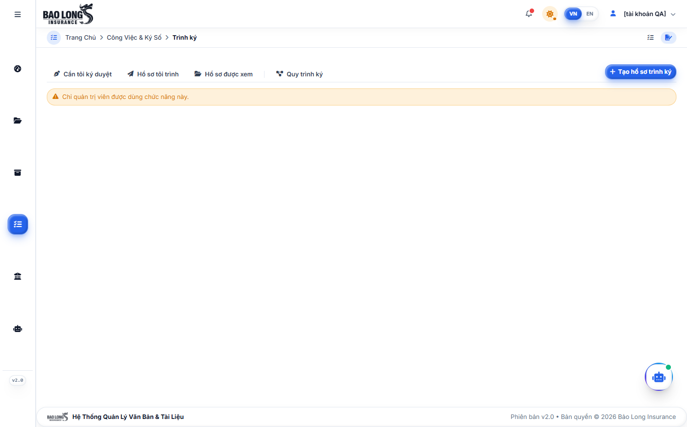 |
| EP-13 | #451, PR #452; #456, PR #457 | Quản trị | Tab `/approvals/quan-ly-khoa`: bật lại quyền ký, kiểm tra bắt buộc nhập lý do. | Không bật lại được khi thiếu lý do; bật lại thành công khi có lý do. | Không thực hiện được: tài khoản QA hiện có chỉ giữ vai trò chuyên viên, không phải quản trị và chưa có quyền ký. Ảnh là màn hình hiện hành thể hiện rào chắn. | Blocked | Chưa đánh giá | Cần tài khoản quản trị và tài khoản đang bị khóa (EP-12). |  |
| EP-14 | #451, PR #452 | Quản trị | Tab `/approvals/quan-ly-khoa`: thu hồi khóa ký khẩn cấp của tài khoản có khóa hoạt động. | Khóa chuyển sang đã thu hồi; ký sau đó bị từ chối. | Không thực hiện được: tài khoản QA hiện có chỉ giữ vai trò chuyên viên, không phải quản trị và chưa có quyền ký. Ảnh là màn hình hiện hành thể hiện rào chắn. | Blocked | Chưa đánh giá | Cần quản trị và tài khoản có khóa hoạt động (khóa thử nghiệm tạo bằng PIN tạm). |  |
| EP-15 | #478, PR #479 | Quản trị | Tab `/approvals/quan-ly-khoa`: đặt lại PIN thay mặt cho tài khoản khác, kiểm tra cấp khóa mới. | PIN được đặt lại cùng lúc với cấp khóa mới; khóa cũ vô hiệu. | Không thực hiện được: tài khoản QA hiện có chỉ giữ vai trò chuyên viên, không phải quản trị và chưa có quyền ký. Ảnh là màn hình hiện hành thể hiện rào chắn. | Blocked | Chưa đánh giá | Cần quản trị, tài khoản có khóa và PIN tạm; email xác nhận cần `EMAIL_HOST` (chưa cấu hình trên staging). |  |
| EP-16 | #451, PR #452; #467, PR #476 | Quản trị | Tab `/approvals/quan-ly-khoa`: xem nhật ký thao tác quản trị (khóa, bật lại, thu hồi, đặt lại PIN) và thông báo gửi tới tài khoản bị tác động. | Mỗi thao tác có một dòng nhật ký kèm lý do và người thực hiện. | Không thực hiện được: tài khoản QA hiện có chỉ giữ vai trò chuyên viên, không phải quản trị và chưa có quyền ký. Ảnh là màn hình hiện hành thể hiện rào chắn. | Blocked | Chưa đánh giá | Cần quản trị và các thao tác từ EP-12 đến EP-15. |  |
| EP-17 | #454, PR #455; #467, PR #476 | Người ký bị khóa quyền | Đăng nhập bằng tài khoản người ký đang bị khóa quyền; mở `/approvals` và thử ký. | Hiển thị thông báo quyền bị khóa bởi quản trị viên kèm hướng dẫn liên hệ; thao tác ký bị chặn. | Không thực hiện được: tài khoản QA hiện có chỉ giữ vai trò chuyên viên, không phải quản trị và chưa có quyền ký. Ảnh là màn hình hiện hành thể hiện rào chắn. | Blocked | Chưa đánh giá | Cần người ký có quyền ký và đối tượng bị khóa (EP-12). | 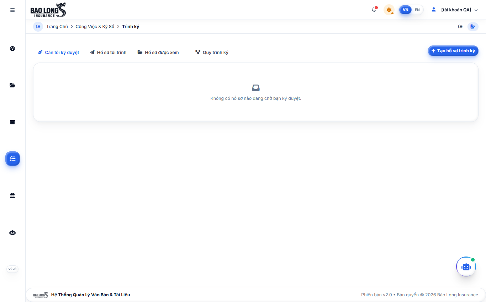 |
| EP-18 | #487, PR #493 | Người ký có quyền ký, có khóa | Mở hộp thoại ký, bấm "Quên PIN", gửi mã, đặt lại PIN và tạo khóa mới. | Luồng đặt lại PIN hoàn tất, khóa mới ký được hồ sơ. | Không thực hiện được: tài khoản QA hiện có chỉ giữ vai trò chuyên viên, không phải quản trị và chưa có quyền ký. Ảnh là màn hình hiện hành thể hiện rào chắn. | Blocked | Chưa đánh giá | Cần người ký, khóa thử nghiệm, PIN tạm, hồ sơ chờ ký và email nhận mã (cần `EMAIL_HOST`). | 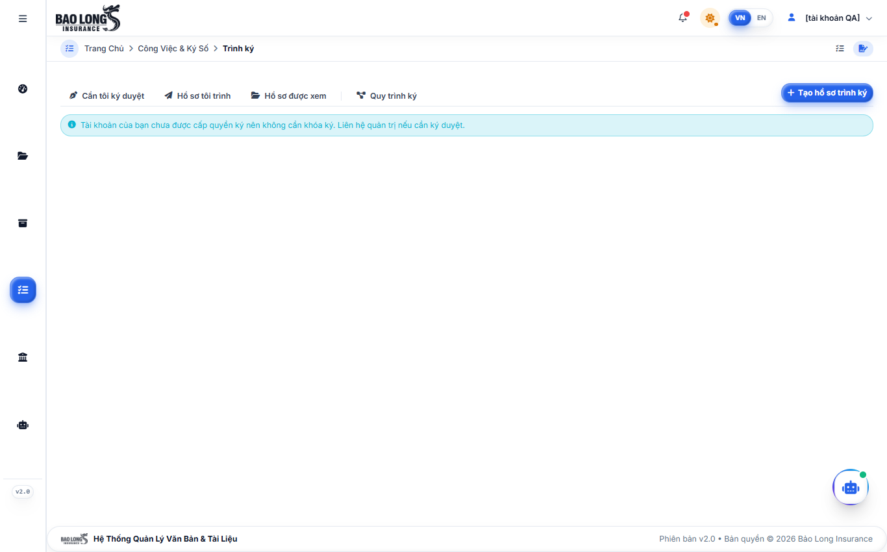 |
| EP-19 | #488, PR #494 | Người ký có khóa quá hạn | Dùng khóa đã quá hạn sử dụng để ký hoặc mở cấu hình khóa. | Khóa chuyển sang `HET_HAN`, ký bị từ chối, giao diện hướng dẫn tạo khóa mới. | Không thực hiện được: tài khoản QA hiện có chỉ giữ vai trò chuyên viên, không phải quản trị và chưa có quyền ký. Ảnh là màn hình hiện hành thể hiện rào chắn. | Blocked | Chưa đánh giá | Cần khóa có thời điểm hết hạn đã qua; không đổi được thời hạn khóa trên staging bằng giao diện. |  |
| EP-20 | #499, PR #502; #500, PR #504 | Người trình hoặc quản trị; hồ sơ chờ người ký bị khóa | Mở chi tiết hồ sơ chờ người ký đang bị khóa quyền, mở hộp thoại thay người ký, chọn người thay. | Có nút thay người ký, hồ sơ chuyển cho người mới, nhật ký ghi nhận. | Không thực hiện được: tài khoản QA hiện có chỉ giữ vai trò chuyên viên, không phải quản trị và chưa có quyền ký. Ảnh là màn hình hiện hành thể hiện rào chắn. | Blocked | Chưa đánh giá | Cần người ký bị khóa (EP-12) trên hồ sơ đang chờ. Hiện chi tiết hồ sơ không có nút thay người ký vì người ký chưa bị khóa. | 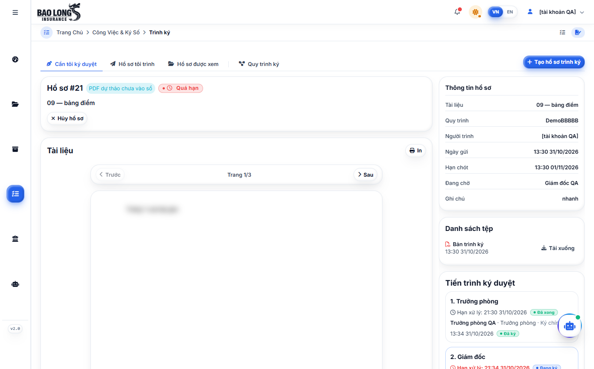 |
| EP-21 | #424, PR #462; #426 | Người ký có ảnh chữ ký | Ký hồ sơ có khung ký đã đặt vị trí; kiểm tra ảnh chữ ký nằm trong khung và không đè lên khung khác (nhiều người ký, nhiều trang). | Ảnh chữ ký nằm trong khung của từng người ký; các khung không chồng lên nhau. | Không thực hiện được: tài khoản QA hiện có chỉ giữ vai trò chuyên viên, không phải quản trị và chưa có quyền ký. Ảnh là màn hình hiện hành thể hiện rào chắn. | Blocked | Chưa đánh giá | Cần người ký, khóa thử nghiệm và hồ sơ có khung ký; màn hình xem hồ sơ chưa ký không hiển thị khung ký. |  |
| EP-22 | #447 | Văn thư | Đăng nhập tài khoản văn thư, mở `/approvals/tat-ca`. | Văn thư xem được tất cả hồ sơ trình ký theo phạm vi quy định. | Không thực hiện được: tài khoản QA hiện có chỉ giữ vai trò chuyên viên, không phải quản trị và chưa có quyền ký. Ảnh là màn hình hiện hành thể hiện rào chắn. | Blocked | Chưa đánh giá | Cần tài khoản văn thư. Với chuyên viên, tab này hiển thị đúng 6 hồ sơ do chính tài khoản trình (EP-07), chưa đủ để đối chiếu phạm vi văn thư. | 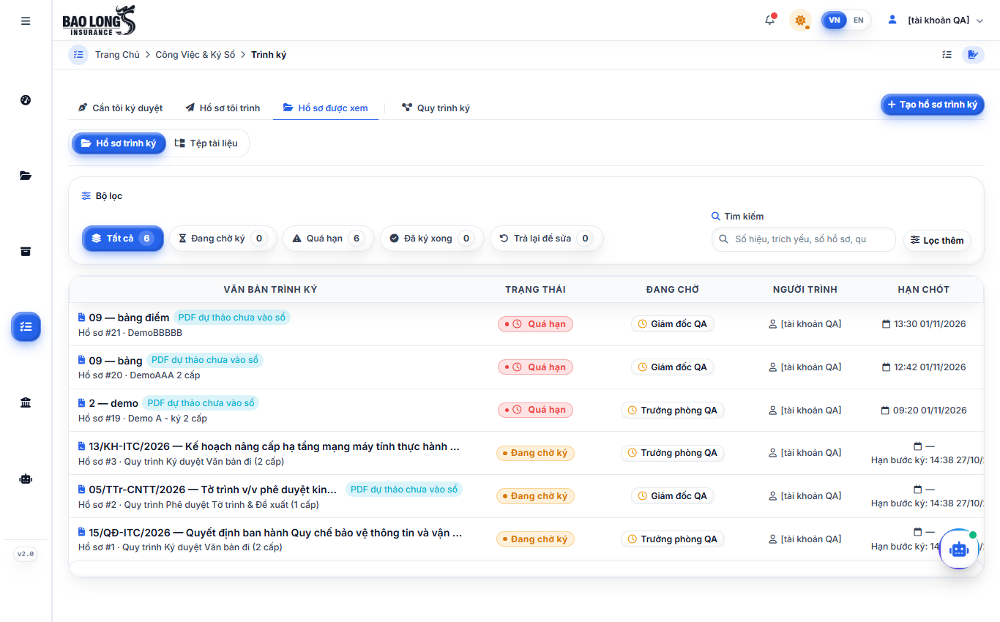 |
| EP-23 | #507, PR #508 (challenge một lần, lưu PostgreSQL) | Người ký có khóa | Lấy challenge của khóa, dùng một lần để chứng minh sở hữu, dùng lại challenge đã dùng. | Lần dùng lại bị từ chối. | Chỉ kiểm được lấy challenge của khóa không tồn tại: `GET /api/v1/signing/khoa/0/thach-thuc/` trả 404 `khong_tim_thay`. Lần dùng một lần chưa kiểm vì chưa có khóa hợp lệ. | Blocked | Chưa đánh giá | Cần người ký có khóa thử nghiệm để lấy và dùng challenge. | 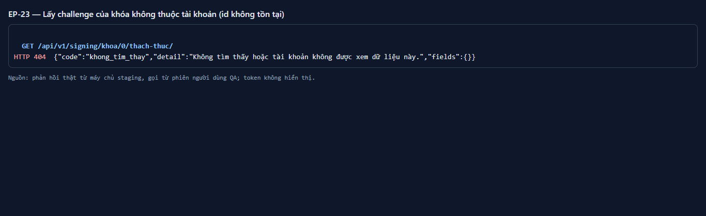 |
| EP-24 | #466; PR #470 | Người ký có quyền ký | Tạo khóa thử nghiệm bằng PIN tạm tại "Cấu hình khóa ký" và kiểm tra chứng minh sở hữu khóa bằng challenge ngẫu nhiên. | Khóa được kích hoạt sau khi chứng minh sở hữu bằng challenge ngẫu nhiên có hạn dùng. | Không thực hiện được: tài khoản QA hiện có chỉ giữ vai trò chuyên viên, không phải quản trị và chưa có quyền ký. Ảnh là màn hình hiện hành thể hiện rào chắn. | Blocked | Chưa đánh giá | Cần người ký có quyền ký; tài khoản hiện tại thấy thông báo chưa có quyền ký (EP-04). | 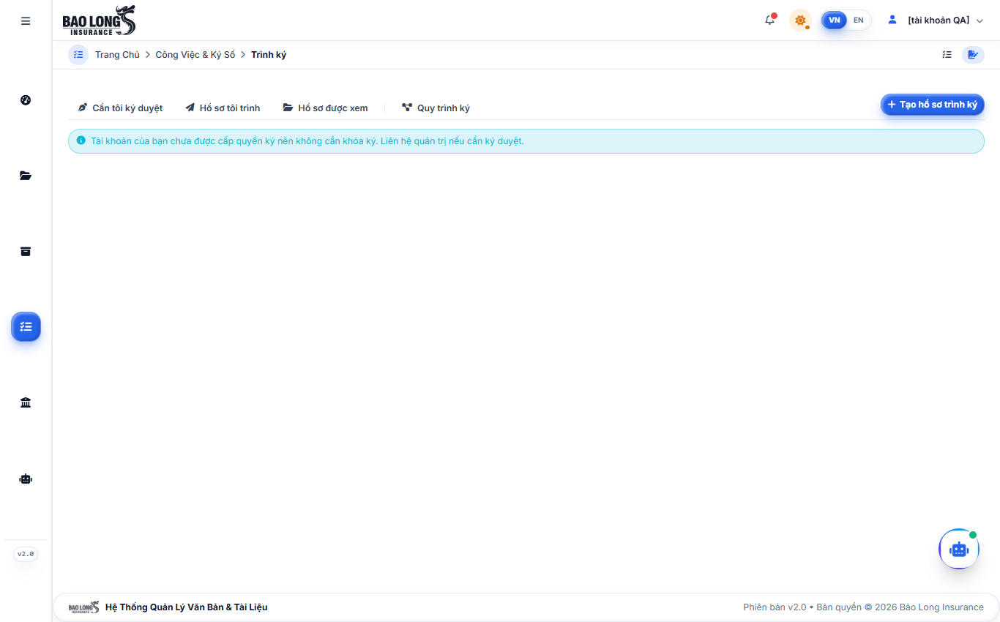 |
| EP-25 | #468, PR #477; #478, PR #479; #490, PR #492 | Người ký có khóa | Nhập sai PIN đến giới hạn mỗi ngày và gửi mã đặt lại PIN liên tiếp để nhận phản hồi 429 thật; kiểm tra thông báo và đếm ngược trong hộp thoại. | Hộp thoại hiển thị thông báo giới hạn kèm đếm ngược theo `thu_lai_sau`. | Không thực hiện được: tài khoản QA hiện có chỉ giữ vai trò chuyên viên, không phải quản trị và chưa có quyền ký. Ảnh là màn hình hiện hành thể hiện rào chắn. | Blocked | Chưa đánh giá | Cần người ký có khóa thử nghiệm. Nhập sai PIN 15 lần khóa PIN của tài khoản đó đến hết ngày nên chỉ thực hiện với tài khoản thử riêng. Mới kiểm trên danh sách bằng 429 giả lập (EP-10). |  |
| EP-26 | #509, PR #511; #510, PR #512 | Người ký | MFA email khi ký: nhận mã, nhập 6 ô, gửi lại, 429. | Theo thiết kế MFA email. | Không thực hiện được: tài khoản QA hiện có chỉ giữ vai trò chuyên viên, không phải quản trị và chưa có quyền ký. Ảnh là màn hình hiện hành thể hiện rào chắn. | Blocked | Chưa đánh giá | Ngoài phạm vi đợt này: cờ tính năng tắt và staging chưa có `EMAIL_HOST`. |  |

---

## 3. Điều kiện để hoàn tất các ca Blocked

| Vai trò cần có | Ca mở khóa |
|---|---|
| Quản trị | EP-12, EP-13, EP-14, EP-15, EP-16, EP-20 |
| Người ký có quyền ký (khóa thử nghiệm, PIN tạm) | EP-17, EP-18, EP-19, EP-21, EP-23, EP-24, EP-25 |
| Văn thư | EP-22 |
| Người tạo hồ sơ cùng quy trình có ứng viên bị khóa | EP-11 |
| `EMAIL_HOST` và cờ MFA bật trên staging | EP-15 (email), EP-18, EP-26 |
