# QA staging các hạng mục epic #447 (Trình ký)

> Phạm vi: các hạng mục đã hợp nhất vào `staging` thuộc epic #447. Kết quả kiểm thử thủ công có giao diện trên môi trường staging.
> Ngày kiểm thử: 2026-11-04. Issue theo dõi: #518. Quy ước mã và cột theo [`qa-test-cases-80.md`](qa-test-cases-80.md) và [`FLOW_TEST_EVIDENCE.md`](FLOW_TEST_EVIDENCE.md); mã test case dùng tiền tố `EP-` (không trùng QT, KP, HS, KY, TS, KQ, DT, UI, DB, BM, STG, QA).

---

## 0. Môi trường và phương pháp

| Mục | Nội dung |
|---|---|
| Môi trường | Staging của hệ thống (cổng 8088), trình duyệt Chrome điều khiển bằng Playwright (`playwright-core`, kênh `chrome`) |
| Tài khoản | Bốn tài khoản QA, đăng nhập thủ công, phiên lưu ngoài repo: chuyên viên (không quyền ký), quản trị, người ký (lãnh đạo) và văn thư |
| Khung hiển thị | 1366×850 (máy tính) và 390×844 (điện thoại); ngôn ngữ `vi`/`en`; giao diện sáng/tối |
| Che thông tin | Tên đăng nhập, email, token, mã khóa, họ tên người dùng không thuộc tài khoản QA được thay thế trước khi chụp; vùng xem trước PDF của hồ sơ có sẵn làm mờ. Tên hiển thị của tài khoản QA (mang tên vai trò) có thể còn hiện |
| Khóa và PIN | Khóa ký thử nghiệm tạo mới qua giao diện bằng PIN tạm; không dùng khóa hay PIN thật. Tệp khóa và PIN không đưa vào repo |
| Dữ liệu tạo ra | Ba hồ sơ thử bằng PDF tự sinh (hai đã hủy, một hoàn tất duyệt nội bộ), khóa ký thử nghiệm, ảnh chữ ký giả lập. Khóa và ảnh đã được dọn sau khi kiểm; các lệnh khóa quyền ký đã bật lại |
| Giả lập | EP-09 chặn request API và EP-10 trả 429 do trình duyệt tạo. Các phản hồi 429 ở EP-25 là phản hồi thật của máy chủ |
| Đường đối chứng | EP-21 bước 8 tải ảnh chữ ký bằng yêu cầu multipart gửi trực tiếp (giao diện bị lỗi, xem #BUG1) để kiểm tiếp luồng ký |
| Phiên bản | `origin/staging` tại thời điểm lập tài liệu: `61ab83ef`. Chưa đối chiếu được phiên bản đã triển khai |
| Chưa kiểm | MFA email (cờ tắt, staging chưa có `EMAIL_HOST`), nhập mã Quên PIN (cần email), `HET_HAN` (không đổi được hạn khóa) |

---

## 1. Tổng hợp

| Chỉ số | Giá trị |
|---|---|
| Tổng test case | 26 |
| Test case Pass hoàn toàn | 21 |
| Test case có bước Fail | 2 (EP-16, EP-21) |
| Test case có bước Blocked | 3 (EP-18, EP-19, EP-26) |
| Bước Pass / Fail / Blocked | 122 / 3 / 3 |
| Lỗi phát hiện | 2: #BUG1 (tải ảnh chữ ký cá nhân luôn bị từ chối 400), #BUG2 (nhật ký hoạt động ký số hiển thị sai hành động và thời điểm) |

Quan sát không tính là lỗi (ghi ở cột Ghi chú): chip "Quá hạn" gộp hồ sơ chỉ trễ hạn cấp ký trong khi nhãn dòng vẫn "Đang chờ ký" (đúng thiết kế #265); định dạng thời điểm trong thông báo 429 khác nhau giữa `vi` và `en`; cột "Hạn chót" bị cắt mép ở 1366px; thanh tab chỉ hiển thị khoảng 1,5 tab và bảng quản lý khóa phải cuộn ngang ở 390px; thông báo chặn gửi không nêu tên người ký bị khóa; nút ký không bị vô hiệu khi người ký đang bị khóa.

---

## 2. Test case

| ID | Hạng mục / Nguồn (PR, issue) | Tiền điều kiện (vai trò) | Bước | Expectation | Actual | Kết quả (Pass/Fail/Blocked) | Mức nghiêm trọng | Ghi chú | Ảnh |
|---|---|---|---|---|---|---|---|---|---|
| EP-01 | #456, PR #457 (tab quản lý khóa ký) | Chuyên viên, không phải quản trị, chưa có quyền ký | 1. Mở `/approvals` (vi, sáng, 1366px). | Thanh tab Trình ký không có mục "Quản lý khóa ký" với tài khoản không phải quản trị. | Thanh tab có 4 mục: Cần tôi ký duyệt, Hồ sơ tôi trình, Hồ sơ được xem, Quy trình ký. Liên kết `/approvals*` trong DOM: `/approvals`, `/approvals/toi-gui`, `/approvals/tat-ca`, `/approvals/quy-trinh`; không có liên kết `quan-ly-khoa`. | Pass | — | Tên hiển thị tài khoản đã được che trong ảnh. |  |
| EP-01 | #456, PR #457 (tab quản lý khóa ký) | Chuyên viên, không phải quản trị, chưa có quyền ký | 2. Như bước 1, ngôn ngữ en. | Như bước 1. | 4 mục tab: Awaiting my signature, Submitted by me, Requests available to me, Signing workflows. Danh sách liên kết DOM giống bước 1. | Pass | — | — |  |
| EP-02 | #456, PR #457; #451, PR #452 (API quản trị) | Chuyên viên, không phải quản trị, chưa có quyền ký | 1. Vào thẳng `/approvals/quan-ly-khoa` (vi, sáng, 1366px). | Hiển thị thông báo không có quyền, không tải danh sách tài khoản; API quản trị trả 403. | Tiêu đề "Quản lý khóa ký"; nội dung chỉ có cảnh báo "Chỉ quản trị viên được dùng chức năng này."; không có bảng tài khoản. `GET /api/v1/signing/quan-tri/nguoi-dung/` trả 403. | Pass | — | — |  |
| EP-02 | #456, PR #457; #451, PR #452 (API quản trị) | Chuyên viên, không phải quản trị, chưa có quyền ký | 2. Như bước 1, ngôn ngữ en. | Hiển thị thông báo không có quyền, không tải danh sách tài khoản; API quản trị trả 403. | Tiêu đề "Key management"; cảnh báo "Only administrators can use this function."; `GET .../quan-tri/nguoi-dung/` trả 403. | Pass | — | — |  |
| EP-02 | #456, PR #457; #451, PR #452 (API quản trị) | Chuyên viên, không phải quản trị, chưa có quyền ký | 3. Như bước 1, giao diện tối. | Hiển thị thông báo không có quyền, không tải danh sách tài khoản; API quản trị trả 403. | Cảnh báo "Chỉ quản trị viên được dùng chức năng này." hiển thị; `GET .../quan-tri/nguoi-dung/` trả 403. | Pass | — | — |  |
| EP-02 | #456, PR #457; #451, PR #452 (API quản trị) | Chuyên viên, không phải quản trị, chưa có quyền ký | 4. Như bước 1, khung 390px. | Hiển thị thông báo không có quyền, không tải danh sách tài khoản; API quản trị trả 403. | Cảnh báo hiển thị đủ chữ trong khung 390px; thanh tab cuộn ngang được (khoảng 1,5 tab hiển thị cùng lúc, nút "Tạo hồ sơ trình ký" nằm cạnh thanh tab). `GET .../quan-tri/nguoi-dung/` trả 403. | Pass | — | Kiểm bằng DOM: tab "Quy trình ký" truy cập được sau khi cuộn thanh tab; không có cuộn ngang ở cấp trang. |  |
| EP-03 | #451, PR #452 (API quản trị khóa và quyền ký) | Chuyên viên, không phải quản trị, chưa có quyền ký; gọi API bằng token của chính phiên đó | 1. `GET /api/v1/signing/quan-tri/nguoi-dung/?q=`. | 403, thông điệp không có quyền. | HTTP 403, `{"code":"khong_co_quyen","detail":"Chỉ quản trị viên được dùng chức năng này.","fields":{}}`. | Pass | — | Ảnh là thẻ trích phản hồi thật; token không hiển thị. |  |
| EP-03 | #451, PR #452 (API quản trị khóa và quyền ký) | Chuyên viên, không phải quản trị, chưa có quyền ký; gọi API bằng token của chính phiên đó | 2. `POST .../quan-tri/nguoi-dung/0/khoa-quyen-ky/` với thân `{}` (id không tồn tại). | 403 trước khi kiểm tra id (không phải 404), không có bản ghi nào thay đổi. | HTTP 403, cùng mã `khong_co_quyen`. | Pass | — | Dùng id không tồn tại để loại trừ tác dụng phụ; kết quả 403 cho thấy kiểm quyền chạy trước tra cứu đối tượng. |  |
| EP-03 | #451, PR #452 (API quản trị khóa và quyền ký) | Chuyên viên, không phải quản trị, chưa có quyền ký; gọi API bằng token của chính phiên đó | 3. `POST .../quan-tri/nguoi-dung/0/bat-lai-quyen-ky/` với thân `{}`. | Như bước 2. | HTTP 403, cùng mã `khong_co_quyen`. | Pass | — | Như bước 2. |  |
| EP-03 | #451, PR #452 (API quản trị khóa và quyền ký) | Chuyên viên, không phải quản trị, chưa có quyền ký; gọi API bằng token của chính phiên đó | 4. `POST .../quan-tri/nguoi-dung/0/thu-hoi-khoa/` với thân `{}`. | Như bước 2. | HTTP 403, cùng mã `khong_co_quyen`. | Pass | — | Như bước 2. |  |
| EP-04 | #454, PR #455; #466 (khóa ký và trạng thái tài khoản) | Chuyên viên, không phải quản trị, chưa có quyền ký | 1. Mở `/approvals/khoa` (vi, sáng, 1366px). | Hiển thị thông báo chưa có quyền ký, không có form tạo khóa. | Tiêu đề "Cấu hình khóa ký"; chỉ có thông báo "Tài khoản của bạn chưa được cấp quyền ký nên không cần khóa ký. Liên hệ quản trị nếu cần ký duyệt."; không có form tạo khóa. `GET /api/v1/signing/khoa/` trả 200. | Pass | — | — |  |
| EP-04 | #454, PR #455; #466 (khóa ký và trạng thái tài khoản) | Chuyên viên, không phải quản trị, chưa có quyền ký | 2. Như bước 1, ngôn ngữ en. | Hiển thị thông báo chưa có quyền ký, không có form tạo khóa. | "Signing key settings"; "Your account has no signing permission, so it does not need a signing key. Contact the administrator if you must sign." | Pass | — | — |  |
| EP-04 | #454, PR #455; #466 (khóa ký và trạng thái tài khoản) | Chuyên viên, không phải quản trị, chưa có quyền ký | 3. Như bước 1, giao diện tối. | Hiển thị thông báo chưa có quyền ký, không có form tạo khóa. | Thông báo thông tin hiển thị trên nền tối, chữ đọc được; không có form tạo khóa. | Pass | — | — |  |
| EP-04 | #454, PR #455; #466 (khóa ký và trạng thái tài khoản) | Chuyên viên, không phải quản trị, chưa có quyền ký | 4. Như bước 1, khung 390px. | Hiển thị thông báo chưa có quyền ký, không có form tạo khóa. | Thông báo hiển thị đủ chữ trong khung 390px. | Pass | — | — |  |
| EP-05 | #468, PR #477 (PIN và khóa); #507, PR #508 (challenge); #424 (ảnh chữ ký) | Chuyên viên, không phải quản trị, chưa có quyền ký; gọi API bằng token của chính phiên đó | 1. `GET /api/v1/signing/khoa/`. | Trả danh sách rỗng, không lộ khóa của tài khoản khác. | HTTP 200, thân `[]`. | Pass | — | — |  |
| EP-05 | #468, PR #477 (PIN và khóa); #507, PR #508 (challenge); #424 (ảnh chữ ký) | Chuyên viên, không phải quản trị, chưa có quyền ký; gọi API bằng token của chính phiên đó | 2. `GET /api/v1/signing/khoa/0/thach-thuc/` (khóa không thuộc tài khoản). | Không cấp challenge; trả 403 hoặc 404. | HTTP 404, `{"code":"khong_tim_thay","detail":"Không tìm thấy hoặc tài khoản không được xem dữ liệu này.","fields":{}}`. | Pass | — | Challenge của khóa thật chưa kiểm được, xem EP-23. |  |
| EP-05 | #468, PR #477 (PIN và khóa); #507, PR #508 (challenge); #424 (ảnh chữ ký) | Chuyên viên, không phải quản trị, chưa có quyền ký; gọi API bằng token của chính phiên đó | 3. `POST /api/v1/signing/khoa/` với thân `{}` (tạo khóa khi thiếu quyền ký). | 403, nêu quyền còn thiếu. | HTTP 403, `{"code":"khong_co_quyen","detail":"Tài khoản không có quyền thực hiện thao tác này.","fields":{"quyen":["sign_trinhky"]}}`. | Pass | — | Thân rỗng nên dù được chấp nhận cũng không tạo khóa hợp lệ. |  |
| EP-05 | #468, PR #477 (PIN và khóa); #507, PR #508 (challenge); #424 (ảnh chữ ký) | Chuyên viên, không phải quản trị, chưa có quyền ký; gọi API bằng token của chính phiên đó | 4. `GET /api/v1/signing/anh-chu-ky-ca-nhan/`. | Cho biết chưa có ảnh chữ ký. | HTTP 200, `{"co_anh":false}`. | Pass | — | — |  |
| EP-06 | #424, PR #462 (ảnh chữ ký); #459 (nguồn đọc ảnh chữ ký) | Chuyên viên, không phải quản trị, chưa có quyền ký | 1. Mở `/approvals` (vi, sáng, 1366px). | Hộp "Cần tôi ký duyệt" hiển thị trạng thái rỗng, không có hồ sơ. | Hiển thị "Không có hồ sơ nào đang chờ bạn ký duyệt."; các API danh sách trả 200. | Pass | — | — |  |
| EP-06 | #424, PR #462 (ảnh chữ ký); #459 (nguồn đọc ảnh chữ ký) | Chuyên viên, không phải quản trị, chưa có quyền ký | 2. Như bước 1, ngôn ngữ en. | Hộp "Cần tôi ký duyệt" hiển thị trạng thái rỗng, không có hồ sơ. | Hiển thị "Nothing is waiting for your signature." | Pass | — | — |  |
| EP-06 | #424, PR #462 (ảnh chữ ký); #459 (nguồn đọc ảnh chữ ký) | Chuyên viên, không phải quản trị, chưa có quyền ký | 3. Như bước 1, giao diện tối. | Hộp "Cần tôi ký duyệt" hiển thị trạng thái rỗng, không có hồ sơ. | Hiển thị "Không có hồ sơ nào đang chờ bạn ký duyệt." | Pass | — | — |  |
| EP-06 | #424, PR #462 (ảnh chữ ký); #459 (nguồn đọc ảnh chữ ký) | Chuyên viên, không phải quản trị, chưa có quyền ký | 4. Như bước 1, khung 390px. | Hộp "Cần tôi ký duyệt" hiển thị trạng thái rỗng, không có hồ sơ. | Hiển thị đủ chữ trong thẻ; thanh tab hiển thị khoảng 1,5 tab, nút "Tạo hồ sơ trình ký" nằm cạnh thanh tab. | Pass | — | Tất cả tab truy cập được bằng cuộn ngang thanh tab (kiểm bằng DOM). Chưa có chỉ dẫn cuộn trực quan: khuyến nghị cải tiến, không tính lỗi. |  |
| EP-07 | #265 (phân định trễ hạn cấp ký), #447 | Chuyên viên là người trình của 6 hồ sơ chờ ký (3 quá hạn toàn trình, 3 chỉ trễ hạn cấp ký) | 1. Mở `/approvals/toi-gui` (vi, sáng, 1366px). | Danh sách hồ sơ do tài khoản trình, bộ đếm khớp số dòng. | Chip: Tất cả 6, Đang chờ ký 0, Quá hạn 6, Đã ký xong 0, Trả lại để sửa 0; bảng 6 dòng: 3 dòng nhãn "Quá hạn", 3 dòng nhãn "Đang chờ ký" kèm "Hạn bước ký" đã qua. API: `qua_han=true` cho cả 6, `qua_han_cap=true` cho 3 dòng sau. | Pass | — | Nhãn dòng "Đang chờ ký" khi chỉ trễ hạn cấp ký và chip "Quá hạn" gộp cả hai loại phù hợp thiết kế trong `ChungUI.tsx` (`qua_han && !qua_han_cap`). Ở 1366px chữ "Hạn bước ký" trong cột Hạn chót bị cắt mép, bảng cuộn ngang (rộng 1279px so với vùng 1250px); ở 1920px không bị cắt. |  |
| EP-07 | #265 (phân định trễ hạn cấp ký), #447 | Chuyên viên là người trình của 6 hồ sơ chờ ký (3 quá hạn toàn trình, 3 chỉ trễ hạn cấp ký) | 2. Mở `/approvals/tat-ca` (tab Hồ sơ được xem). | Hiển thị hồ sơ mà tài khoản được xem. | Hiển thị cùng 6 hồ sơ, cùng bộ đếm; có thêm tab con "Hồ sơ trình ký" và "Tệp tài liệu". | Pass | — | Tài khoản không phải văn thư nên không đối chiếu được phạm vi "văn thư xem tất cả", xem EP-22. |  |
| EP-07 | #265 (phân định trễ hạn cấp ký), #447 | Chuyên viên là người trình của 6 hồ sơ chờ ký (3 quá hạn toàn trình, 3 chỉ trễ hạn cấp ký) | 3. Như bước 2, ngôn ngữ en. | Nhãn dịch đủ, định dạng ngày theo en. | Tiêu đề cột "DOCUMENT FOR SIGNING / STATUS / WAITING FOR / SUBMITTED BY / DEADLINE", nhãn "Overdue", "Unregistered draft PDF"; ngày dạng `01/11/2026, 13:30`. | Pass | — | Tên quy trình, chức danh và tên văn bản là dữ liệu danh mục nên giữ tiếng Việt. |  |
| EP-07 | #265 (phân định trễ hạn cấp ký), #447 | Chuyên viên là người trình của 6 hồ sơ chờ ký (3 quá hạn toàn trình, 3 chỉ trễ hạn cấp ký) | 4. Như bước 2, giao diện tối. | Bố cục và màu nhãn đọc được. | Bảng, chip lọc và nhãn trạng thái hiển thị đủ trên nền tối. | Pass | — | Nút trợ lý AI nổi che một phần ô "Hạn bước ký" ở dòng cuối khi chưa cuộn (thành phần dùng chung, ngoài module Trình ký). |  |
| EP-07 | #265 (phân định trễ hạn cấp ký), #447 | Chuyên viên là người trình của 6 hồ sơ chờ ký (3 quá hạn toàn trình, 3 chỉ trễ hạn cấp ký) | 5. Như bước 2, khung 390px. | Danh sách chuyển dạng thẻ, không vỡ bố cục. | Danh sách hiển thị dạng thẻ có đủ: tên văn bản, nhãn, người trình, hạn chót; chip lọc xếp nhiều dòng. | Pass | — | — |  |
| EP-08 | #424, PR #462; #459; #265 | Chuyên viên là người trình | 1. Mở chi tiết hồ sơ quá hạn toàn trình, đã ký cấp 1, đang chờ cấp 2 (vi, sáng). | Chi tiết hiển thị nhãn quá hạn, tiến trình theo cấp, lịch sử, xem trước PDF. | Nhãn "Quá hạn"; "Thông tin hồ sơ"; "Tiến trình ký duyệt": cấp 1 "Đã xong" / "Đã ký", cấp 2 "Đang ký"; "Lịch sử": Tạo hồ sơ, Gửi trình ký, Mở cấp ký; PDF xem trước "Trang 1/3". Có nút "Hủy hồ sơ", không có nút thay người ký. | Pass | — | Nội dung PDF được làm mờ trong ảnh. Nút thay người ký chỉ áp dụng khi người ký bị khóa quyền, xem EP-20. |  |
| EP-08 | #424, PR #462; #459; #265 | Chuyên viên là người trình | 2. Mở chi tiết hồ sơ cũ (gửi từ 26/10/2026, không hạn chót, hạn cấp 1 đã qua) (vi, sáng). | Hồ sơ cũ mở được, hiển thị cấp ký trễ hạn riêng. | Nhãn "Đang chờ ký"; "Hạn chót —"; cấp 1 "Hạn xử lý: 14:38 27/10/2026" chữ đỏ, "Đang ký"; PDF 5 trang xem trước được. | Pass | — | Nội dung PDF được làm mờ. |  |
| EP-08 | #424, PR #462; #459; #265 | Chuyên viên là người trình | 3. Như bước 2, ngôn ngữ en. | Nhãn dịch đủ. | "Request #3", "Awaiting signatures", "Cancel request", "Document", "Dossier details", "Signing progress", "Due: 27/10/2026, 14:38". | Pass | — | Tên quy trình, chức danh và ghi chú giữ tiếng Việt (dữ liệu). |  |
| EP-08 | #424, PR #462; #459; #265 | Chuyên viên là người trình | 4. Như bước 2, giao diện tối. | Bố cục và màu đọc được. | Các khối thông tin, tiến trình, nút hiển thị đủ trên nền tối; vùng xem trước PDF giữ nền sáng. | Pass | — | — |  |
| EP-08 | #424, PR #462; #459; #265 | Chuyên viên là người trình | 5. Như bước 2, khung 390px. | Bố cục một cột, không vỡ. | Khối tiêu đề, "Tài liệu", "Thông tin hồ sơ" xếp một cột; PDF xem trước vừa khung. | Pass | — | Chỉ chụp phần đầu trang. |  |
| EP-09 | Biên chung của lớp gọi API Trình ký; #492 | Chuyên viên; mạng lỗi giả lập bằng chặn request `/api/v1/signing/trinh-ky/**` trên trình duyệt (không phải sự cố máy chủ thật) | 1. Mở `/approvals/toi-gui` (vi, sáng) khi API bị chặn. | Hiển thị lỗi kết nối kèm nút "Thử lại", không treo ở trạng thái đang tải. | Chip lọc không có số; thông báo đỏ "Không thể kết nối đến máy chủ Backend. Vui lòng kiểm tra lại đường truyền!" và nút "Thử lại". | Pass | — | — |  |
| EP-09 | Biên chung của lớp gọi API Trình ký; #492 | Chuyên viên; mạng lỗi giả lập bằng chặn request `/api/v1/signing/trinh-ky/**` trên trình duyệt (không phải sự cố máy chủ thật) | 2. Như bước 1, ngôn ngữ en. | Hiển thị lỗi kết nối kèm nút "Thử lại", không treo ở trạng thái đang tải. | "Cannot connect to the Backend server. Please check your network connection!" (3/3 lần chạy lại). | Pass | — | Lần chạy đầu tiên của bước này dừng ở "Loading…" và quá 45 giây chờ mạng nhàn rỗi; chạy lại 3 lần đều hiện lỗi đúng nên không tái hiện được. Ảnh là lần chạy lại. |  |
| EP-09 | Biên chung của lớp gọi API Trình ký; #492 | Chuyên viên; mạng lỗi giả lập bằng chặn request `/api/v1/signing/trinh-ky/**` trên trình duyệt (không phải sự cố máy chủ thật) | 3. Như bước 1, giao diện tối, khung 390px. | Hiển thị lỗi kết nối kèm nút "Thử lại", không treo ở trạng thái đang tải. | Thông báo lỗi và nút "Thử lại" hiển thị đủ trong khung 390px. | Pass | — | — |  |
| EP-09 | Biên chung của lớp gọi API Trình ký; #492 | Chuyên viên; mạng lỗi giả lập bằng chặn request `/api/v1/signing/trinh-ky/**` trên trình duyệt (không phải sự cố máy chủ thật) | 4. Gỡ chặn, bấm "Thử lại". | Danh sách tải lại và hiển thị hồ sơ. | Nút "Thử lại" có mặt; sau khi bấm danh sách hiển thị lại 6 hồ sơ. | Pass | — | — |  |
| EP-10 | #490, PR #492 (xử lý HTTP 429) | Chuyên viên; phản hồi 429 giả lập cho `GET /api/v1/signing/trinh-ky/` kèm `fields.thu_lai_sau` sau 60 giây (không phải giới hạn thật của máy chủ) | 1. Mở `/approvals/toi-gui` (vi, sáng). | Không dùng thông báo lỗi chung; nêu thời điểm được thử lại. | "Đã chạm giới hạn thao tác. Thử lại sau 09:52:16 4/11/26." kèm nút "Thử lại". | Pass | — | Định dạng thời điểm bản vi (`giờ:phút:giây d/M/yy`) khác bản en và khác định dạng `dd/MM/yyyy` ở các màn hình khác (lệch trình bày, không ảnh hưởng chức năng). Nút "Thử lại" không bị khóa đếm ngược; phạm vi #490 là hộp thoại PIN và đặt lại PIN, xem EP-25. |  |
| EP-10 | #490, PR #492 (xử lý HTTP 429) | Chuyên viên; phản hồi 429 giả lập cho `GET /api/v1/signing/trinh-ky/` kèm `fields.thu_lai_sau` sau 60 giây (không phải giới hạn thật của máy chủ) | 2. Như bước 1, ngôn ngữ en. | Không dùng thông báo lỗi chung; nêu thời điểm được thử lại. | "Action limit reached. Try again after 04/11/2026, 09:52:22." kèm nút "Retry". | Pass | — | — |  |
| EP-10 | #490, PR #492 (xử lý HTTP 429) | Chuyên viên; phản hồi 429 giả lập cho `GET /api/v1/signing/trinh-ky/` kèm `fields.thu_lai_sau` sau 60 giây (không phải giới hạn thật của máy chủ) | 3. Như bước 1, giao diện tối, 390px. | Không dùng thông báo lỗi chung; nêu thời điểm được thử lại. | Thông báo xuống dòng trong khung 390px, nút "Thử lại" hiển thị đủ. | Pass | — | — |  |
| EP-11 | #454, PR #455 (chặn chọn người ký bị khóa), #451, PR #452 | Quản trị là người trình; người ký cấp 2 đang bị khóa quyền ký (xem EP-12) | 1. Mở hồ sơ nháp thử, sang bước 2 "Xem trước và đặt vị trí ký". | Danh sách người ký theo quy trình hiển thị đủ cấp. | Bước 2 liệt kê "1. Trưởng phòng" và "2. Giám đốc", mỗi người có nút "Đặt khung", "Đặt trang cuối", cùng nút "Gửi trình ký". Không có dấu hiệu cho biết người ký cấp 2 đang bị khóa. | Pass | — | Người dùng chỉ biết người ký bị khóa sau khi bấm gửi (bước 3). Hồ sơ thử dùng PDF tự sinh. |  |
| EP-11 | #454, PR #455 (chặn chọn người ký bị khóa), #451, PR #452 | Quản trị là người trình; người ký cấp 2 đang bị khóa quyền ký (xem EP-12) | 2. Bấm "Gửi trình ký". | Hộp thoại xác nhận gửi. | Hộp thoại "Gửi trình ký": "Sau khi gửi, mọi người sẽ ký trên cùng bản PDF này. Muốn sửa nội dung, hồ sơ cần được trả lại để sửa." với nút "Hủy bỏ", "Xác nhận". | Pass | — | — |  |
| EP-11 | #454, PR #455 (chặn chọn người ký bị khóa), #451, PR #452 | Quản trị là người trình; người ký cấp 2 đang bị khóa quyền ký (xem EP-12) | 3. Bấm "Xác nhận" (vi, sáng, 1366px). | Gửi bị từ chối, hiển thị "Người này tạm thời không có quyền ký". | `POST /api/v1/signing/trinh-ky/<id>/gui/` trả 400; khung đỏ "Người này tạm thời không có quyền ký. Chọn người khác hoặc liên hệ quản trị viên."; hồ sơ vẫn ở trạng thái nháp (gửi lại được ở bước 6). | Pass | — | Thông điệp không nêu tên người bị khóa; với quy trình nhiều người ký, người dùng phải tự suy ra. |  |
| EP-11 | #454, PR #455 (chặn chọn người ký bị khóa), #451, PR #452 | Quản trị là người trình; người ký cấp 2 đang bị khóa quyền ký (xem EP-12) | 4. Như bước 3, ngôn ngữ en. | Như bước 3, thông điệp tiếng Anh. | HTTP 400; "This person temporarily has no signing right. Choose another person or contact an administrator." | Pass | — | — | 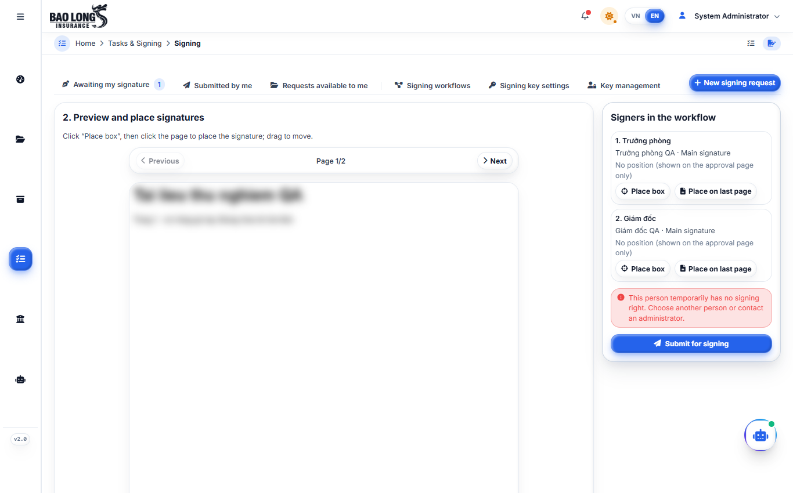 |
| EP-11 | #454, PR #455 (chặn chọn người ký bị khóa), #451, PR #452 | Quản trị là người trình; người ký cấp 2 đang bị khóa quyền ký (xem EP-12) | 5. Như bước 3, giao diện tối, khung 390px. | Như bước 3. | HTTP 400; thông báo hiển thị đủ trong khung 390px. | Pass | — | — | 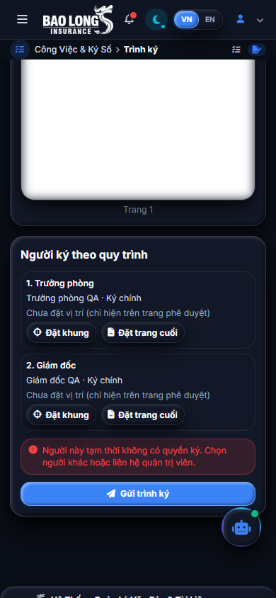 |
| EP-11 | #454, PR #455 (chặn chọn người ký bị khóa), #451, PR #452 | Quản trị là người trình; người ký cấp 2 đang bị khóa quyền ký (xem EP-12) | 6. Bật lại quyền ký của người ký (EP-13), mở lại hồ sơ nháp và gửi. | Gửi thành công. | `POST .../gui/` trả 200; hồ sơ chuyển "Đang chờ ký", cấp 1 mở. | Pass | — | — | 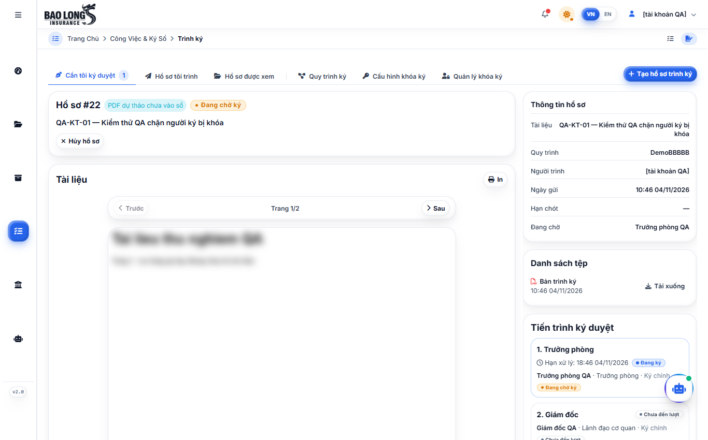 |
| EP-12 | #449, PR #450 (khóa tạm thời); #456, PR #457 (tab quản lý) | Quản trị | 1. Mở `/approvals/quan-ly-khoa` (vi, sáng, 1366px). | Tab hiển thị danh sách tài khoản kèm trạng thái khóa ký, PIN, quyền ký và nút thao tác. | Tiêu đề "Quản lý khóa ký và quyền ký", ô tìm kiếm, bảng 5 cột (Tài khoản, Khóa ký, PIN, Quyền ký, Thao tác). Mỗi dòng có "Khóa quyền ký"; dòng có khóa hoạt động có thêm "Thu hồi khóa & đặt lại PIN". `GET .../quan-tri/nguoi-dung/` trả 200. | Pass | — | Tên đăng nhập, họ tên người dùng không thuộc tài khoản QA và mã khóa đã được che trong ảnh. |  |
| EP-12 | #449, PR #450 (khóa tạm thời); #456, PR #457 (tab quản lý) | Quản trị | 2. Như bước 1, ngôn ngữ en. | Tab hiển thị danh sách tài khoản kèm trạng thái khóa ký, PIN, quyền ký và nút thao tác. | Tiêu đề tab "Key management"; tiêu đề trang "Signing key and signing right management"; bảng và nút hiển thị bằng tiếng Anh. | Pass | — | — | 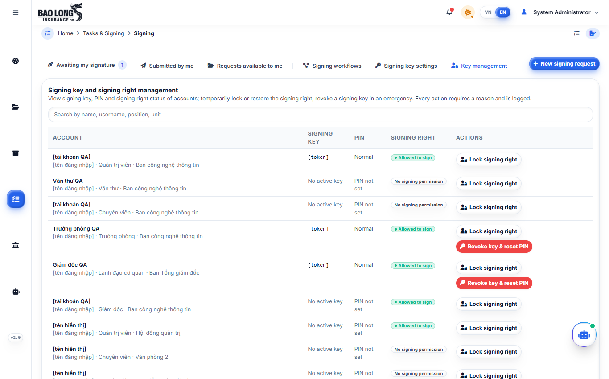 |
| EP-12 | #449, PR #450 (khóa tạm thời); #456, PR #457 (tab quản lý) | Quản trị | 3. Như bước 1, giao diện tối. | Tab hiển thị danh sách tài khoản kèm trạng thái khóa ký, PIN, quyền ký và nút thao tác. | Bảng, nhãn trạng thái và nút hiển thị trên nền tối. | Pass | — | — | 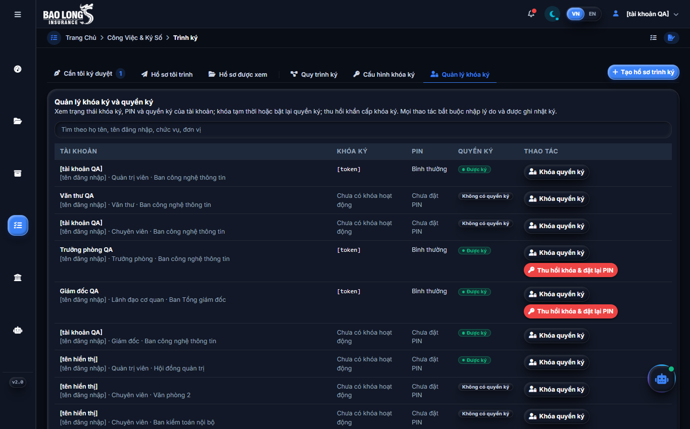 |
| EP-12 | #449, PR #450 (khóa tạm thời); #456, PR #457 (tab quản lý) | Quản trị | 4. Như bước 1, khung 390px. | Tab hiển thị danh sách tài khoản kèm trạng thái khóa ký, PIN, quyền ký và nút thao tác. | Bảng rộng hơn khung nên cuộn ngang trong thẻ: cột "Quyền ký" bị cắt mép phải, cột "Thao tác" chỉ thấy sau khi cuộn. | Pass | — | Đọc được nhưng phải cuộn ngang để bấm nút thao tác; chưa có chỉ dẫn cuộn. | 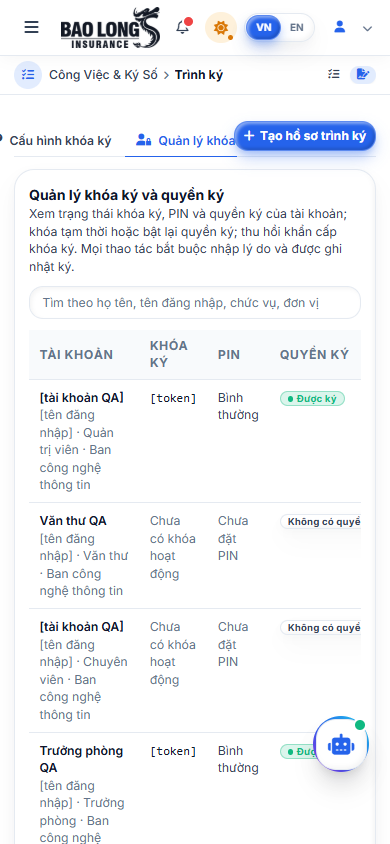 |
| EP-12 | #449, PR #450 (khóa tạm thời); #456, PR #457 (tab quản lý) | Quản trị | 5. Bấm "Khóa quyền ký" ở dòng của một tài khoản người ký. | Hộp thoại có thời hạn 1 giờ, 8 giờ, 24 giờ, đến khi bật lại và lý do bắt buộc. | Hộp thoại "Khóa quyền ký của <tài khoản>": "Tài khoản không ký được và không nhận email trình ký cho đến khi hết thời hạn hoặc được bật lại."; ô "Thời hạn khóa" (1 giờ, 8 giờ, 24 giờ, Đến khi được bật lại) và ô "Lý do" (bắt buộc). | Pass | — | — | 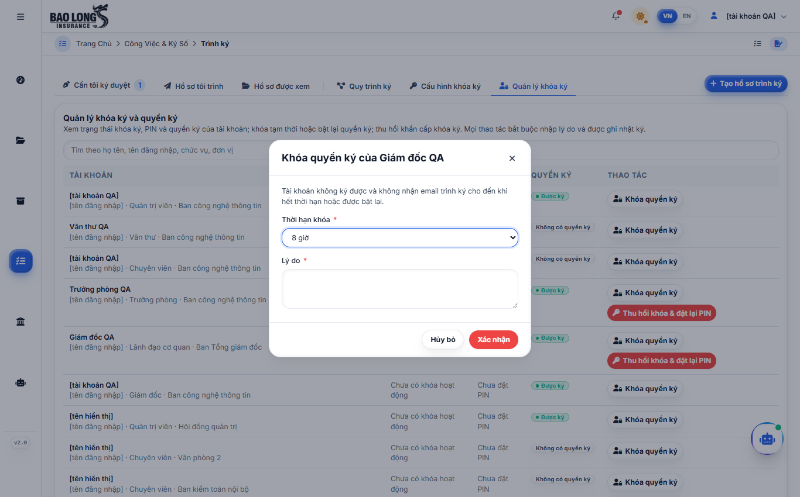 |
| EP-12 | #449, PR #450 (khóa tạm thời); #456, PR #457 (tab quản lý) | Quản trị | 6. Bấm "Xác nhận" khi chưa nhập lý do. | Báo thiếu lý do, không gọi API. | Ô lý do hiện "Phải nhập lý do."; hộp thoại giữ nguyên. | Pass | — | — | 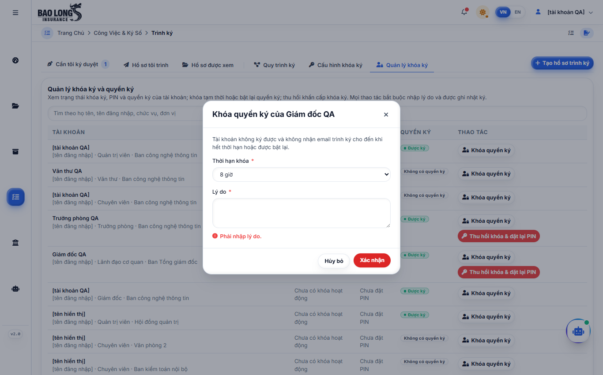 |
| EP-12 | #449, PR #450 (khóa tạm thời); #456, PR #457 (tab quản lý) | Quản trị | 7. Chọn "1 giờ", nhập lý do, xác nhận. | Quyền ký bị khóa đến thời điểm hết hạn; hiển thị lý do. | `POST .../quan-tri/nguoi-dung/<id>/khoa-quyen-ky/` trả 200; dòng tài khoản hiển thị "Đang bị khóa đến <giờ> <ngày>", lý do vừa nhập và nút "Bật lại quyền ký". | Pass | — | Chưa kiểm được "không nhận email trình ký" vì staging chưa có `EMAIL_HOST`. | 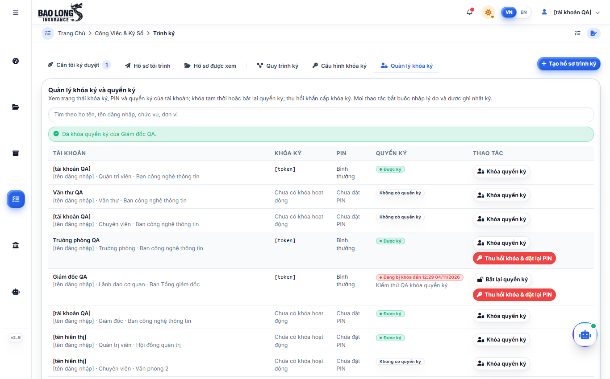 |
| EP-13 | #451, PR #452; #456, PR #457 | Quản trị; tài khoản đang bị khóa (EP-12) | 1. Mở tab quản lý khóa khi một tài khoản đang bị khóa. | Dòng tài khoản bị khóa có nút "Bật lại quyền ký". | Dòng hiển thị "Đang bị khóa đến <giờ>", lý do khóa và nút "Bật lại quyền ký". | Pass | — | — |  |
| EP-13 | #451, PR #452; #456, PR #457 | Quản trị | 2. Bấm "Bật lại quyền ký". | Hộp thoại yêu cầu lý do. | Hộp thoại "Bật lại quyền ký của <tài khoản>": "Quyền ký của tài khoản được khôi phục ngay. Lý do bật lại được ghi vào nhật ký."; ô "Lý do" bắt buộc. | Pass | — | — | 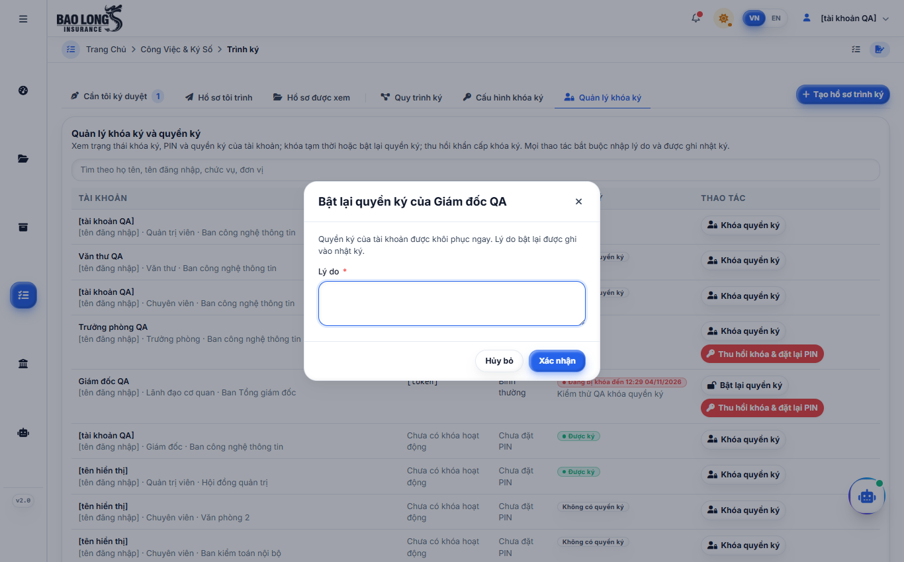 |
| EP-13 | #451, PR #452; #456, PR #457 | Quản trị | 3. Bấm "Xác nhận" khi chưa nhập lý do. | Báo thiếu lý do. | Ô lý do hiện "Phải nhập lý do.". | Pass | — | — |  |
| EP-13 | #451, PR #452; #456, PR #457 | Quản trị | 4. Nhập lý do, xác nhận. | Quyền ký được khôi phục. | `POST .../bat-lai-quyen-ky/` trả 200; dòng chuyển "Được ký" và nút "Khóa quyền ký". | Pass | — | — | 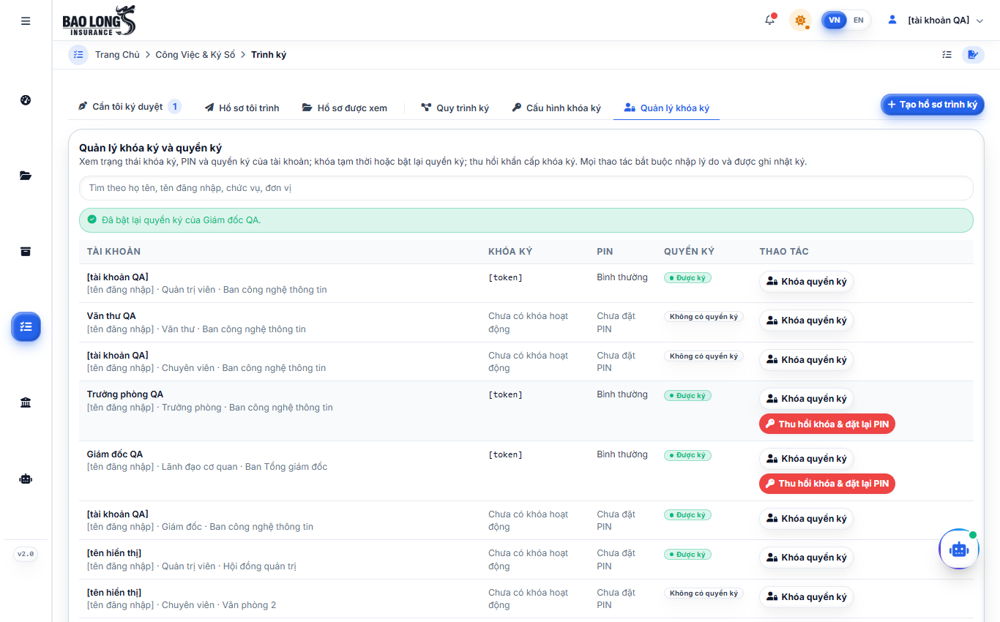 |
| EP-14 | #451, PR #452 (thu hồi khóa khẩn cấp) | Quản trị; tài khoản có khóa ký hoạt động | 1. Bấm "Thu hồi khóa & đặt lại PIN" rồi "Xác nhận" khi chưa nhập lý do. | Báo thiếu lý do. | Hộp thoại "Thu hồi khóa ký của <tài khoản>": "Khóa ký đang hoạt động bị thu hồi và PIN gắn với khóa mất hiệu lực. Tài khoản cần tạo khóa mới và đặt PIN mới để ký."; ô lý do hiện "Phải nhập lý do.". | Pass | — | — |  |
| EP-14 | #451, PR #452 (thu hồi khóa khẩn cấp) | Quản trị | 2. Nhập lý do, xác nhận. | Khóa bị thu hồi. | `POST .../quan-tri/nguoi-dung/<id>/thu-hoi-khoa/` trả 200; thông báo "Đã thu hồi khóa ký của <tài khoản>."; dòng chuyển "Chưa có khóa hoạt động", "Chưa đặt PIN". | Pass | — | Ảnh dùng chung với EP-15 bước 3 (cùng thao tác). | 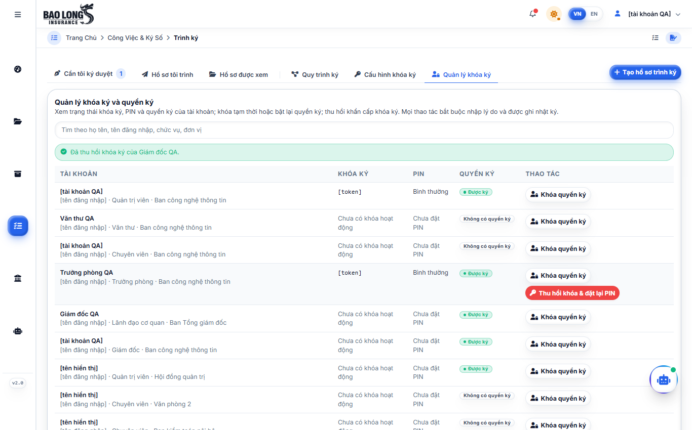 |
| EP-15 | #478, PR #479 (đặt lại PIN); #451, PR #452 | Quản trị và người ký có khóa thử nghiệm (PIN tạm) | 1. Mở tab quản lý khóa, xem dòng tài khoản có khóa hoạt động. | Dòng hiển thị khóa, PIN và nút thu hồi. | Dòng có mã khóa (đã che), PIN "Bình thường", "Được ký", nút "Khóa quyền ký" và "Thu hồi khóa & đặt lại PIN". | Pass | — | — |  |
| EP-15 | #478, PR #479 (đặt lại PIN); #451, PR #452 | Quản trị và người ký có khóa thử nghiệm (PIN tạm) | 2. Bấm "Thu hồi khóa & đặt lại PIN". | Hộp thoại nêu hậu quả và yêu cầu lý do. | Hộp thoại nêu khóa bị thu hồi, PIN gắn với khóa mất hiệu lực, tài khoản cần tạo khóa và PIN mới; ô lý do bắt buộc. | Pass | — | — | 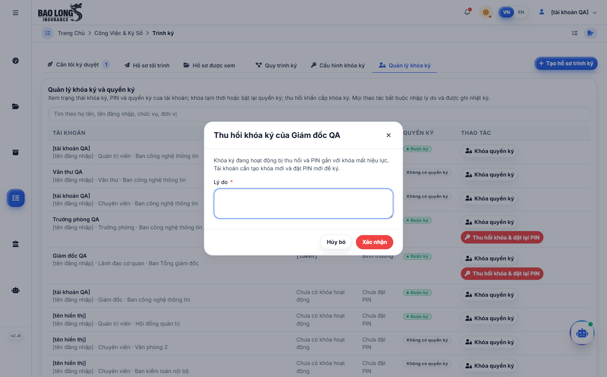 |
| EP-15 | #478, PR #479 (đặt lại PIN); #451, PR #452 | Quản trị và người ký có khóa thử nghiệm (PIN tạm) | 3. Nhập lý do, xác nhận. | Khóa thu hồi, PIN không còn. | `POST .../thu-hoi-khoa/` trả 200; dòng chuyển "Chưa có khóa hoạt động", "Chưa đặt PIN". | Pass | — | — |  |
| EP-15 | #478, PR #479 (đặt lại PIN); #451, PR #452 | Quản trị và người ký có khóa thử nghiệm (PIN tạm) | 4. Người ký mở "Cấu hình khóa ký". | Thông báo chưa có khóa, có form tạo khóa mới. | "Bạn chưa có khóa ký trên thiết bị này." kèm form "PIN mới (6 chữ số)", "Nhập lại PIN", nút "Tạo khóa ký cho thiết bị này". | Pass | — | — | 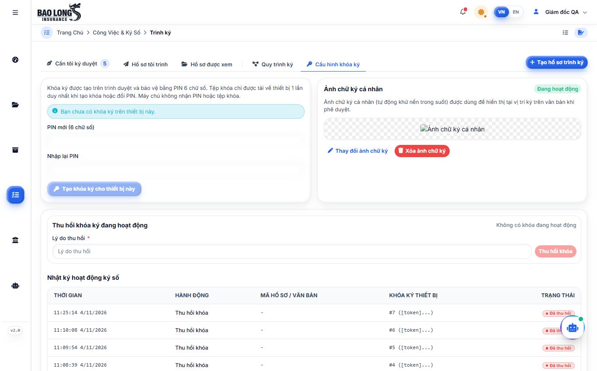 |
| EP-15 | #478, PR #479 (đặt lại PIN); #451, PR #452 | Quản trị và người ký có khóa thử nghiệm (PIN tạm) | 5. Tạo khóa mới bằng PIN tạm. | Khóa mới kích hoạt. | Chuỗi `POST khoa` 201, `POST xac-minh` 200, `POST dat-pin` 201, `POST kich-hoat` 200; "Khóa ký trên thiết bị này đã sẵn sàng." | Pass | — | — | 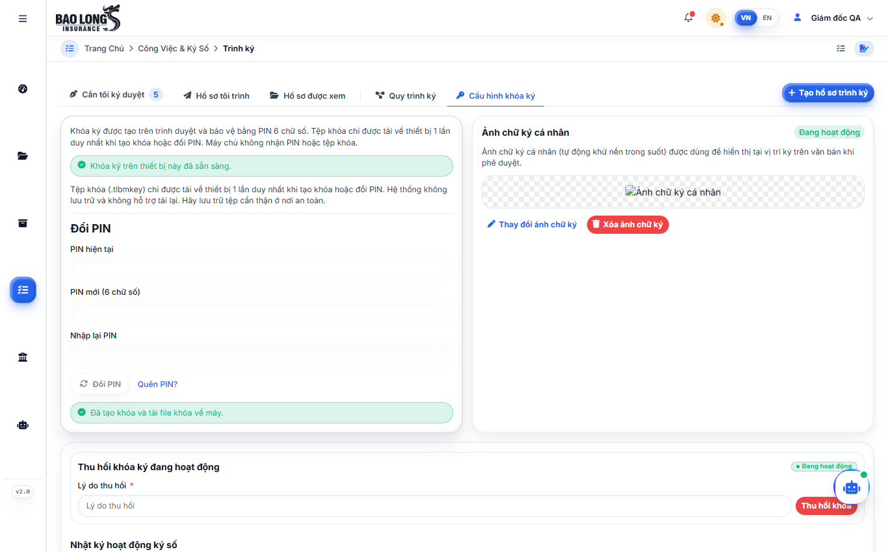 |
| EP-15 | #478, PR #479 (đặt lại PIN); #451, PR #452 | Quản trị và người ký có khóa thử nghiệm (PIN tạm) | 6. Ký một hồ sơ bằng khóa mới và PIN mới (lần chạy trước của luồng này). | Ký thành công; bộ đếm sai PIN không còn giới hạn. | `POST khoa/<id>/mo-khoa-ky/` trả 200 và `POST trinh-ky/<id>/ky/` trả 200 sau khi trước đó tài khoản bị giới hạn 15 lần sai PIN (EP-25). | Pass | — | Luồng đặt lại diễn ra hai lần; ảnh bước này lấy từ lần đầu. | 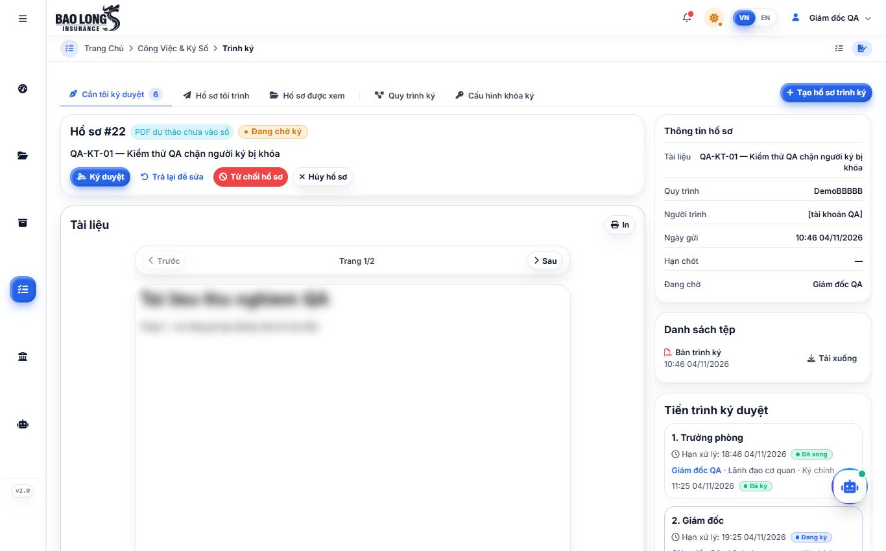 |
| EP-16 | #451, PR #452; #467, PR #476 (ghi nhật ký thao tác) | Người ký đã bị khóa quyền, bật lại, thu hồi khóa và đặt lại PIN (EP-12 đến EP-15) | 1. Mở "Cấu hình khóa ký", xem bảng "Nhật ký hoạt động ký số". | Nhật ký ghi đúng hành động và thời điểm của từng thao tác trên khóa và quyền ký. | Bảng có 5 dòng, mỗi dòng ứng với một khóa: cột Thời gian là thời điểm tạo khóa, cột Hành động là "Đăng ký khóa thiết bị" hoặc "Thu hồi khóa" theo trạng thái hiện tại của khóa, cột Mã hồ sơ luôn là "-". Không có dòng nào cho khóa quyền ký, bật lại quyền ký, thu hồi do quản trị, đặt lại PIN hay ký duyệt. | Fail | Thấp | Khóa đã thu hồi hiển thị "Thu hồi khóa" kèm thời điểm tạo khóa, không phải thời điểm thu hồi (`KhoaPage.tsx`, bảng dựng từ danh sách khóa). Không có màn hình xem nhật ký thao tác quản trị nên chưa xác minh được việc ghi nhật ký phía máy chủ. Issue bug: #BUG2. | 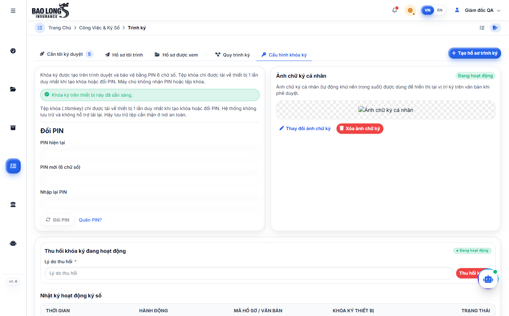 |
| EP-17 | #454, PR #455; #467, PR #476 (thông báo người ký bị khóa) | Người ký có quyền ký, đang bị khóa quyền; có khóa và ảnh chữ ký thử nghiệm | 1. Đăng nhập người ký bị khóa, mở `/approvals`. | Hiển thị thông báo quyền bị khóa bởi quản trị viên kèm hướng dẫn liên hệ. | Khung "Quyền ký của bạn đang bị quản trị viên khóa", "Bạn không ký được đến <giờ> <ngày>. Liên hệ quản trị viên để được hỗ trợ." hiện phía trên danh sách; `GET /api/v1/signing/toi/` trả `khoa_quyen_ky.khoa_den`; danh sách hồ sơ chờ ký vẫn hiển thị. | Pass | — | — |  |
| EP-17 | #454, PR #455; #467, PR #476 (thông báo người ký bị khóa) | Người ký có quyền ký, đang bị khóa quyền; có khóa và ảnh chữ ký thử nghiệm | 2. Mở `/approvals/khoa`. | Thông báo khóa hiển thị ở màn hình cấu hình khóa. | Thông báo khóa hiện cùng nội dung bước 1; form cấu hình khóa vẫn dùng được ("Khóa ký trên thiết bị này đã sẵn sàng."). | Pass | — | — | 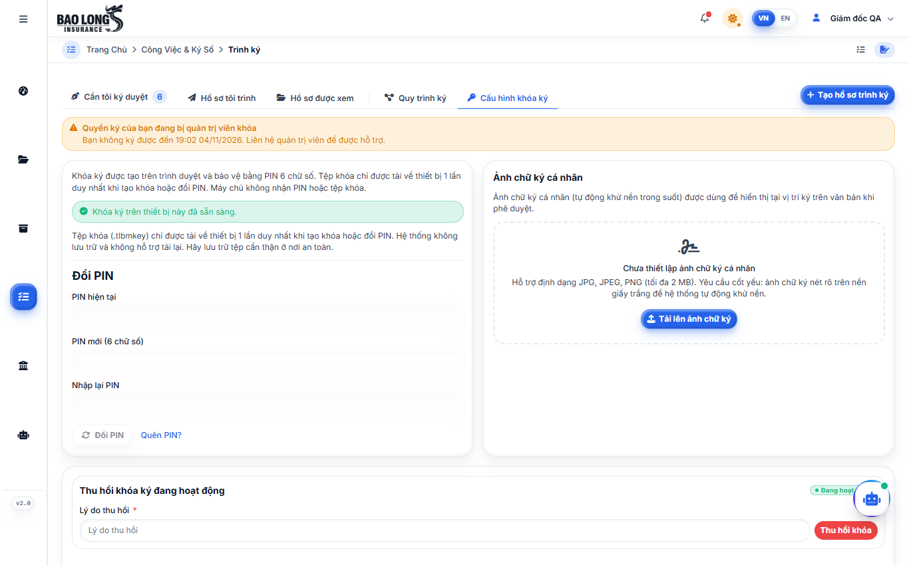 |
| EP-17 | #454, PR #455; #467, PR #476 (thông báo người ký bị khóa) | Người ký có quyền ký, đang bị khóa quyền; có khóa và ảnh chữ ký thử nghiệm | 3. Mở chi tiết hồ sơ đang chờ người ký này. | Thông báo khóa hiển thị; thao tác ký bị chặn. | Thông báo khóa hiện đầu trang; các nút "Ký duyệt", "Trả lại để sửa", "Từ chối hồ sơ" vẫn bật. | Pass | — | Nút ký không bị vô hiệu khi bị khóa; việc chặn xảy ra ở máy chủ sau khi nhập tệp khóa và PIN (cải tiến trải nghiệm, không tính lỗi). | 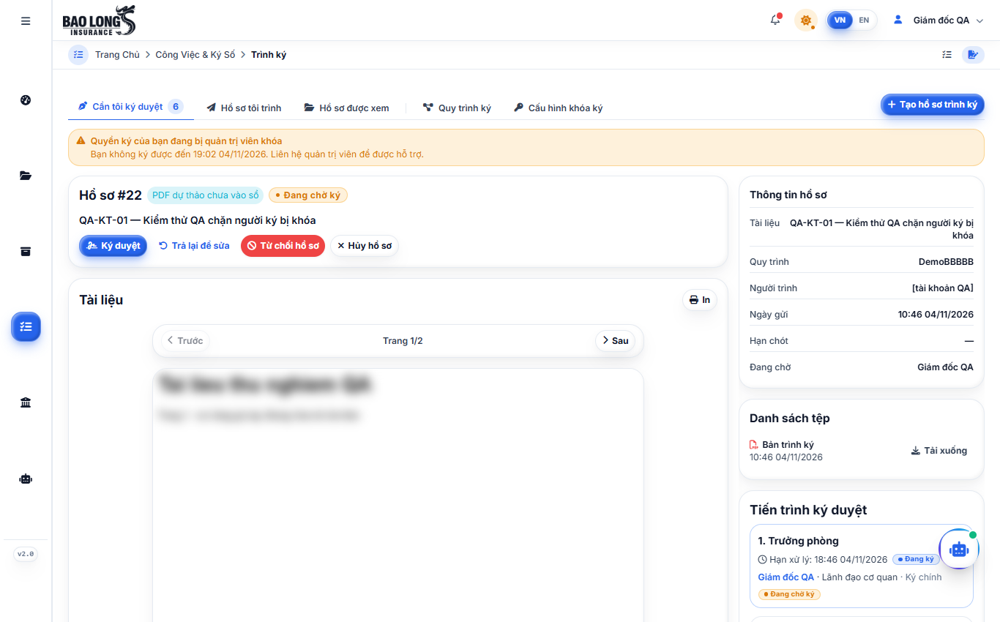 |
| EP-17 | #454, PR #455; #467, PR #476 (thông báo người ký bị khóa) | Người ký có quyền ký, đang bị khóa quyền; có khóa và ảnh chữ ký thử nghiệm | 4. Bấm "Ký duyệt" khi chưa có ảnh chữ ký cá nhân. | Hộp thoại ký báo thiếu ảnh chữ ký. | Hộp thoại có "File khóa ký (.tlbmkey)", ô PIN bị vô hiệu, cảnh báo "Thiếu chữ ký: Chưa có ảnh chữ ký cá nhân" kèm "Đi tới Cấu hình khóa ký"; nút "Ký duyệt" bị vô hiệu. | Pass | — | Chặn thiếu ảnh ở giao diện hoạt động đúng; xem EP-21 về việc tải ảnh. | 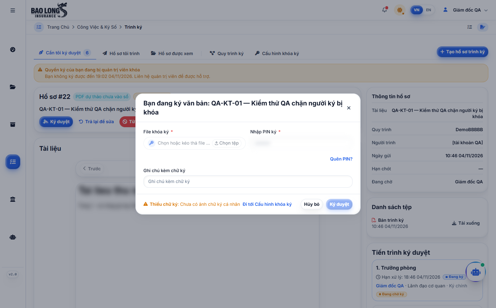 |
| EP-17 | #454, PR #455; #467, PR #476 (thông báo người ký bị khóa) | Người ký có quyền ký, đang bị khóa quyền; có khóa và ảnh chữ ký thử nghiệm | 5. Sau khi có ảnh chữ ký, chọn tệp khóa, nhập PIN đúng, bấm "Ký duyệt" khi đang bị khóa. | Máy chủ từ chối, giao diện báo quyền ký bị khóa. | `POST khoa/<id>/mo-khoa-ky/` trả 200 (PIN đúng); `POST trinh-ky/<id>/ky/` trả 403; hộp thoại hiện "Quyền ký của tài khoản đang bị quản trị viên khóa. Liên hệ quản trị viên."; hộp thoại giữ nguyên. | Pass | — | Ký không tạo chữ ký khi bị khóa. | 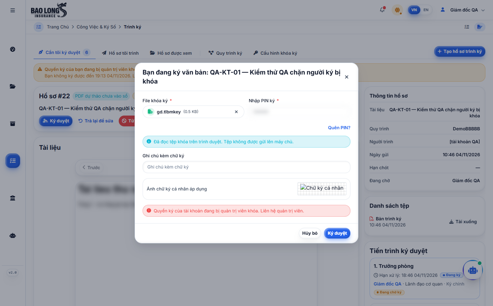 |
| EP-18 | #487, PR #493 (Quên PIN trong hộp thoại ký); #478, PR #479 | Người ký có khóa; hồ sơ chờ ký | 1. Mở hộp thoại ký của một hồ sơ đang chờ. | Có liên kết "Quên PIN?" cạnh ô PIN. | Hộp thoại ký có liên kết "Quên PIN?" cạnh nhãn "Nhập PIN ký". | Pass | — | — |  |
| EP-18 | #487, PR #493 (Quên PIN trong hộp thoại ký); #478, PR #479 | Người ký có khóa; hồ sơ chờ ký | 2. Bấm "Quên PIN?". | Hộp thoại đặt lại PIN nêu cách thức và hậu quả. | Hộp thoại "Đặt lại PIN": "Mã xác thực 6 chữ số sẽ được gửi tới email của tài khoản. Nhập đúng mã sẽ thu hồi khóa ký hiện tại; sau đó tạo khóa và PIN mới."; nút "Gửi mã xác thực", "Đóng". | Pass | — | — | 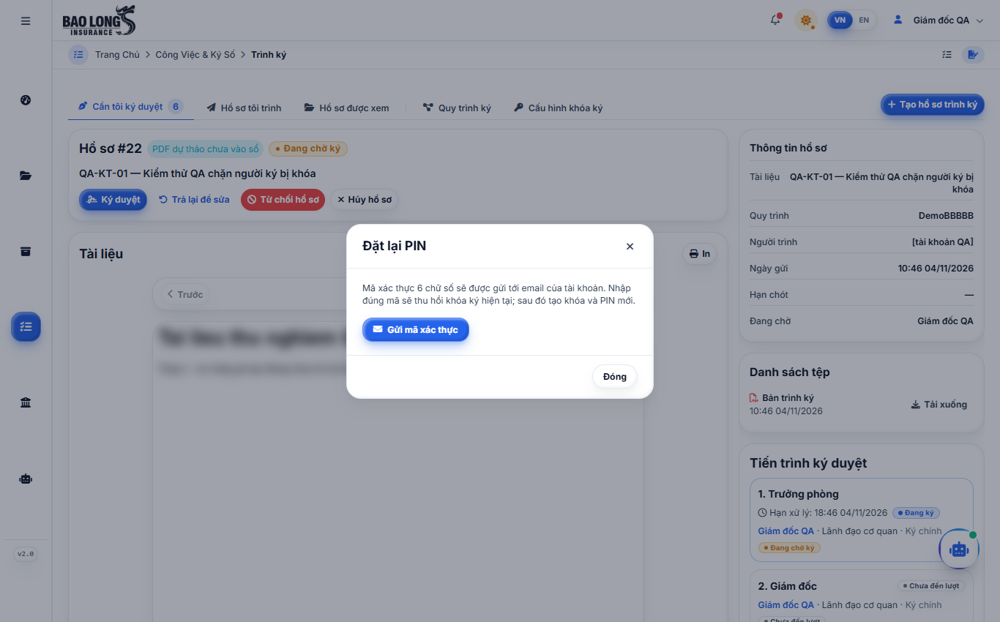 |
| EP-18 | #487, PR #493 (Quên PIN trong hộp thoại ký); #478, PR #479 | Người ký có khóa; hồ sơ chờ ký | 3. Bấm "Gửi mã xác thực". | Mã được gửi; hiển thị hạn mã và đếm ngược gửi lại. | `POST /api/v1/signing/dat-lai-pin/yeu-cau/` trả 200, thân có `het_han` và `gian_cach_giay` = 120; hộp thoại "Đã gửi mã tới email của tài khoản. Mã có hiệu lực đến <giờ>.", ô nhập mã 6 ký tự, nút "Gửi lại sau 117 giây" (đếm ngược), nút "Xác nhận và thu hồi khóa". | Pass | — | — |  |
| EP-18 | #487, PR #493 (Quên PIN trong hộp thoại ký); #478, PR #479 | Người ký có khóa; hồ sơ chờ ký | 4. Nhập mã đúng, bấm "Xác nhận và thu hồi khóa", rồi tạo khóa mới. | Khóa cũ bị thu hồi, tạo được khóa và PIN mới. | Không thực hiện được: staging chưa có `EMAIL_HOST`, mã gửi tới email không đọc được. Bước thu hồi và tạo khóa mới sau đặt lại được kiểm bằng luồng quản trị ở EP-15. | Blocked | Chưa đánh giá | Cần cấu hình `EMAIL_HOST` hoặc cách đọc mã trên staging. | 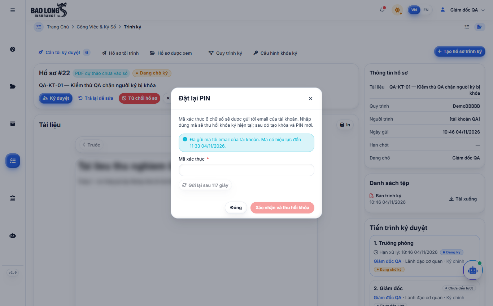 |
| EP-19 | #488, PR #494 (khóa quá hạn chuyển HET_HAN) | Người ký có khóa đã quá hạn sử dụng | 1. Dùng khóa quá hạn để ký hoặc mở cấu hình khóa. | Khóa chuyển sang `HET_HAN`, ký bị từ chối, giao diện hướng dẫn tạo khóa mới. | Không thực hiện được: khóa thử nghiệm tạo mới có thời hạn dài, giao diện và API quản trị không cho đổi thời điểm hết hạn của khóa. Ảnh là màn hình cấu hình khóa với khóa đang hoạt động. | Blocked | Chưa đánh giá | Cần khóa có thời điểm hết hạn đã qua (thao tác ở CSDL hoặc cấu hình thời hạn khóa ngắn trên staging). |  |
| EP-20 | #499, PR #502 (backend); #500, PR #504 (giao diện thay người ký) | Quản trị là người trình; người ký cấp 1 đang bị khóa quyền ký | 1. Mở chi tiết hồ sơ đang chờ người ký bị khóa. | Có nút "Thay người ký". | Chi tiết hồ sơ có nút "Thay người ký" cạnh "Hủy hồ sơ" (hồ sơ có người ký chưa bị khóa không có nút này, xem EP-08). | Pass | — | — |  |
| EP-20 | #499, PR #502 (backend); #500, PR #504 (giao diện thay người ký) | Quản trị là người trình; người ký cấp 1 đang bị khóa quyền ký | 2. Bấm "Thay người ký" (vi, sáng). | Hộp thoại nêu người cần thay, danh sách người mới và lý do. | Hộp thoại "Thay người ký": "Người ký đang chờ bị khóa quyền ký nên hồ sơ chưa tiếp tục được. Chọn người thay; chữ ký đã có được giữ nguyên."; "Người ký cần thay", ô tìm theo tên, chức vụ, đơn vị, ô chọn "Người ký mới" (không có người đang bị khóa), ô "Lý do thay người ký". | Pass | — | Danh sách người ký mới gồm nhiều người dùng thật nên ảnh chỉ chụp ô chọn khi đóng. |  |
| EP-20 | #499, PR #502 (backend); #500, PR #504 (giao diện thay người ký) | Quản trị là người trình; người ký cấp 1 đang bị khóa quyền ký | 3. Quan sát nút xác nhận khi chưa chọn người và chưa nhập lý do. | Không thay được khi thiếu dữ liệu. | Nút "Thay người ký" trong hộp thoại bị vô hiệu cho đến khi chọn người ký mới và nhập lý do. | Pass | — | Thiếu dữ liệu được chặn bằng nút vô hiệu, không có thông báo lỗi. | 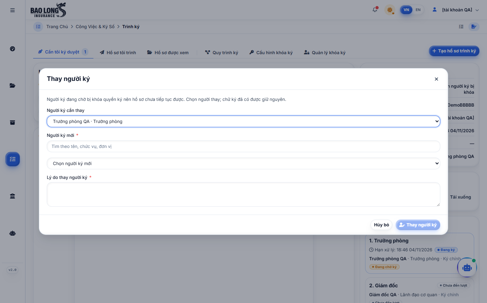 |
| EP-20 | #499, PR #502 (backend); #500, PR #504 (giao diện thay người ký) | Quản trị là người trình; người ký cấp 1 đang bị khóa quyền ký | 4. Chọn người ký mới, nhập lý do, xác nhận. | Hồ sơ chuyển cho người mới, lịch sử ghi nhận. | `POST /api/v1/signing/trinh-ky/<id>/thay-nguoi-ky/` trả 200; "Đang chờ" và cấp 1 hiển thị người mới; nút "Thay người ký" biến mất; "Lịch sử" có dòng "Thay người ký · <lý do>". | Pass | — | Quy tắc trùng người chỉ áp dụng trong cùng một cấp (`services/thay_nguoi_ky.py`); người mới được chọn đã đứng ở cấp 2 và hệ thống cho phép. | 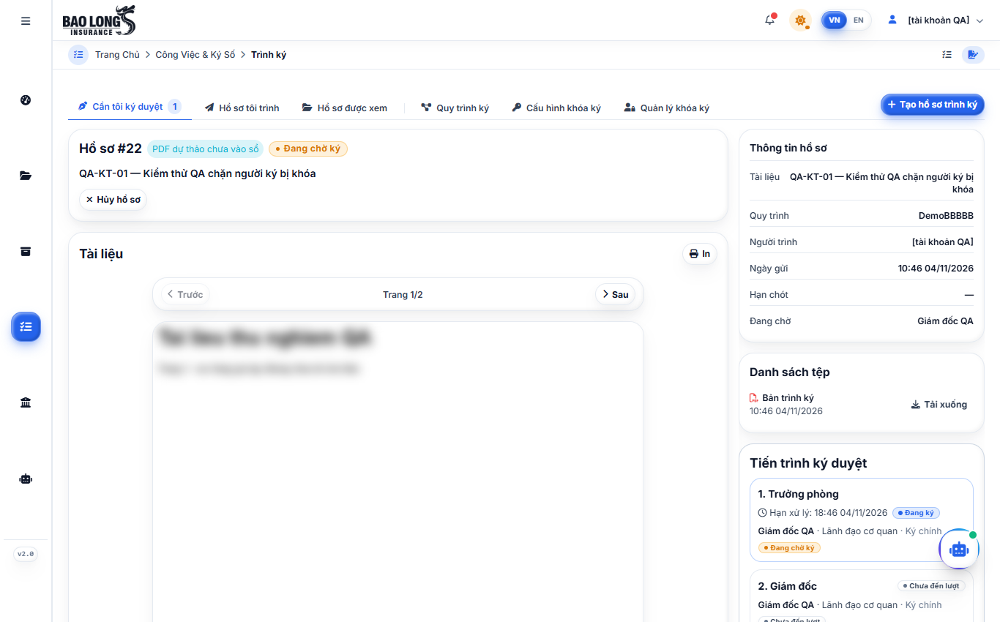 |
| EP-20 | #499, PR #502 (backend); #500, PR #504 (giao diện thay người ký) | Quản trị là người trình; người ký cấp 1 đang bị khóa quyền ký | 5. Như bước 2, ngôn ngữ en. | Hộp thoại hiển thị bằng tiếng Anh. | Hộp thoại hiển thị nhãn tiếng Anh, nút xác nhận tương ứng. | Pass | — | — | 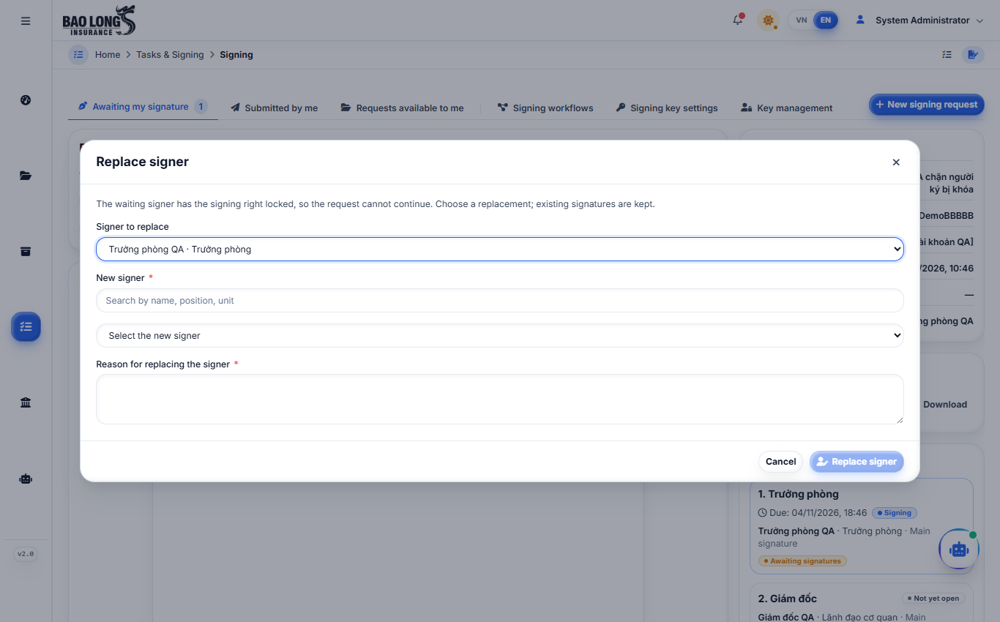 |
| EP-20 | #499, PR #502 (backend); #500, PR #504 (giao diện thay người ký) | Quản trị là người trình; người ký cấp 1 đang bị khóa quyền ký | 6. Như bước 2, giao diện tối, khung 390px. | Hộp thoại hiển thị đủ. | Hộp thoại hiển thị trong khung 390px trên nền tối. | Pass | — | — | 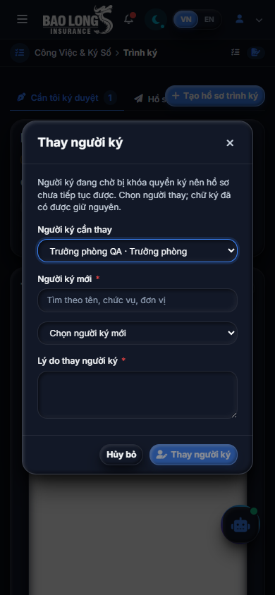 |
| EP-21 | #424, PR #462 (ảnh chữ ký); #459; #463, PR #485 | Người ký có khóa thử nghiệm và quyền ký; quản trị tạo hồ sơ | 1. Mở "Cấu hình khóa ký" khi chưa có ảnh chữ ký. | Có khu vực tải ảnh chữ ký cá nhân. | Khu "Ảnh chữ ký cá nhân": "Chưa thiết lập ảnh chữ ký cá nhân", nút "Tải lên ảnh chữ ký", gợi ý JPG, JPEG, PNG tối đa 2 MB. | Pass | — | — | 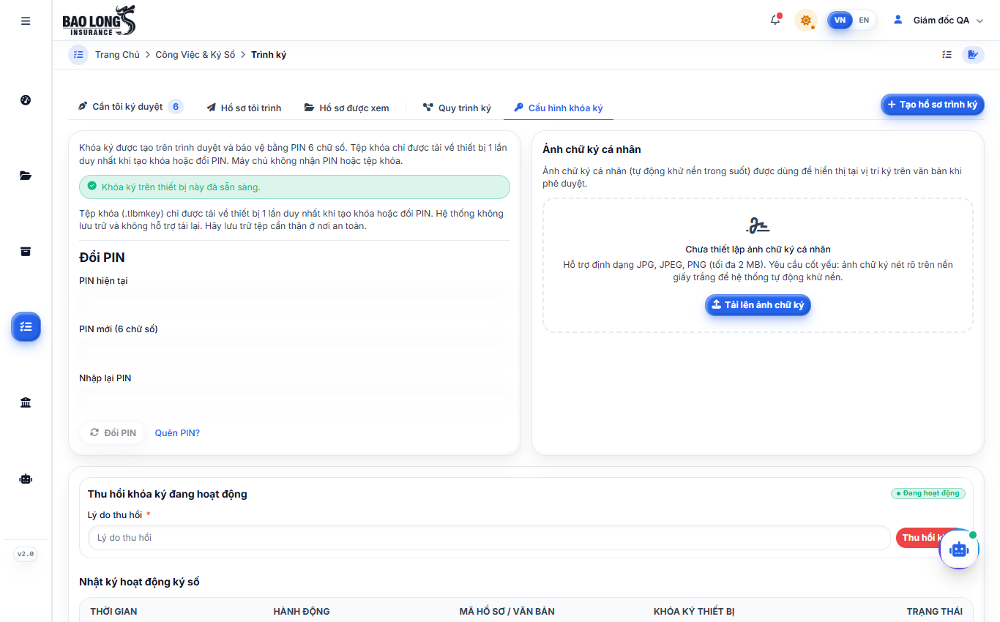 |
| EP-21 | #424, PR #462 (ảnh chữ ký); #459; #463, PR #485 | Người ký có khóa thử nghiệm và quyền ký; quản trị tạo hồ sơ | 2. Chọn tệp ảnh chữ ký PNG (nét mực trên nền trắng). | Hộp thoại cắt ảnh hiển thị. | Hộp thoại cắt ảnh với khung chọn vùng và nút "Hủy bỏ", "Cắt & Áp dụng". | Pass | — | — | 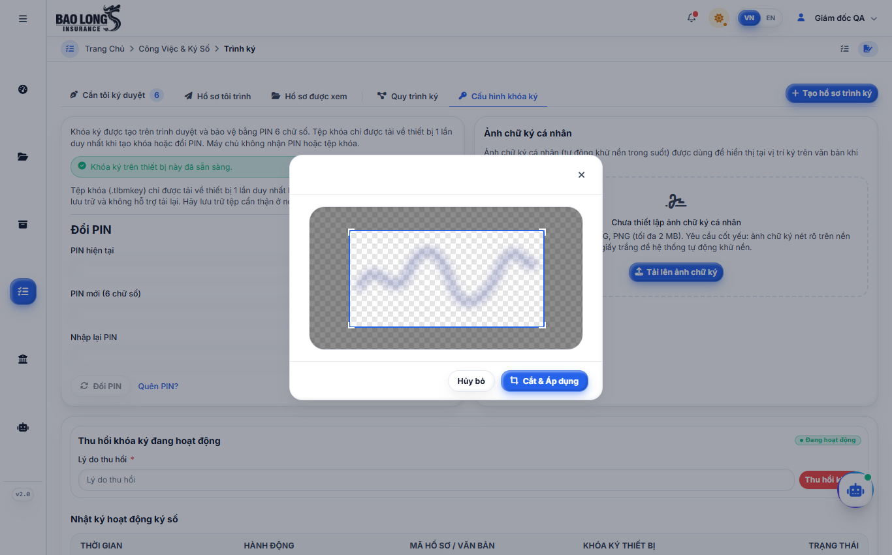 |
| EP-21 | #424, PR #462 (ảnh chữ ký); #459; #463, PR #485 | Người ký có khóa thử nghiệm và quyền ký; quản trị tạo hồ sơ | 3. Bấm "Cắt & Áp dụng". | Hiển thị ảnh kết quả để xác nhận. | Hộp thoại "Xác nhận ảnh chữ ký": ảnh kết quả nền trong suốt, cảnh báo kiểm tra không bị cắt mất; nút "Chỉnh sửa lại", "Xác nhận áp dụng". | Pass | — | — | 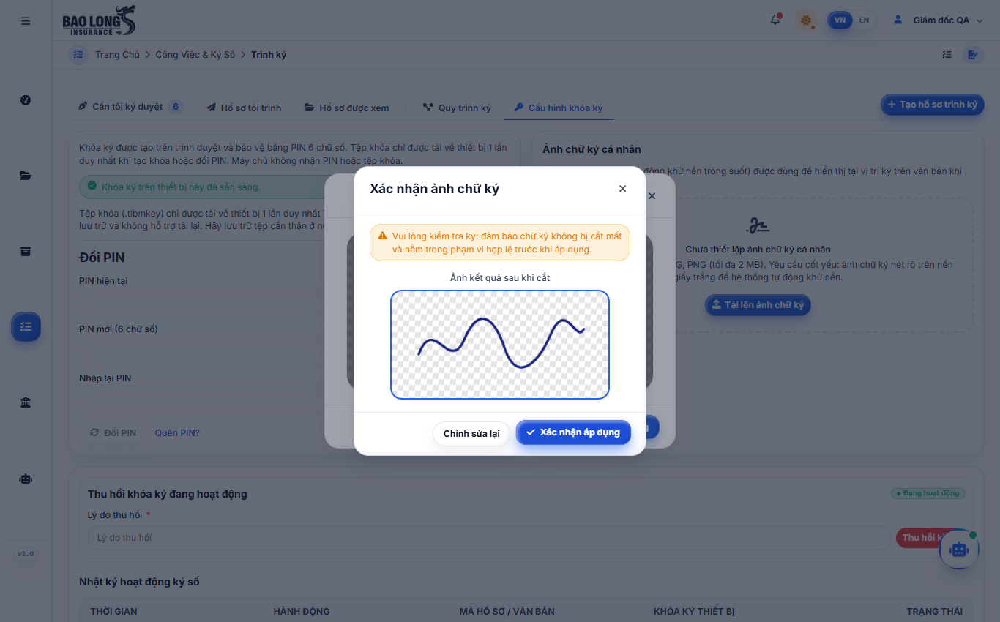 |
| EP-21 | #424, PR #462 (ảnh chữ ký); #459; #463, PR #485 | Người ký có khóa thử nghiệm và quyền ký; quản trị tạo hồ sơ | 4. Bấm "Xác nhận áp dụng". | Ảnh được lưu trên máy chủ. | `POST /api/v1/signing/anh-chu-ky-ca-nhan/` trả 400 `thieu_tep_anh`: "Vui lòng cung cấp tệp ảnh hoặc dữ liệu Base64 ảnh chữ ký."; giao diện hiện cùng thông báo, ảnh không được lưu. | Fail | Cao | Tái hiện 3/3 lần. Yêu cầu do giao diện gửi có `Content-Type: application/json` và thân 2 byte (xem bước 7). Issue bug: #BUG1. | 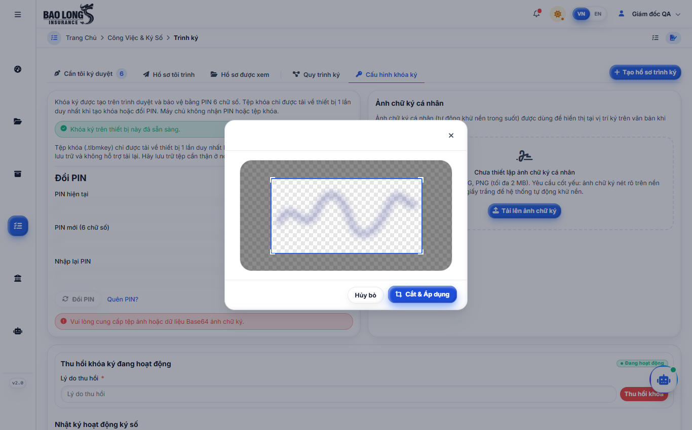 |
| EP-21 | #424, PR #462 (ảnh chữ ký); #459; #463, PR #485 | Người ký có khóa thử nghiệm và quyền ký; quản trị tạo hồ sơ | 5. Mở hộp thoại ký khi chưa có ảnh chữ ký. | Báo thiếu ảnh, không ký được. | Hộp thoại ký hiện "Thiếu chữ ký: Chưa có ảnh chữ ký cá nhân" kèm "Đi tới Cấu hình khóa ký"; ô PIN và nút "Ký duyệt" bị vô hiệu. | Pass | — | Do bước 4 lỗi nên người ký không thể tự có ảnh để ký bằng giao diện. | 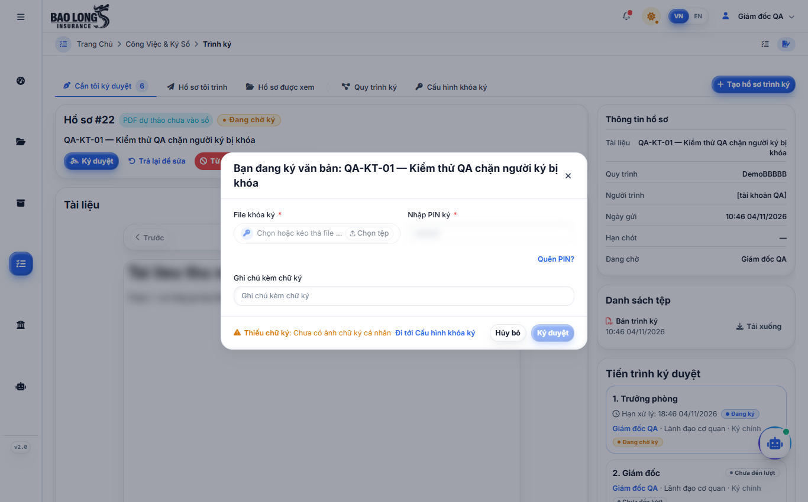 |
| EP-21 | #424, PR #462 (ảnh chữ ký); #459; #463, PR #485 | Người ký có khóa thử nghiệm và quyền ký; quản trị tạo hồ sơ | 6. Chọn tệp khóa trong hộp thoại ký khi vẫn thiếu ảnh. | Vẫn không ký được. | Ô PIN vẫn bị vô hiệu sau khi chọn tệp khóa. | Pass | — | — | 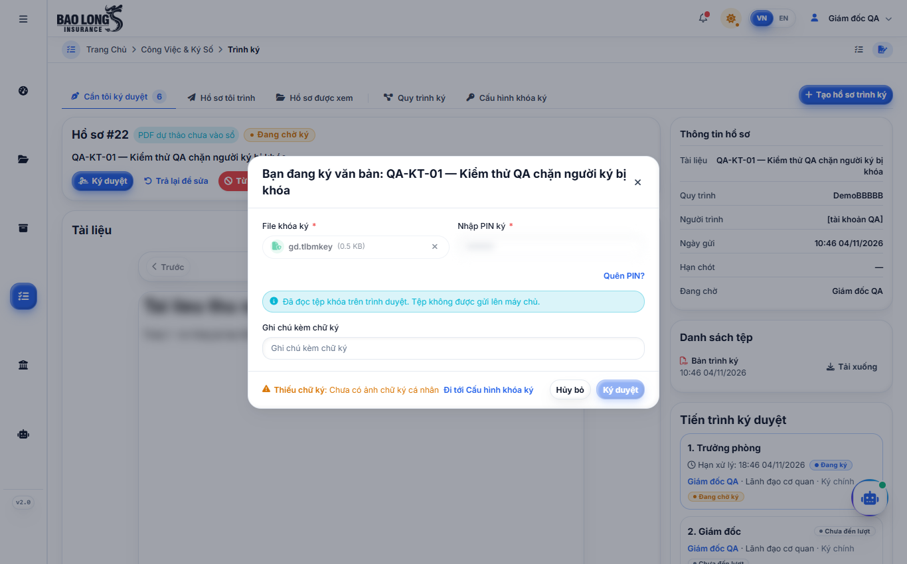 |
| EP-21 | #424, PR #462 (ảnh chữ ký); #459; #463, PR #485 | Người ký có khóa thử nghiệm và quyền ký; quản trị tạo hồ sơ | 7. Ghi lại yêu cầu tải ảnh do giao diện gửi. | Yêu cầu `multipart/form-data` có trường `tep`. | `Content-Type: application/json`, thân 2 byte (`{}`), phản hồi 400. `apiClient.post` gọi `JSON.stringify(body)` (`frontend/src/lib/apiClient.ts:204`) còn `taiLenAnhChuKy` truyền `FormData` (`frontend/src/lib/signing/api.ts:254`). | Fail | Cao | Nguyên nhân mã nguồn của bước 4. | 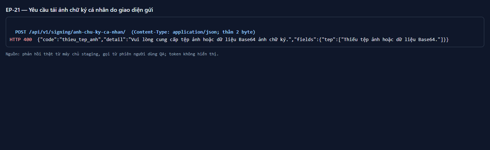 |
| EP-21 | #424, PR #462 (ảnh chữ ký); #459; #463, PR #485 | Người ký có khóa thử nghiệm và quyền ký; quản trị tạo hồ sơ | 8. Gửi cùng ảnh bằng `multipart/form-data` (đối chứng). | Máy chủ nhận ảnh. | HTTP 200, `co_anh: true`, dung lượng 6380 byte. | Pass | — | Từ đây ảnh được thiết lập bằng cách này để kiểm tiếp luồng ký; vì bỏ qua bước khử nền ở giao diện nên ảnh giữ nền trắng khi hiển thị trong khung ký. | 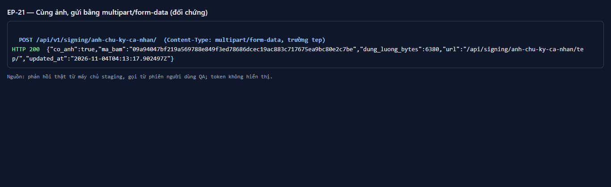 |
| EP-21 | #424, PR #462 (ảnh chữ ký); #459; #463, PR #485 | Quản trị tạo hồ sơ thử (PDF tự sinh, 2 trang) | 9. Ở bước 2 tạo hồ sơ, bấm "Đặt khung" của người ký cấp 1 rồi bấm lên trang 1. | Khung ký xuất hiện tại vị trí bấm. | Khung "Trưởng phòng QA, Ký chính" xuất hiện tại vị trí bấm; dòng người ký ghi "Trang 1" kèm "Bỏ khung". | Pass | — | — | 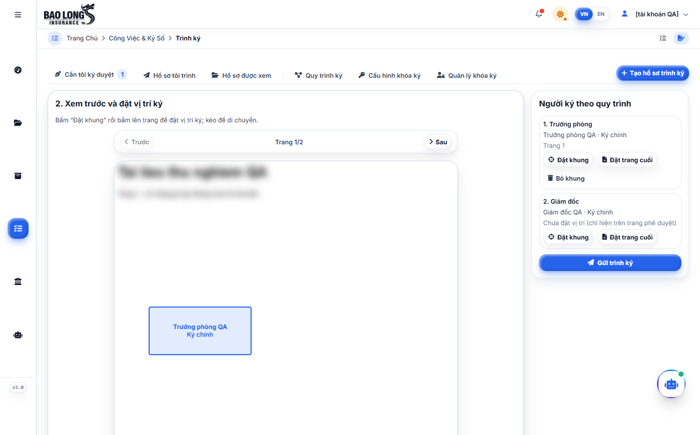 |
| EP-21 | #424, PR #462 (ảnh chữ ký); #459; #463, PR #485 | như bước 9 | 10. Bật "Đặt khung" cho người ký cấp 2 rồi bấm đè lên khung cấp 1. | Không đặt chồng khung lên khung khác. | Không có khung mới; dòng người ký cấp 2 vẫn "Chưa đặt vị trí". | Pass | — | — | 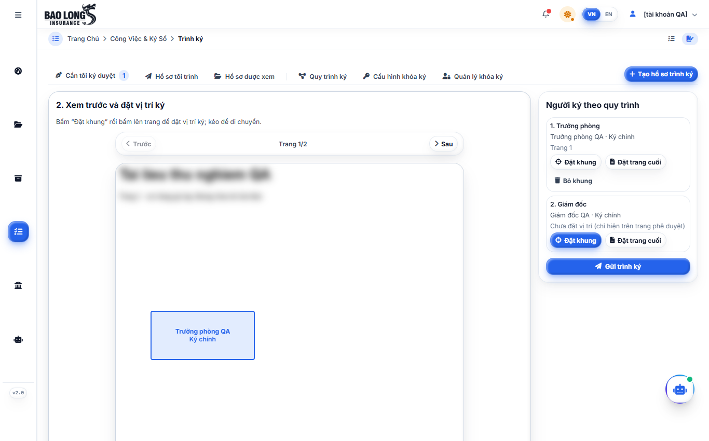 |
| EP-21 | #424, PR #462 (ảnh chữ ký); #459; #463, PR #485 | như bước 9 | 11. Bấm vào vị trí trống bên cạnh. | Khung cấp 2 xuất hiện, không chồng khung cấp 1. | Khung cấp 2 xuất hiện cạnh khung cấp 1, dòng người ký cấp 2 ghi "Trang 1". | Pass | — | Bật lại "Đặt khung" sau lần bấm bị bỏ qua sẽ tắt chế độ đặt; chỉ cần bấm lên trang. | 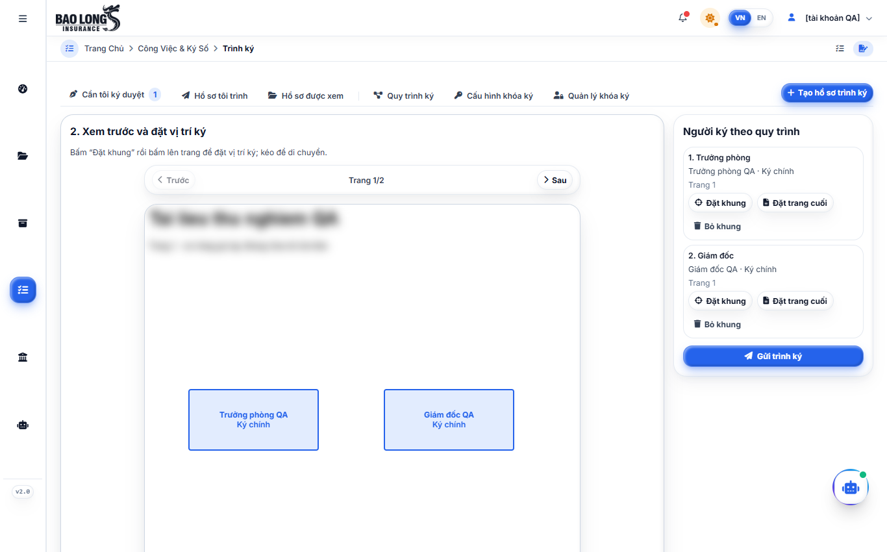 |
| EP-21 | #424, PR #462 (ảnh chữ ký); #459; #463, PR #485 | như bước 9 | 12. Bấm "Gửi trình ký", xác nhận. | Hồ sơ gửi thành công. | `POST .../gui/` trả 200; chuyển sang trang chi tiết hồ sơ. | Pass | — | — | 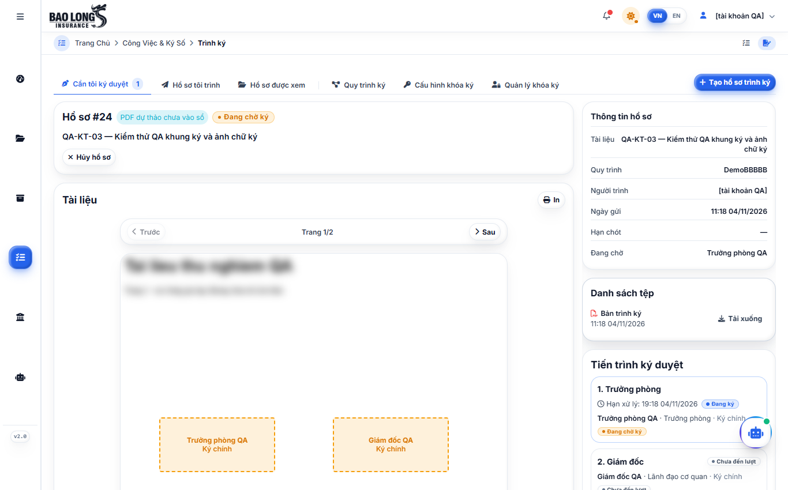 |
| EP-21 | #424, PR #462 (ảnh chữ ký); #459; #463, PR #485 | Cấp 1 đã được thay người (EP-20); người ký có ảnh (bước 8) | 13. Người ký chọn tệp khóa, nhập PIN, ký cấp 1. | Ký thành công. | `POST khoa/<id>/mo-khoa-ky/` trả 200 và `POST trinh-ky/<id>/ky/` trả 200; hộp thoại đóng. | Pass | — | — | 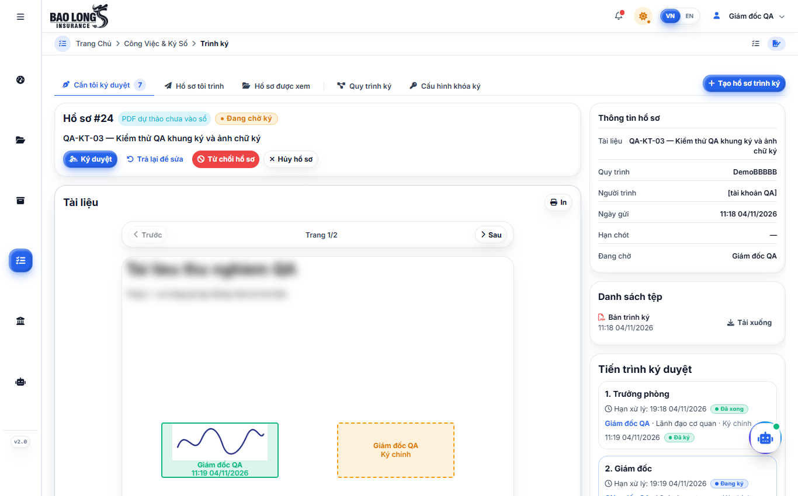 |
| EP-21 | #424, PR #462 (ảnh chữ ký); #459; #463, PR #485 | như bước 13 | 14. Người ký ký cấp 2. | Hồ sơ hoàn tất. | `mo-khoa-ky` 200, `ky` 200; hộp thoại đóng. | Pass | — | — | 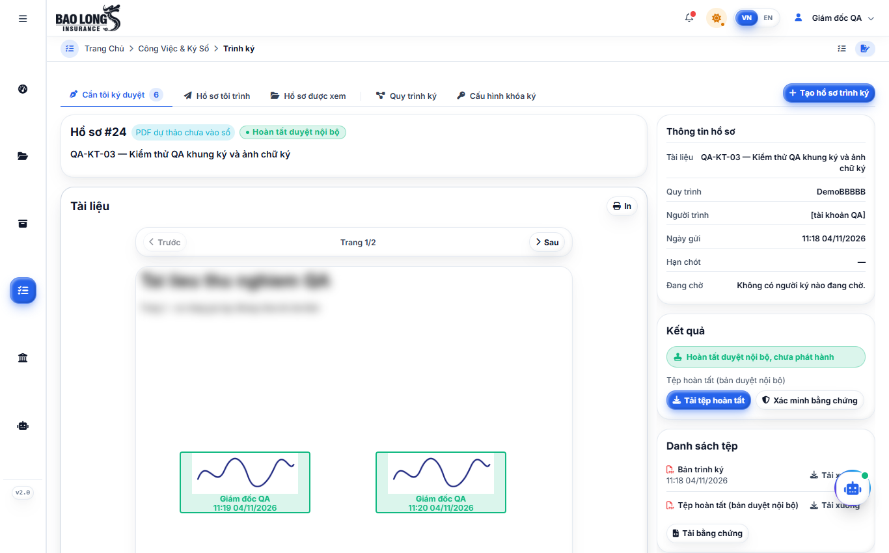 |
| EP-21 | #424, PR #462 (ảnh chữ ký); #459; #463, PR #485 | như bước 13 | 15. Xem chi tiết hồ sơ đã hoàn tất. | Ảnh chữ ký nằm trong từng khung, hai khung không đè nhau. | Trạng thái "Hoàn tất duyệt nội bộ"; trang 1 hiển thị hai khung xanh đặt cạnh nhau, mỗi khung chứa ảnh chữ ký, tên người ký và thời điểm ký; có "Tải tệp hoàn tất", "Xác minh bằng chứng", "Tải bằng chứng". | Pass | — | Ảnh có nền trắng nổi trên nền khung vì ảnh được tải bằng đường đối chứng (bước 8). |  |
| EP-21 | #424, PR #462 (ảnh chữ ký); #459; #463, PR #485 | như bước 13 | 16. Tải tệp hoàn tất và dựng trang 1 đến 3. | Ảnh chữ ký đúng vị trí khung trong PDF, trang cuối có bảng phê duyệt. | PDF 3 trang: trang 1 có hai ảnh chữ ký cạnh nhau kèm tên và thời điểm, chân trang "BẢN DUYỆT NỘI BỘ, CHƯA PHÁT HÀNH" cùng mã bằng chứng; trang 2 giữ nguyên; trang 3 là "TRANG PHÊ DUYỆT NỘI BỘ" với bảng các cấp ký. | Pass | — | Ảnh dựng bằng pdf.js từ tệp tải về. | 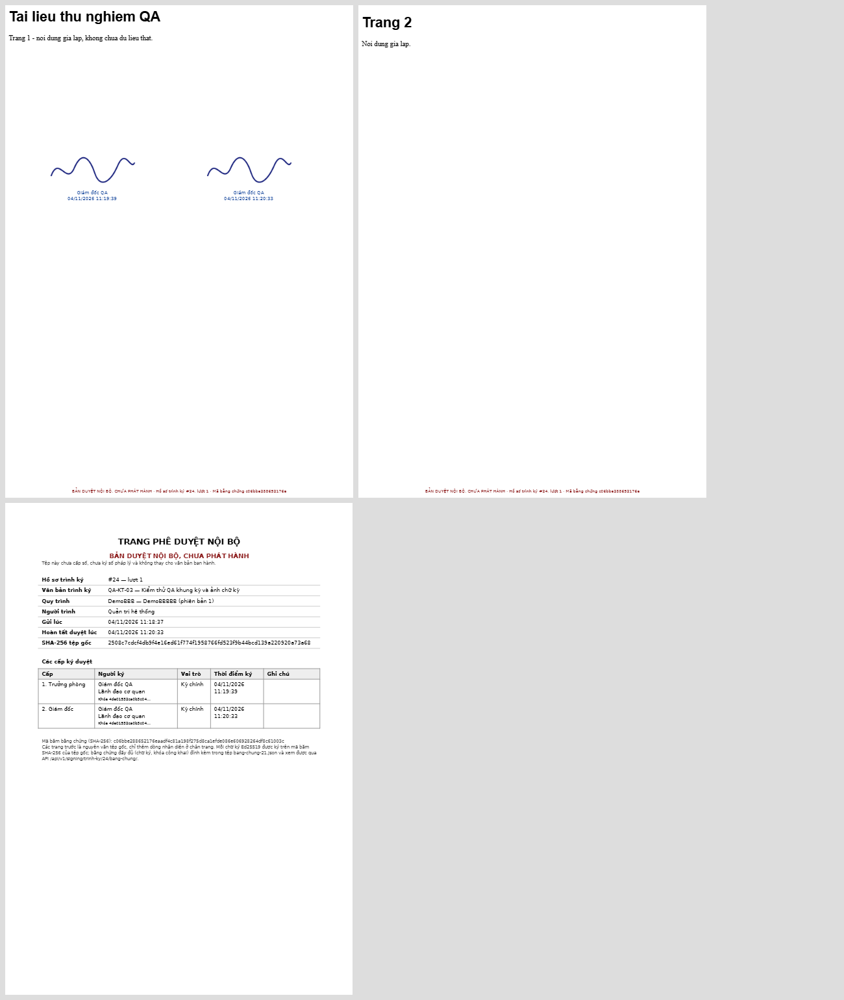 |
| EP-21 | #424, PR #462 (ảnh chữ ký); #459; #463, PR #485 | như bước 13 | 17. Như bước 15, ngôn ngữ en. | Nhãn dịch đủ. | Trang chi tiết hiển thị nhãn tiếng Anh ("Signing progress", "Awaiting my signature"). | Pass | — | — | 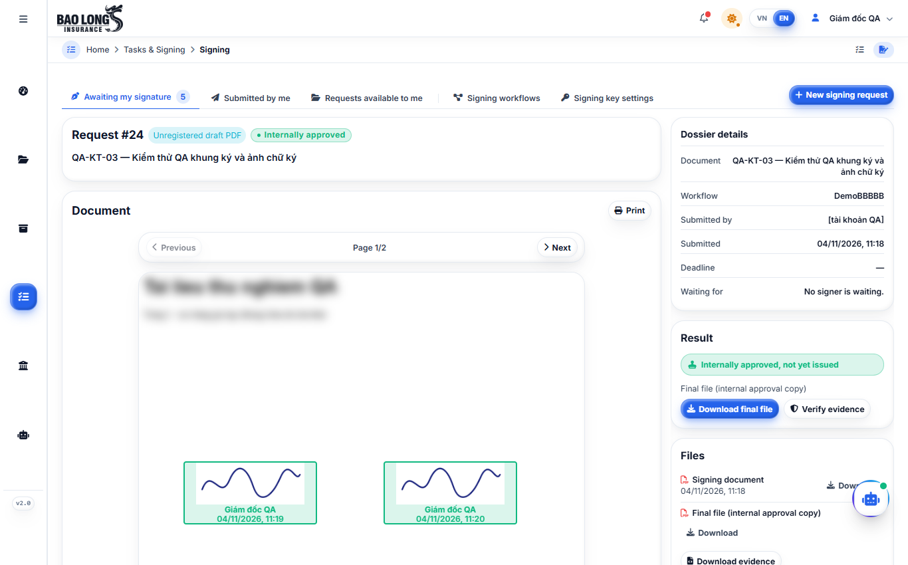 |
| EP-21 | #424, PR #462 (ảnh chữ ký); #459; #463, PR #485 | như bước 13 | 18. Như bước 15, giao diện tối, khung 390px. | Bố cục không vỡ. | Trang chi tiết hiển thị một cột trong khung 390px trên nền tối. | Pass | — | — | 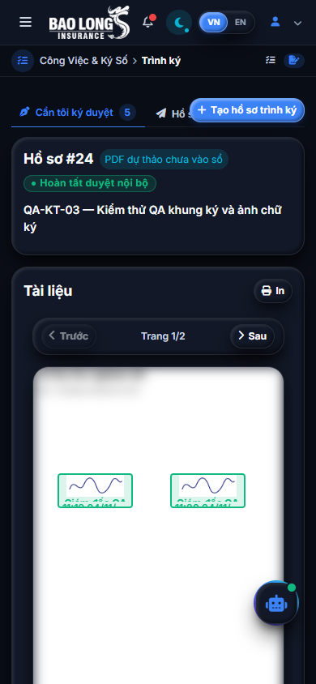 |
| EP-22 | #447 (xem tất cả hồ sơ theo vai trò) | Văn thư (có quyền xem tất cả hồ sơ trình ký, không có quyền ký, không phải người trình) | 1. Mở `/approvals/tat-ca` (vi, sáng, 1366px). | Văn thư thấy tất cả hồ sơ trình ký. | Chip: Tất cả 24, Đang chờ ký 0, Quá hạn 12, Đã ký xong 4, Trả lại để sửa 0; bảng liệt kê hồ sơ của nhiều người trình. `GET /api/v1/signing/toi/`: `view_all_trinhky=true`, `sign_trinhky=false`. | Pass | — | — |  |
| EP-22 | #447 (xem tất cả hồ sơ theo vai trò) | Văn thư (có quyền xem tất cả hồ sơ trình ký, không có quyền ký, không phải người trình) | 2. Như bước 1, ngôn ngữ en. | Như bước 1. | Danh sách và nhãn hiển thị bằng tiếng Anh, cùng số liệu. | Pass | — | — | 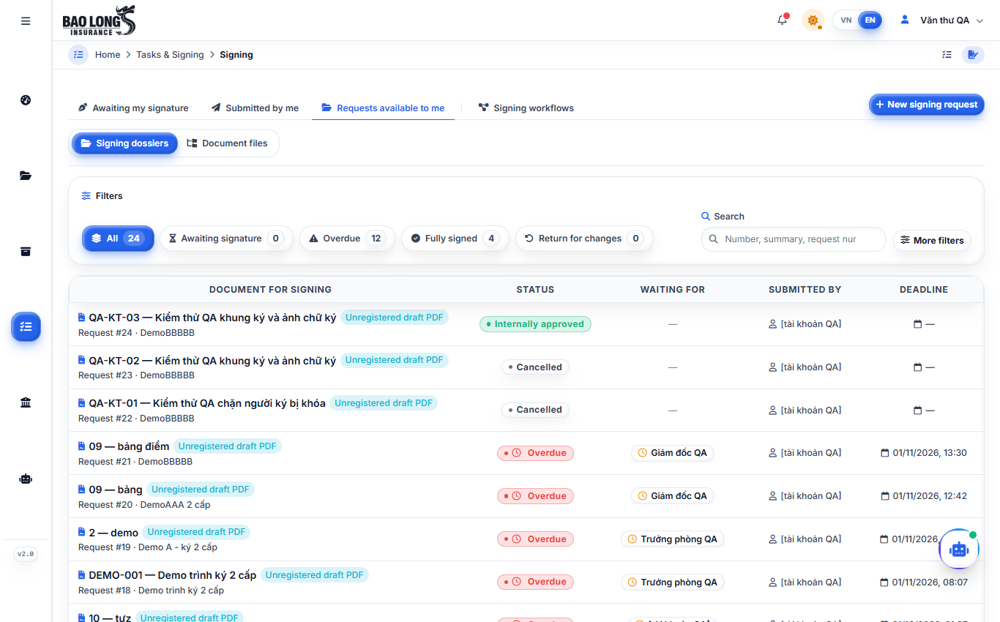 |
| EP-22 | #447 (xem tất cả hồ sơ theo vai trò) | Văn thư (có quyền xem tất cả hồ sơ trình ký, không có quyền ký, không phải người trình) | 3. Như bước 1, giao diện tối. | Như bước 1. | Bảng và chip hiển thị trên nền tối, cùng số liệu. | Pass | — | — | 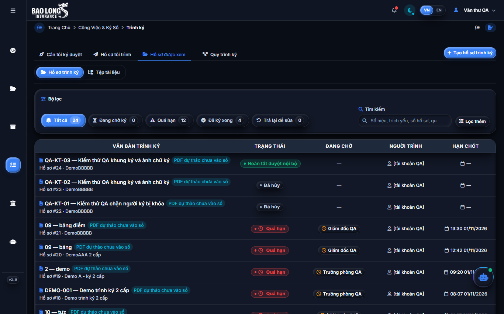 |
| EP-22 | #447 (xem tất cả hồ sơ theo vai trò) | Văn thư (có quyền xem tất cả hồ sơ trình ký, không có quyền ký, không phải người trình) | 4. Như bước 1, khung 390px. | Như bước 1. | Danh sách chuyển dạng thẻ, cùng số liệu. | Pass | — | — | 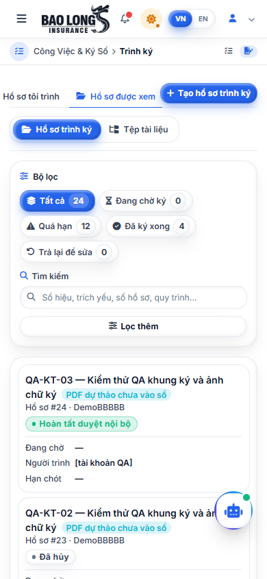 |
| EP-22 | #447 (xem tất cả hồ sơ theo vai trò) | Văn thư (có quyền xem tất cả hồ sơ trình ký, không có quyền ký, không phải người trình) | 5. Mở `/approvals/toi-gui`. | Chỉ hiện hồ sơ do chính văn thư trình. | "Bạn chưa gửi trình hồ sơ nào."; hộp "Cần tôi ký duyệt" cũng trống. | Pass | — | Phân biệt rõ phạm vi xem tất cả với hồ sơ của riêng người dùng. | 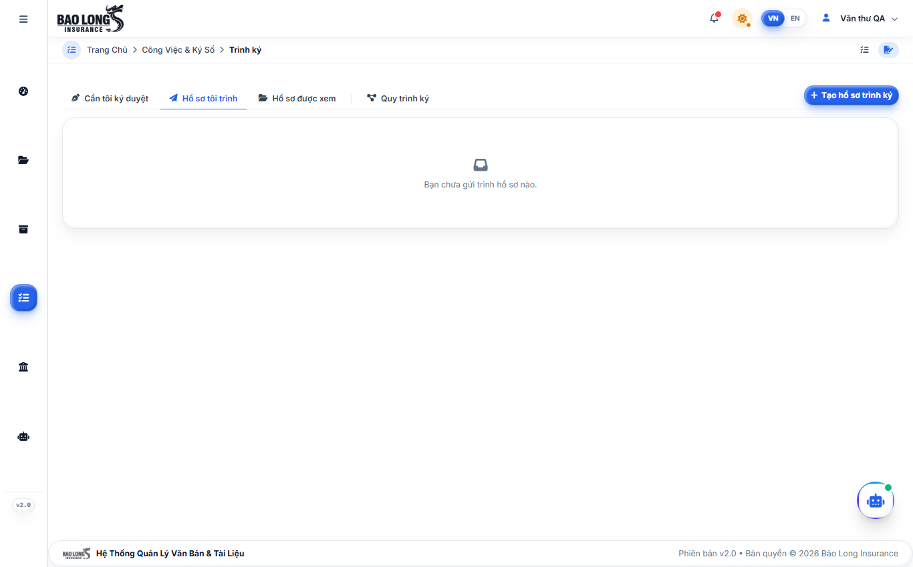 |
| EP-23 | #507, PR #508 (challenge một lần, lưu PostgreSQL); #470 | Người ký có khóa thử nghiệm; gọi API bằng token của chính phiên đó | 1. Gửi lại yêu cầu chứng minh sở hữu đã dùng cho khóa đang hoạt động (cùng challenge, cùng chữ ký). | Bị từ chối. | `POST /api/v1/signing/khoa/<id>/xac-minh/` trả 409 `khoa_khong_cho_kich_hoat`: "Khóa không ở trạng thái chờ kích hoạt." | Pass | — | Kiểm tra trạng thái khóa chạy trước kiểm tra challenge nên bước này không chứng minh được tính dùng một lần; xem bước 4. |  |
| EP-23 | #507, PR #508 (challenge một lần, lưu PostgreSQL); #470 | Người ký có khóa thử nghiệm; gọi API bằng token của chính phiên đó | 2. Như bước 1, thay chữ ký bằng chuỗi sai. | Bị từ chối. | HTTP 409 `khoa_khong_cho_kich_hoat`, cùng thông điệp bước 1. | Pass | — | Như bước 1. | 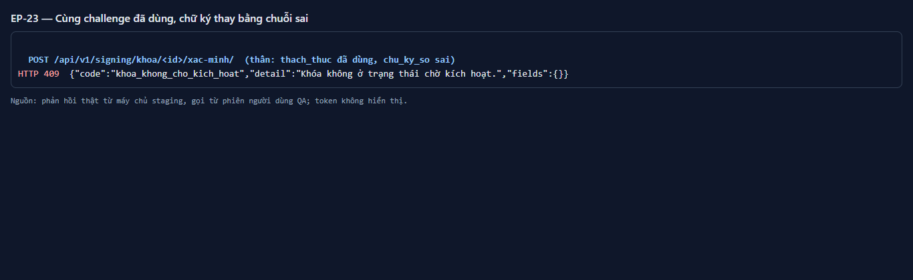 |
| EP-23 | #507, PR #508 (challenge một lần, lưu PostgreSQL); #470 | Người ký có khóa thử nghiệm; gọi API bằng token của chính phiên đó | 3. Gửi challenge không tồn tại. | Bị từ chối. | HTTP 409 `khoa_khong_cho_kich_hoat`, cùng thông điệp bước 1. | Pass | — | Như bước 1. | 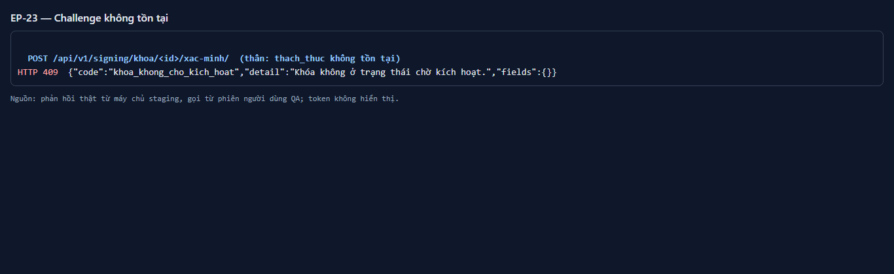 |
| EP-23 | #507, PR #508 (challenge một lần, lưu PostgreSQL); #470 | Người ký có khóa thử nghiệm; gọi API bằng token của chính phiên đó; khóa ở trạng thái chờ kích hoạt | 4. Tạo khóa chờ kích hoạt, lấy challenge, chứng minh bằng chữ ký đúng, rồi dùng lại đúng challenge đó. | Lần dùng lại bị từ chối. | Lần chứng minh đầu trả 200; lần gửi lại trả 409 `thach_thuc_da_dung`: "Challenge chứng minh sở hữu đã được dùng. Hãy yêu cầu challenge mới." | Pass | — | Khóa chờ kích hoạt tạo cho bước này đã được thu hồi để dọn. |  |
| EP-24 | #468, PR #477 (PIN 6 chữ số); #470 (chứng minh sở hữu khóa) | Người ký có quyền ký, chưa có khóa; PIN thử nghiệm tạm | 1. Mở "Cấu hình khóa ký" khi chưa có khóa (vi, sáng, 1366px). | Có form tạo khóa với PIN 6 chữ số. | "Bạn chưa có khóa ký trên thiết bị này." kèm "PIN mới (6 chữ số)", "Nhập lại PIN", nút "Tạo khóa ký cho thiết bị này"; mô tả nêu PIN 6 chữ số và tệp khóa chỉ tải một lần. | Pass | — | — |  |
| EP-24 | #468, PR #477 (PIN 6 chữ số); #470 (chứng minh sở hữu khóa) | Người ký có quyền ký, chưa có khóa; PIN thử nghiệm tạm | 2. Nhập PIN 5 chữ số. | Từ chối, nút tạo khóa bị vô hiệu. | Cảnh báo "PIN phải gồm đúng 6 chữ số."; nút "Tạo khóa ký cho thiết bị này" bị vô hiệu. | Pass | — | — |  |
| EP-24 | #468, PR #477 (PIN 6 chữ số); #470 (chứng minh sở hữu khóa) | Người ký có quyền ký, chưa có khóa; PIN thử nghiệm tạm | 3. Nhập PIN dãy tăng liên tiếp. | Từ chối. | Cảnh báo "PIN không được là dãy tăng hoặc giảm liên tiếp."; nút tạo khóa bị vô hiệu. | Pass | — | — |  |
| EP-24 | #468, PR #477 (PIN 6 chữ số); #470 (chứng minh sở hữu khóa) | Người ký có quyền ký, chưa có khóa; PIN thử nghiệm tạm | 4. Nhập PIN lặp một chữ số. | Từ chối. | Cảnh báo "PIN không được lặp một chữ số."; nút tạo khóa bị vô hiệu. | Pass | — | — |  |
| EP-24 | #468, PR #477 (PIN 6 chữ số); #470 (chứng minh sở hữu khóa) | Người ký có quyền ký, chưa có khóa; PIN thử nghiệm tạm | 5. Nhập hai lần PIN khác nhau. | Từ chối. | Cảnh báo "Hai lần nhập PIN không khớp."; nút tạo khóa bị vô hiệu. | Pass | — | — |  |
| EP-24 | #468, PR #477 (PIN 6 chữ số); #470 (chứng minh sở hữu khóa) | Người ký có quyền ký, chưa có khóa; PIN thử nghiệm tạm | 6. Nhập PIN hợp lệ hai lần, bấm tạo khóa. | Khóa được tạo, chứng minh sở hữu và kích hoạt; không gửi PIN hay khóa riêng. | Chuỗi `POST khoa` 201, `GET thach-thuc` 200, `POST xac-minh` 200, `POST dat-pin` 201, `POST kich-hoat` 200; "Khóa ký trên thiết bị này đã sẵn sàng."; tệp `.tlbmkey` được tải về. Thân các yêu cầu chỉ có `ma_khoa`, `khoa_cong_khai`, `ngay_hieu_luc`; `thach_thuc`, `chu_ky_so`; `xac_minh_pin`, `tham_so_kdf`; không có PIN hay khóa riêng. | Pass | — | — |  |
| EP-24 | #468, PR #477 (PIN 6 chữ số); #470 (chứng minh sở hữu khóa) | Người ký có quyền ký, chưa có khóa; PIN thử nghiệm tạm | 7. Tự thu hồi khóa: nhập lý do, bấm "Thu hồi khóa". | Có hộp thoại xác nhận; khóa bị thu hồi. | Hộp thoại "Thu hồi khóa ký đang hoạt động? Sau khi thu hồi, khóa này không thể ký; cần tạo khóa mới để tiếp tục." kèm lý do; xác nhận thì `POST khoa/<id>/thu-hoi/` trả 200 và trang trở về trạng thái chưa có khóa. | Pass | — | — |  |
| EP-24 | #468, PR #477 (PIN 6 chữ số); #470 (chứng minh sở hữu khóa) | Người ký có quyền ký, chưa có khóa; PIN thử nghiệm tạm | 8. Tạo lại khóa bằng PIN tạm. | Khóa mới kích hoạt. | Cùng chuỗi API bước 6, khóa mới trạng thái "Đang hoạt động"; tệp khóa mới được tải về. | Pass | — | — |  |
| EP-24 | #468, PR #477 (PIN 6 chữ số); #470 (chứng minh sở hữu khóa) | Người ký có quyền ký, chưa có khóa; PIN thử nghiệm tạm | 9. Chứng minh sở hữu bằng chữ ký của khóa khác (challenge hợp lệ). | Bị từ chối. | `POST .../xac-minh/` trả 400 `chung_minh_so_huu_that_bai`: "Chữ ký chứng minh sở hữu khóa không hợp lệ." | Pass | — | Khóa thử bằng WebCrypto trong trình duyệt, dùng khóa chờ kích hoạt tạo riêng. |  |
| EP-24 | #468, PR #477 (PIN 6 chữ số); #470 (chứng minh sở hữu khóa) | Người ký có quyền ký, chưa có khóa; PIN thử nghiệm tạm | 10. Chứng minh sở hữu bằng chữ ký đúng. | Được chấp nhận. | `POST .../xac-minh/` trả 200; khóa chuyển sang chờ kích hoạt. | Pass | — | Dấu vân tay và khóa công khai được lược bỏ khỏi ảnh. |  |
| EP-24 | #468, PR #477 (PIN 6 chữ số); #470 (chứng minh sở hữu khóa) | Người ký có quyền ký, chưa có khóa; PIN thử nghiệm tạm | 11. Như bước 8, ngôn ngữ en. | Nhãn dịch đủ. | Màn hình cấu hình khóa hiển thị nhãn tiếng Anh ("Signing key settings"). | Pass | — | — |  |
| EP-24 | #468, PR #477 (PIN 6 chữ số); #470 (chứng minh sở hữu khóa) | Người ký có quyền ký, chưa có khóa; PIN thử nghiệm tạm | 12. Như bước 8, giao diện tối. | Hiển thị đủ. | Màn hình hiển thị trên nền tối. | Pass | — | — |  |
| EP-24 | #468, PR #477 (PIN 6 chữ số); #470 (chứng minh sở hữu khóa) | Người ký có quyền ký, chưa có khóa; PIN thử nghiệm tạm | 13. Như bước 8, khung 390px. | Bố cục không vỡ. | Màn hình hiển thị một cột trong khung 390px. | Pass | — | — |  |
| EP-25 | #468, PR #477; #478, PR #479; #490, PR #492 (HTTP 429 thật) | Người ký có khóa thử nghiệm; hồ sơ chờ ký | 1. Trong hộp thoại ký, bấm "Quên PIN?" rồi "Gửi mã xác thực". | Mã gửi thành công, nút gửi lại đếm ngược. | Hộp thoại "Đã gửi mã tới email của tài khoản…", nút "Gửi lại sau <n> giây" đếm ngược. | Pass | — | — |  |
| EP-25 | #468, PR #477; #478, PR #479; #490, PR #492 (HTTP 429 thật) | Người ký có khóa thử nghiệm; hồ sơ chờ ký | 2. Mở lại hộp thoại và gửi mã lần nữa trong cửa sổ giãn cách 2 phút. | Máy chủ trả 429; giao diện nêu thời gian chờ. | `POST .../dat-lai-pin/yeu-cau/` trả 429 `gui_ma_qua_nhanh` kèm `fields.thu_lai_sau`; hộp thoại hiện "Vừa gửi mã xác thực. Chờ 2 phút trước khi gửi lại." và nút "Gửi lại sau 92 giây" (đếm ngược). | Pass | — | Phản hồi 429 thật từ máy chủ. |  |
| EP-25 | #468, PR #477; #478, PR #479; #490, PR #492 (HTTP 429 thật) | Người ký có khóa thử nghiệm; hồ sơ chờ ký | 3. Ghi lại phản hồi của bước 2. | Có mã lỗi và thời điểm thử lại. | HTTP 429, `{"code":"gui_ma_qua_nhanh","detail":"Vừa gửi mã xác thực, hãy chờ trước khi yêu cầu lại.","fields":{"thu_lai_sau":["<thời điểm UTC>"]}}`. | Pass | — | — |  |
| EP-25 | #468, PR #477; #478, PR #479; #490, PR #492 (HTTP 429 thật) | Người ký có khóa thử nghiệm; hồ sơ chờ ký | 4. Nhập PIN sai lần đầu (tệp khóa đã chọn). | Báo PIN sai kèm số lần còn lại. | `POST khoa/<id>/mo-khoa-ky/` trả 400 `pin_khong_dung`: "PIN không đúng. Còn 14 lần thử trong ngày." | Pass | — | — |  |
| EP-25 | #468, PR #477; #478, PR #479; #490, PR #492 (HTTP 429 thật) | Người ký có khóa thử nghiệm; hồ sơ chờ ký | 5. Nhập sai liên tiếp đến lần thứ 16. | Sau 15 lần sai, lần tiếp theo trả 429. | Các lần 1 đến 15 trả 400, số lần còn lại giảm từ 14 về 0; lần 16 trả 429 `pin_het_luot_trong_ngay`: "Đã nhập sai PIN 15 lần trong ngày; thử lại sau 05/11/2026 00:00 hoặc liên hệ quản trị viên."; giao diện hiện "Đã nhập sai PIN 15 lần trong ngày. Thử lại vào ngày mai hoặc liên hệ quản trị viên." | Pass | — | Ô PIN và nút "Ký duyệt" vẫn bật sau 429; thời gian chờ kéo đến hết ngày nên không có đếm ngược. Danh sách quản trị đồng thời hiển thị nhãn PIN "Sai 15 lần" (quan sát bằng văn bản, không lưu ảnh). |  |
| EP-25 | #468, PR #477; #478, PR #479; #490, PR #492 (HTTP 429 thật) | Người ký có khóa thử nghiệm; hồ sơ chờ ký | 6. Nhập PIN đúng sau khi đã hết lượt. | Vẫn bị từ chối đến hết ngày. | `POST .../mo-khoa-ky/` trả 429; giao diện giữ thông báo hết lượt. | Pass | — | Quản trị thu hồi khóa và đặt lại PIN (EP-15) gỡ giới hạn này. |  |
| EP-26 | #509, PR #511; #510, PR #512 (MFA email khi ký) | Người ký | 1. MFA email khi ký: nhận mã, nhập 6 ô, gửi lại, 429. | Theo thiết kế MFA email. | Không thực hiện được: `GET /api/v1/signing/toi/` trả `mfa_ky.bat=false` (cờ tắt) và staging chưa có `EMAIL_HOST`. Ảnh là màn hình cấu hình khóa của người ký. | Blocked | Chưa đánh giá | Ngoài phạm vi đợt này; cần bật cờ MFA và cấu hình `EMAIL_HOST`. |  |

---

## 3. Điều kiện để hoàn tất các ca Blocked

| Ca | Điều kiện cần |
|---|---|
| EP-18 bước 4 | `EMAIL_HOST` hoặc cách đọc mã xác thực trên staging |
| EP-19 | Khóa có thời điểm hết hạn đã qua |
| EP-26 | Bật cờ MFA và cấu hình `EMAIL_HOST` |
